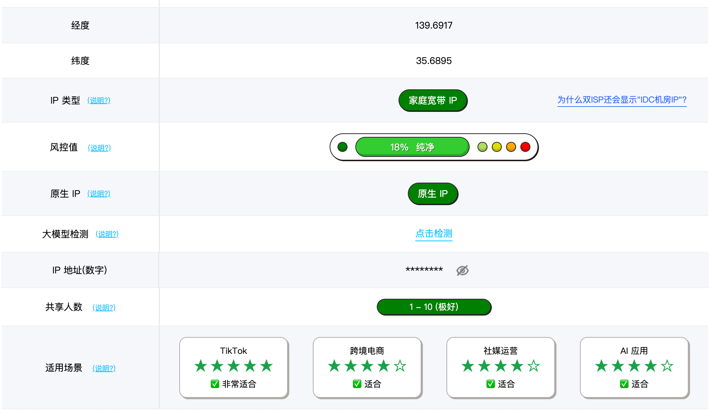
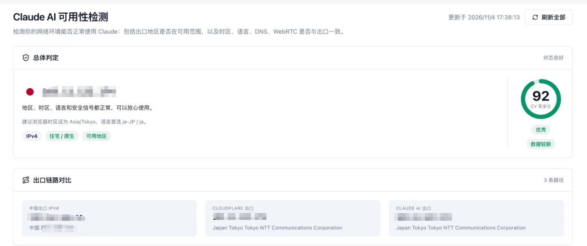
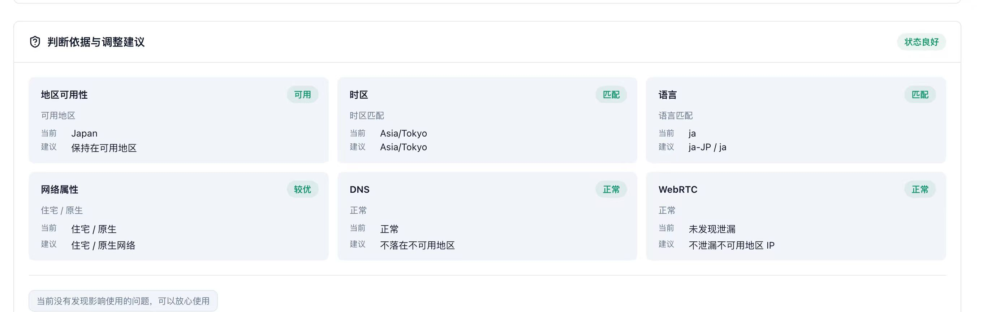
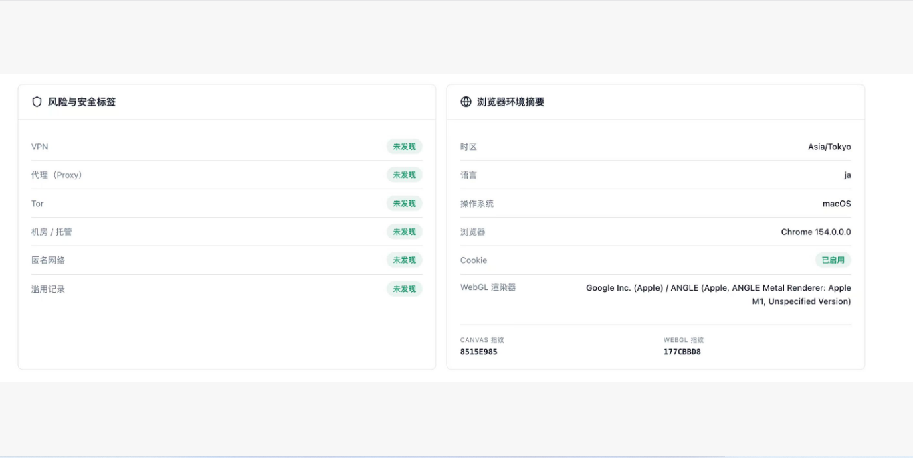
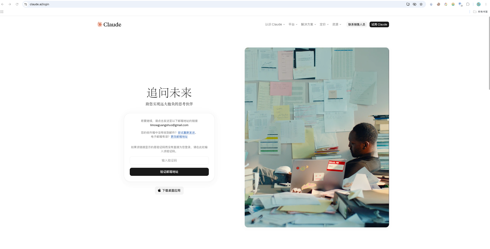
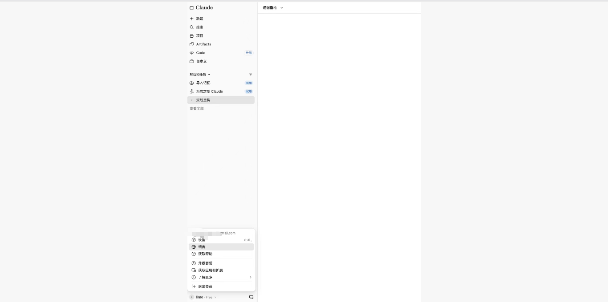
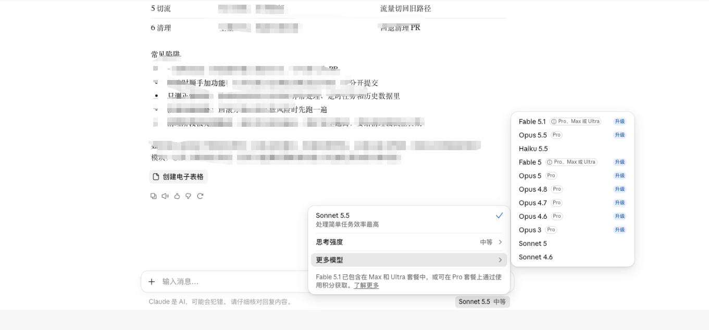

最近后台被问得最多的一句话就是："**Claude 一注册就封号怎么办？**"

我自己前前后后也封过十几个号，交过不少学费。后来才想明白一件事：Claude 的封号，**绝大部分发生在注册那一瞬间**（所以注册环境纯净度非常重要！！）——你提交注册的那一刻，Anthropic 就已经在给你的网络环境、浏览器指纹、时区语言打分了。环境不干净，号刚注册下来就是"高危账号"，用不了几天必封。

所以这篇文章把我的完整流程分享出来：**先检测环境 → 准备注册材料 → 手把手注册 → 防封养号**，最后附上不想折腾的朋友直接用的 **Claude Pro 代充**方案。

> **核心原则一句话：让你看起来像一个正常的海外用户。** IP、时区、语言、浏览器指纹，全部要对得上，矛盾一点就是扣分点。

---

## 一、注册 Claude 前的必要准备

注册 Claude 不是打开官网填个邮箱就完事，下面这几样东西**缺一个都可能翻车**。

### 1. 一个干净、固定的网络环境（最重要）

Claude 对中国大陆 IP 不开放，所以梯子是刚需，但随便挂个节点注册，基本等于送号：

- **IP 类型**：优先 **住宅 IP / 原生 IP**，机房 IP（IDC）扣分；机场的"万人骑"共享节点是最差选择，前面几百个人用同一个 IP 注册过 Claude，你这号生下来就是嫌疑犯。
- **IP 必须固定**：机房 IP 还是住宅 IP 都可以，但**一定要固定**。今天美国、明天日本、后天新加坡地跳，风控直接把你当盗号处理。
- **地区选择**：优先**日本、韩国、台湾、美国**，尽可能**避开新加坡**（大量倒卖账号都挂着新加坡时区，属于重点观测池）。
- **代理模式**：梯子开 **全局 + TUN 模式（严格代理）**，确保没有流量走直连泄露真实 IP。

### 2. 一个干净的邮箱

- 推荐**注册满 1 年以上的 Gmail / Outlook 老邮箱**，权重高，通过率高；
- 拒绝十分钟临时邮箱、来路不明的批量邮箱，这类邮箱在 Anthropic 黑名单里是排着队的；
- 进阶玩家可以用 **Proton 邮箱**：Anthropic 的邮件里带了跟踪器，Proton 会自动拦截，不暴露"你什么时候点开了邮件、从哪个 IP 点开的"这些信息。

### 3. 浏览器和系统环境

- **系统语言切英文**，**时区与 IP 所在地区保持一致**（比如日本节点就配 Asia/Tokyo，美国节点就配美国时区）；
- 浏览器建议**单独开一个专用于 Claude 的环境**，不要带着一堆国内网站的 Cookie、插件去注册；
- **WebRTC 必须处理**：它可能绕过代理把你的真实 IP 泄露出去。可以装 WebRTC Leak Shield 插件开 Strict protection，指纹浏览器里直接选"禁止"。

### 4. 手机号（可选）

注册目前以邮箱验证码为主，一般不需要手机号。但如果后续触发验证，**千万别用国内接码平台的虚拟号**，极易触发二次审核直接封禁。

---

## 二、第一步：先做环境检测，分数不到 90 别急着注册

材料备齐了，先别慌着注册。**开通 Claude 之前，一定要先做环境检测：**

👉 [https://ipinfo.cv/claude-ai-check](https://ipinfo.cv/claude-ai-check)

这个工具会检测你的出口地区是否在 Claude 可用范围，以及**时区、语言、DNS、WebRTC 是否与出口一致**，最后给出一个安全分。**确保分数大于 90 分才比较稳妥**，95 以上更好。

下面是如何把我的分数从 36 分一路提到 92+ 的实操方法，每改一项就重新测一次：

1. **系统语言和时区**切换为英文和对应海外时区（与 IP 国家对齐）；
2. **梯子开全局 + TUN 模式**（开启严格代理，杜绝直连分流泄露）；
3. **浏览器安装 WebRTC Leak Shield**，开启 Strict protection，防真实 IP 泄露；
4. **梯子使用固定 IP**，不管机房还是住宅都可以，但必须固定。



像上面这样，IP 类型是**家庭宽带 IP**、风控值**18% 纯净**、原生 IP、共享人数 1-10 人，就是理想状态。如果测出来是高风控数据中心 IP、共享人数几百上千，趁早换节点。

检测通过后大概长这样，**安全分 92，地区、时区、语言和安全信号都正常**：



六项判断依据全部绿灯：地区可用、时区匹配、语言匹配、住宅/原生网络、DNS 正常、WebRTC 无泄漏：



风险与安全标签页，VPN、代理、Tor、机房/托管、匿名网络、滥用记录**全部未发现**，浏览器环境摘要里时区、语言和 IP 国家完全对齐：



> **避坑提醒**：检测工具建议的时区和语言，以你**实际出口 IP 的国家**为准。比如截图里是日本原生 IP，就建议 Asia/Tokyo + ja；如果你用的是美国 IP，就配英文 + 美国时区。核心是**三者一致**，而不是死记某个国家。

想再深入检查的，可以用这个开源小工具辅助检测：

👉 [https://github.com/sakurs2/safe-claude](https://github.com/sakurs2/safe-claude)

**分数不到 90，就回到第一节继续排查，别硬注册。** 号被风控标记之后，怎么养都养不回来，只能换环境重来。

---

## 三、手把手注册 Claude 教程

环境分数达标了，就可以正式开始注册。整个过程 5 分钟内搞定，但每一步都有讲究。

### 第 1 步：确认代理状态

注册全程保持**全局 + TUN 模式**，节点用你刚才检测过的那个**固定 IP**，中途不要切换节点。可以顺手再开一次 ipinfo.cv 确认分数还在 90 以上。

### 第 2 步：打开 Claude 官网，输入邮箱

浏览器访问 [https://claude.ai/login](https://claude.ai/login)，在登录框输入你准备好的**老邮箱地址**，点击继续：



### 第 3 步：接收并填写邮箱验证码

Claude 会发一串验证码到你的邮箱。这里有两个细节：

- **在同一个浏览器环境里收验证码**：Gmail 建议也在这个干净的浏览器配置里打开，别切回日常浏览器；
- 如果收到的不是验证码而是**验证链接**，不要直接点，**右键复制链接地址，粘贴到当前这个环境里打开**，避免泄漏真实环境。

回到登录页输入验证码，点击"验证邮件地址"。

### 第 4 步：完善资料，进入主界面

验证通过后按提示填写姓名、同意服务条款，就能进入 Claude 主界面了。左下角点头像可以看到设置、语言、升级套餐等选项：



### 第 5 步：认识模型选择

主界面底部可以选模型。免费账号默认可用 Sonnet 系列，Pro 账号可以解锁 Opus 系列和更强模型。**注意：语言设置建议保持英文或与 IP 一致的语言**，中文界面不是封号主因，但整套环境"混搭"会增加风控疑点：



到这里，注册就算完成了。但先别急着薅，往下看防封守则。

---

## 四、注册完成只是开始：防封使用守则

很多号不是封在注册，而是**封在注册后的头两周**。新号有一个风控观察期，记住下面几条：

1. **新号 7 天温和期**：注册后前几天别高强度提问、别批量生成代码、别立刻升级套餐，先当普通用户正常聊几句；
2. **环境和 IP 锁死**：以后每次用 Claude，都用**同一个浏览器环境 + 同一个固定 IP**，不要今天家里网、明天公司网来回切；
3. **拒绝第三方中转**：别把账号接到各种镜像站、第三方工具里"万人骑"，Anthropic 检测到异常调用直接封；
4. **一人一号**：不要多设备频繁混用，不要共享账号给朋友；
5. **付款环节别乱来**：如果升级时弹出 KYC（身份认证），说明你的注册环境被标记了，**别硬过，直接换环境重新注册**，硬过的号基本活不长；
6. **备份对话记录**：养成定期导出的习惯，真被封了也不至于心血全无。

> 最后再唠叨一句：**不存在 100% 永久不封的方案**，整套流程的核心就是让设备、网络、身份、行为全部匹配"海外正常用户画像"。环境分越高，账号活得越久。

---

## 五、想升级 Claude Pro？国内用户最省心的方式

注册好的免费号额度有限，想正经干活还是得上 **Claude Pro**。但对国内用户来说，官方订阅有两大拦路虎：

1. **支付**：订阅需要境外信用卡（Visa/Mastercard），国内卡基本被拒，自己折腾虚拟卡还容易被风控连坐；
2. **风控**：自己绑卡付款，账单信息和 IP 环境对不上，分分钟触发审核。

最省心的方案就是**代充**：不碰外币卡、不暴露支付信息，人民币付款，几分钟到账。

> **Claude Pro 代充平台**：[https://littlemagic8.github.io/gptplus/purchase-claude.html](https://littlemagic8.github.io/gptplus/purchase-claude.html)
>
> 无需境外信用卡，支持**支付宝 / 微信**直接付款，充值失败原路退款。

**充值前自查表**（对号入座）：

| 情况 | 能不能充 |
| :--- | :--- |
| 账号是 Free | 可以 |
| 还在 Pro / 其它订阅期内 | 等过期变回 Free 再充 |
| 团队账号 / 填了团队 ID | 不行，要用个人账号 |
| Billing 有 overdue 欠款或还绑着卡 | 先取消自动续费、删掉其它付款方式、结清欠款 |
| 要 Max | 联系客服 **aicygg888**，不要用 Pro 卡密硬充 |

**高频问题**：

- **会自动续费吗？** 不会。一次性充值、不绑卡、不自动扣费，到期自动变回 Free。
- **充值后会被封号吗？** 绝大部分账号充值后正常使用，但 Claude 官方风控和支付方式无关，这也是上文强调环境分的原因——**环境越干净，号越稳**。
- **多久到账？** 一般 2～10 分钟。

> **风险说明：** 近期国内不少 Claude 账号被官方风控封禁，和代充本身无关。封号后订阅一般不退，不能接受这个风险请不要下单。

---

## 联系我们

充值过程中遇到任何问题，或有其他业务需求，请联系我们。

请保存网址 [https://littlemagic8.github.io/gptplus/](https://littlemagic8.github.io/gptplus/) ，并加上联系方式，防止失联。

防失联客服微信：

```
aicygg888
```

添加好友请备注：**Claude代充**（加的人多，微信防频繁，请扫码）

欢迎加微信：


公众号也可以哦：


## 小提示：想用更多 AI 产品，可以联系 V: aicygg888

> **如果不想开通信用卡，可参考：无需开通信用卡完成 ChatGPT 订阅教程。**
>
> ChatGPTplus 独享账号升级充值自助平台：[https://littlemagic8.github.io/gptplus/](https://littlemagic8.github.io/gptplus/)（网站下方有购买卡密和使用教程）
>
> GPT 代充直达：[https://littlemagic8.github.io/gptplus/purchase-gpt.html](https://littlemagic8.github.io/gptplus/purchase-gpt.html)（支付宝/微信付款，几分钟到账，无需账密）
>
> **Claude Pro 代充直达**：[https://littlemagic8.github.io/gptplus/purchase-claude.html](https://littlemagic8.github.io/gptplus/purchase-claude.html)（支付宝/微信付款，2～10 分钟到账）
>
> Grok 代充直达：[https://littlemagic8.github.io/gptplus/purchase-grok.html](https://littlemagic8.github.io/gptplus/purchase-grok.html)（浏览器打开）
>
> 开通自己的 ChatGPT Plus、Claude Pro 个人独享账号，可参考：[使用支付方式订阅开通 ChatGPT Plus、Claude Pro 教程](https://littlemagic8.github.io/2024/09/04/update-ChatGPT-Plus/)
>
> **国内使用 ChatGPT / Claude 镜像账号，有两种方式：**

**方式一：官网镜像（chatgpt官网共享账号，国内网络可访问）按教程自行购买**

遇到问题联系微信：aicygg888

登录地址：https://chatshare.biz/ （复制到浏览器打开，用购买成功后的账号密码登录）
购买地址：https://littlemagic8.github.io/buychat/

- [ChatGPT Plus 独享账号教程](https://littlemagic8.github.io/2025/07/17/chatgptplus-auto-system/)
- [Claude Pro 订阅指南](https://littlemagic8.github.io/2024/12/09/ChatGPT-and-Cluade/)
- [镜像账号使用说明](https://littlemagic8.github.io/2025/07/17/chatgptplus-chatshare/)

**方式二：不想自己注册，添加微信购买**

微信：**aicygg888**（备注：镜像账号）

欢迎加微信：


公众号也可以哦：


