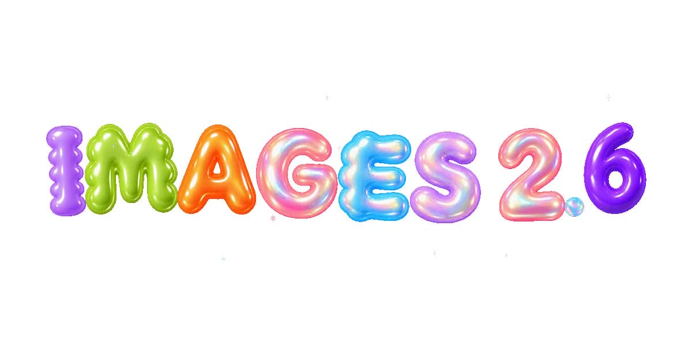
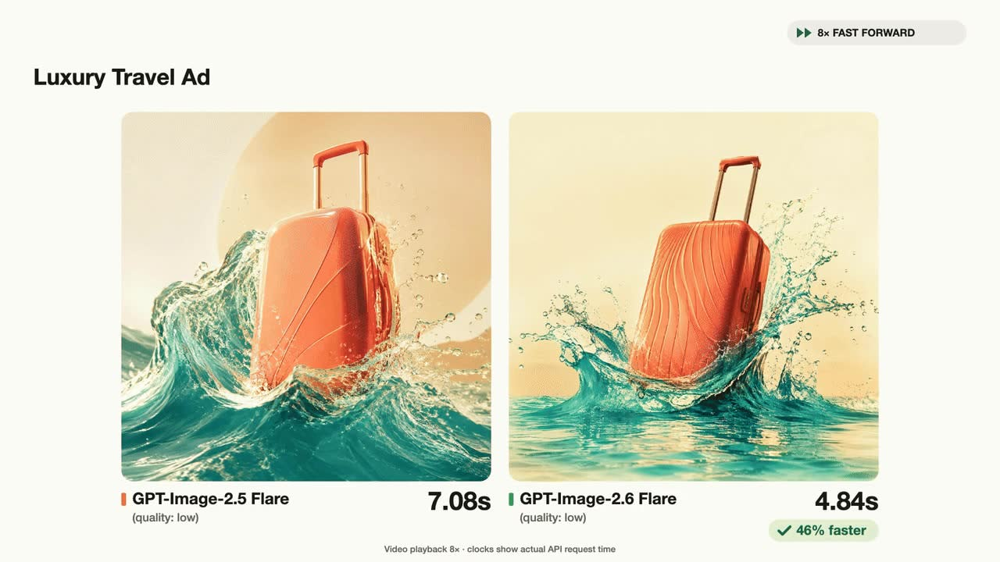
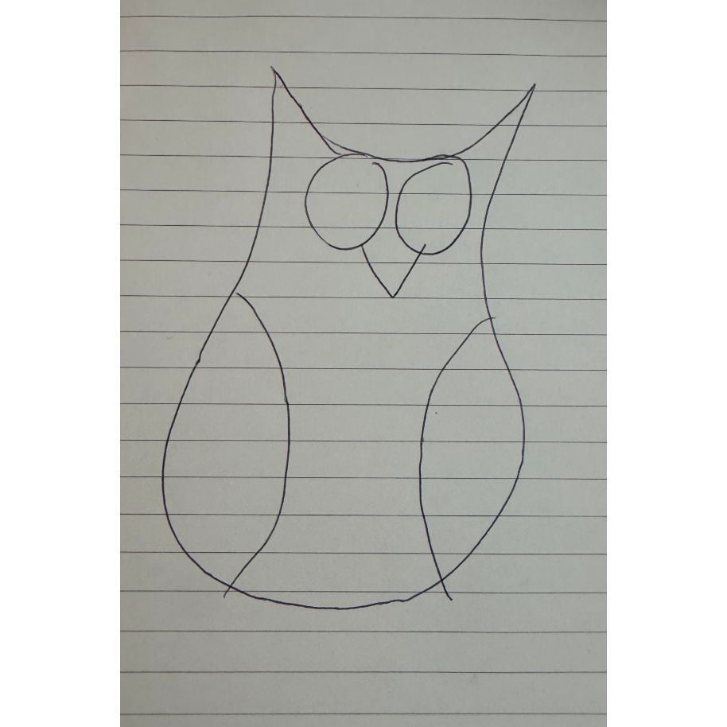
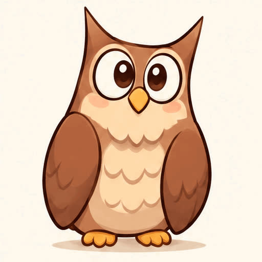
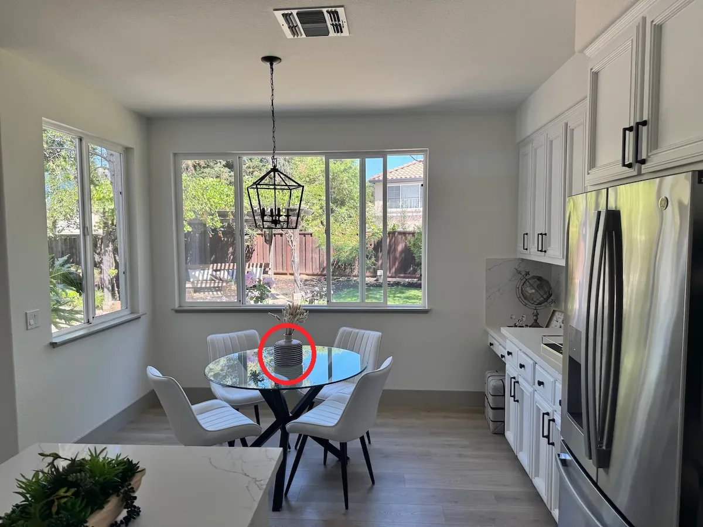
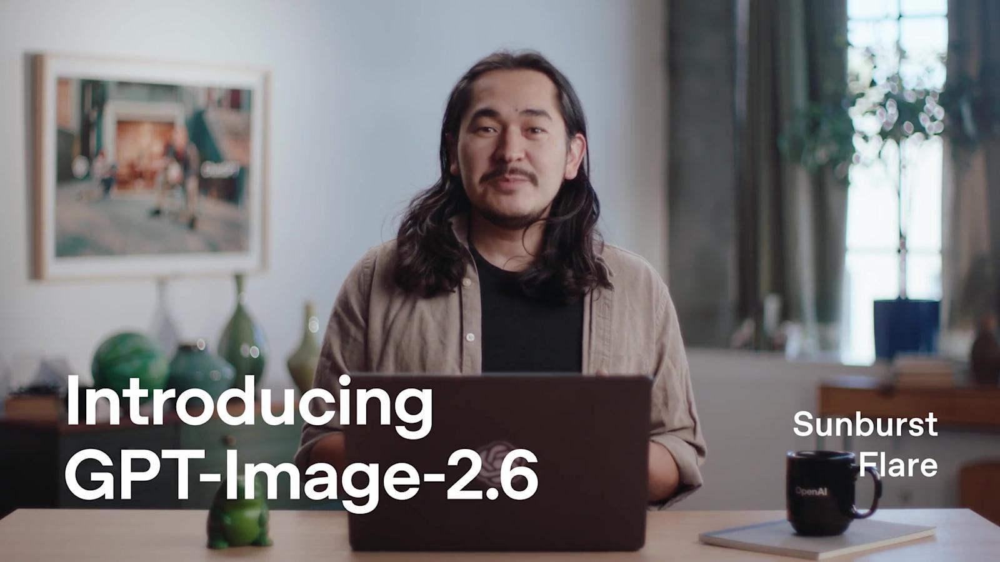
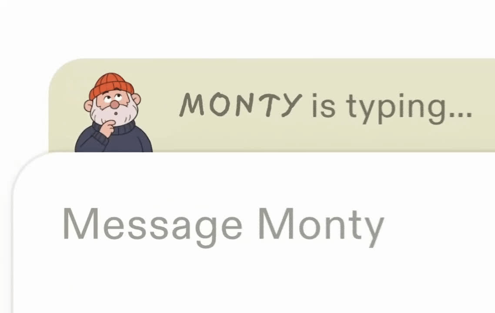

生图赛道又卷出新高度！OpenAI 于北京时间 11 月 5 日正式发布新一代图像模型 **ChatGPT Images 2.6**（也就是大家说的 **GPT-image-2.6**；开发者 API 里则拆成了 **GPT-Image-2.6 Flare** 和 **GPT-Image-2.6 Sunburst** 两个模型）。这次最大的亮点是：**能直接生成 GIF 循环动图了**，出图速度再快 **50%**，API 低质量档最快 **约 6 秒** 出一张！

我们一起来看看大家是怎么玩 GPT-image-2.6 的。Images 2.6 已面向 ChatGPT、Codex 的**所有订阅档位**全球推送，覆盖桌面端、移动端和网页版。免费用户也能试，但次数有限，想畅玩 GIF 动图、批量出图的话，就要订阅充值 ChatGPT Plus 或者 ChatGPT Pro 噢！

官方博客：[Introducing Images 2.6](https://openai.com/index/introducing-images-2-6/)



截至目前，全球用户每周在 ChatGPT、Codex 和 GPT-Image 系列 API 上创建的图片已经超过 **40 亿张**（平均每天超过 5 亿张），比 Images 2.5 发布时的 30 亿又涨了一截。本文带大家一起看看 GPT-image-2.6 到底有哪些能力提升、官方和社区都有哪些高赞玩法、以及怎么用上它~

> tips: Images 2.6 已经向 ChatGPT **所有套餐**（包括免费用户）全球推送，覆盖桌面端、移动端和网页版，但免费用户生图次数有限，想畅玩还是建议上付费会员。如需订阅 ChatGPT Plus/Pro，可参考图文教程：[https://littlemagic8.github.io/2026/08/16/how-to-sub-gptplus/](https://littlemagic8.github.io/2026/08/16/how-to-sub-gptplus/)

> **小提示：** 想用更多 AI 产品（ChatGPT Plus、Claude、Gemini、SuperGrok 等），可以联系微信：**aicygg888** / **aicygg789**。
>
> 其它代充 AI 服务见：[https://littlemagic8.github.io/gptplus/](https://littlemagic8.github.io/gptplus/)
>
> 同类教程：[ChatGPT Plus](https://littlemagic8.github.io/2026/08/16/how-to-sub-gptplus/) · [Claude Pro](https://littlemagic8.github.io/2026/08/16/how-to-sub-claudepro/) · [X Premium](https://littlemagic8.github.io/2026/08/16/how-to-sub-x/) · [X Premium+](https://littlemagic8.github.io/2026/08/16/how-to-sub-x-premium-plus/)
>
> **官网镜像（chatgpt官网共享账号，国内网络可访问）按教程自行购买**
>
> 登录地址：https://chatshare.biz/ （复制到浏览器打开，用购买成功后的账号密码（激活码）登录）
> 账号密码（激活码）购买地址：https://littlemagic8.github.io/buychat/

---

## GPT-image-2.6 是什么

ChatGPT Images 2.6 是 OpenAI 全新的旗舰图像生成模型，官方一句话定位：**让创意动起来（bring your ideas to life faster）**——更快出图、能做 GIF 动图、编辑更精准，并且角色、产品、品牌细节在多轮编辑中保持一致。

Images 2.6 vs Images 2.5 核心对比：

| 维度 | Images 2.5 | Images 2.6 |
| --- | --- | --- |
| 输出形式 | 静态图 | 静态图 + **GIF 循环动图** |
| 生成速度 | 延迟最高 -50% | 在 2.5 基础上**再快 50%**，Flare 低质量档最快约 **6 秒** |
| 参考图 | 保真五官、标志性特征 | 可用参考图**约束动图和系列图的风格** |
| 局部编辑 | 指哪改哪（ChatGPT 端） | 圈画标注编辑**开放到 API** |
| 版式能力 | 复杂排版更稳 | Flare 海报、产品图等**专业版式质量再提升** |
| API 控制 | 质量档位 | 新增 **complexity 规划档位**、**SVG 矢量导出**、GIF 帧数/帧时长控制 |

一句话总结：**从"又快又准地产出静态图"，进化到"又快又准地产出会动的图"**——表情包、品牌吉祥物、营销动图，一句话直接生成。

## GPT-image-2.6 有哪些能力的提升？

### 1. 速度再快 50%：低质量档最快 6 秒出图

Images 2.6 的生成速度比上一代**快 50%**。在 API 端，**GPT-Image-2.6 Flare** 在 quality 设为 low 时，最快 **6 秒左右**就能出一张图。官方还给了一个豪华旅行广告图的延迟对比演示（8 倍速播放），肉眼可见地快：



对创作者来说是"边聊边出图"的体验；对开发者来说，批量生图、快速原型、社交内容生产的迭代成本直线下降。

### 2. GIF 动图：一句话生成循环动画（本次最大亮点）

这是 Images 2.6 最出圈的新能力。直接生成 **可循环播放的 GIF**，官方给的场景：

- **品牌营销**：给品牌吉祥物做动图，营销活动直接用；
- **社交媒体**：表情包、梗图、reaction 动图，不用再求设计师；
- **动效分镜**：视频制作前先用 GIF 探索角色动作，再进视频生产管线。

官方 API 里做 GIF 只需要把 `output_format` 设为 `"gif"`，再用 `frame_count` 控制 2–16 帧、`frame_duration_ms` 控制每帧 20–2000 毫秒。社区里 OpenArt 用"精灵图分镜"的提示词思路，做出了两组爆火的"打工人股票"动图——跌了会哭、涨了会撒钱：


提示词原文（官方博客收录，可直接抄作业，把股票涨跌换成任意剧情）：

> Create a single animation sprite sheet for a seamless looping GIF. A super-cute chibi adult office worker sits at a desk watching a computer monitor with a clearly plunging stock-market line chart. The sequence: hopeful expression, notices the chart falling, eyes widen, face crumples, large cartoon tears stream down both cheeks, then quietly wipes tears while still staring at the falling chart. ... Exactly 6 sequential frames arranged in a precise 3-column by 2-row grid, read left-to-right then top-to-bottom. Every panel has identical dimensions. Fixed front three-quarter camera, same character, same desk, monitor, outfit, and cozy miniature office background. Clear incremental facial and tear motion; sixth frame transitions smoothly toward the first. Polished kawaii chibi 3D toy-like style, warm pastel lighting, funny and sympathetic mood. No captions, no words, no numbers, no logos, no speech bubbles, no panel labels, no borders, no gutters.

### 3. 涂鸦秒变动图：灵魂画作也能动起来

不用精致的原图——一张潦草的手绘线稿，也能被 Images 2.6 变成有表现力的动画角色。官方示例里，一张横线纸上的圆珠笔猫头鹰涂鸦，直接动了起来：





对做短视频、独立游戏、表情包的人来说，这几乎是"零门槛动画生产线"：手绘草图 → GIF 动图 → 再进视频工具精修。

### 4. 参考图约束风格：角色和品牌细节更稳

继续延续 2.5 的强项并加强：用参考图生成新图或动图时，角色的五官、服装、品牌色、吉祥物造型都能稳稳"锚定"，不会越改越走样。做系列变体、IP 周边、多轮修图的工作流更可靠了。

### 5. 圈画标注编辑开放到 API：指哪改哪，开发者也能用

之前 ChatGPT 端独享的"在图上圈一圈、指定改哪里"（图片评论/Markup），这次正式开放到 API。只需在上传原图的同时附带一张**透明 PNG 标注层**（圈、箭头、涂鸦都行），再用 prompt 描述改什么。官方示例：把红圈圈住的条纹花瓶改成钴蓝色，其余全部保持不变：




这对电商、设计审稿场景是实打实的效率提升：运营直接在图上圈"改这里"，不用再费劲打字描述"左边第二个杯子"。

### 6. 专业版式质量提升：海报、产品图更耐看

Flare 在海报、产品图等专业视觉上的**排版质量**有明显提升，标题、主体、留白的层次感更接近设计师出品。配合新加的 SVG 矢量导出（图标、插画可直接用于网页和印刷），从"生成一张图"到"交付可用素材"又近了一步。

## 官方 & 社区高赞案例赏

**① 编辑过程可视化**——官方演示了从原图到成片的编辑流程，"改一处、不动全身"：



**② Town 创业公司：给 AI 工作助手加个会打字的吉祥物**——Town 用 Images 2.6 API 做了吉祥物 Monty，在消息框上方当"正在输入"指示器，让日常工作交互更有温度：



**③ Picsart：玻璃质感巨鲸场景**——早期接入客户 Picsart 用 Images 2.6 生成的样张，半透明玻璃质感的光影细节相当能打：


**④ API 官方动图样张**——Sunburst 用 `frame_count=9`、`frame_duration_ms=200` 生成的雪屋猴子提灯动图，1.8 秒无缝循环，猴子提灯、眨眼、放下的动作完整回到起点：


## 如何解锁并使用 GPT-image-2.6？

### 哪些用户可以用？

| 套餐 | 能否使用 | 说明 |
| --- | --- | --- |
| Free 免费 | 能 | 有每日生图次数限制 |
| Go | 能 | 额度高于免费版 |
| Plus | 能 | 额度更高 |
| Pro | 能 | 额度最高 |
| ChatGPT Work / Business / Enterprise | 能 | 团队协作场景可用 |
| Codex 用户 | 能 | 官方确认开放 |

覆盖平台：**桌面端、移动端 App、网页版**全球可用。

### ChatGPT 端基本使用步骤

1. 打开 ChatGPT（App 或网页版），直接描述你要的图，或上传参考图约束风格；
2. **想要 GIF 动图**：在提示词里明确说"生成一张可循环播放的 GIF"，并描述主体、动作和循环节奏，例如：
   > 生成一张循环播放的 GIF 动图：一只橘猫坐在办公桌前敲键盘，偶尔抬头看镜头，末帧平滑回到首帧，卡通贴纸风格，背景简洁。
3. **想改图**：点开图片，直接在图上圈出要改的位置并写一句说明（比如圈住杯子写"换成绿色"）；
4. 满意后下载；GIF 可以直接发社交媒体、微信表情、营销落地页。

### 有趣的使用姿势（提示词可直接复制）

**① 打工人表情包 GIF（官方 OpenArt 同款思路）**

> 生成一张 6 帧无缝循环的 GIF 精灵图：Q 版上班族坐在工位盯着电脑，股价曲线先是微微上扬，他露出期待的微笑，然后曲线暴跌，他瞪大眼睛、崩溃大哭，最后抹着眼泪继续盯着屏幕。6 帧按 3 列 2 行排列，机位固定，人物、桌子、背景完全一致，可爱 3D 黏土风。

**② 品牌吉祥物营销动图**

> 参考这张吉祥物图片，生成一张循环 GIF：吉祥物朝镜头挥手、眨眼、比心，末帧平滑回到起始动作，背景是品牌主色渐变，风格干净现代，适合放在官网首屏。

**③ 灵魂涂鸦变动画**

> （上传手绘草图）把我的涂鸦变成一张循环 GIF 动画：保持角色的造型特征，让它轻轻摇摆、眨眼，线条保持手绘质感，白色背景。

**④ 电商产品展示动图**

> 参考这张产品图，生成循环 GIF：产品缓慢旋转 30 度再转回，光影柔和流动，背景纯白，突出产品质感，适合电商主图视频位。

**⑤ 圈画标注改图（ChatGPT 网页/App 直接画）**

> （在图上圈住背景）只把圈中的背景换成黄昏海滩，产品和拍摄角度完全不动。

**⑥ 活动海报一键出**

> 生成一张读书会活动海报：标题"深夜书房"，莫兰迪蓝绿色调，留白干净，包含时间地点占位文字，排版专业，风格安静治愈。

## 开发者：API 上的 GPT-Image-2.6 Flare 和 Sunburst

API 这次按速度和精度分两档：

| 模型 | 定位 | 适合场景 |
| --- | --- | --- |
| **GPT-Image-2.6 Flare** | 快，低质量档最快约 6 秒；海报/产品图版式更好 | 社交内容、快速原型、视觉搜索、大批量生图 |
| **GPT-Image-2.6 Sunburst** | 更高细节与精度；中/高质量档下多轮编辑一致性更强 | 广告级创意、产品精修、品牌物料等精细化工作流 |

API 模型 ID：`gpt-image-2.6-flare`、`gpt-image-2.6-sunburst`。从 `gpt-image-2.5-*` / `gpt-image-2` 迁移基本只需要换 model 参数。另外提醒一下：`gpt-image-1` 已于 2026 年 10 月 23 日停服，还在用的抓紧迁移。

### GIF 动图参数

在 `POST /v1/images/generations` 或 `POST /v1/images/edits` 上把 `output_format` 设为 `"gif"`，prompt 里描述主体、动作和循环方式；想用参考图约束动画风格，就把参考图发给 edits 端点。

| 参数 | 取值 | 默认值 |
| --- | --- | --- |
| `frame_count` | 2–16 帧 | 9 |
| `frame_duration_ms` | 每帧 20–2000 毫秒（按 10ms 取整） | 200 |
| `size` | `auto` 或 16 的倍数的宽高 | `auto` |

注意：GIF 输出不支持流式、partial images、自定义压缩和 prompt 重写；`frame_count` 和 `frame_duration_ms` 仅在 GIF 输出时使用。

### Python 调用示例

**普通生图（Flare 极速档）：**

```python
from openai import OpenAI
import base64

client = OpenAI()

resp = client.images.generate(
    model="gpt-image-2.6-flare",
    prompt="一只戴墨镜的橘猫在沙滩上冲浪，复古海报风格",
    size="1024x1024"
)

with open("cat.png", "wb") as f:
    f.write(base64.b64decode(resp.data[0].b64_json))
```

**生成循环 GIF 动图：**

```python
from openai import OpenAI
import base64

client = OpenAI()

resp = client.images.generate(
    model="gpt-image-2.6-sunburst",
    prompt="一只橘猫在雪屋前提灯、眨眼、放下灯笼，末帧平滑回到首帧，无缝循环，黏土定格动画质感",
    output_format="gif",
    frame_count=9,          # 2-16 帧
    frame_duration_ms=200,  # 每帧 20-2000ms
)

with open("cat.gif", "wb") as f:
    f.write(base64.b64decode(resp.data[0].b64_json))
```

**圈画标注编辑（markup）：**

```python
from openai import OpenAI
import base64
from pathlib import Path

client = OpenAI()

with open("kitchen.webp", "rb") as image, open("markup.png", "rb") as markup:
    result = client.images.edit(
        model="gpt-image-2.6-flare",
        image=("kitchen.webp", image, "image/webp"),
        markup=("markup.png", markup, "image/png"),  # 透明PNG标注层：圈、箭头、涂鸦
        quality="medium",
        prompt="把红圈圈住的条纹花瓶改成钴蓝色陶瓷，保持花瓶形状、干花和厨房其余部分不变，成品图中去掉红圈。",
    )

Path("vase.png").write_bytes(base64.b64decode(result.data[0].b64_json))
```

### 新增 complexity 参数：控制模型"想多深"

用 `complexity` 控制模型渲染前的规划量，可选 `low` / `medium` / `high`（默认 `high`，不额外收费）：

- **low**：适合快速局部修改，如换背景、改牌子，速度更快；
- **medium / high**：适合元素多、约束复杂的场景，如密集文字、复杂排版、多物体关系。

官方提示：complexity 调高会增加延迟、也可能引入计划外的改动，建议按任务对比着用。它和 `quality`（渲染质量，low/medium/high/xhigh/max）是两个独立参数。

### SVG 矢量导出

`output_format="svg"` 可直接输出可编辑的矢量图形（图标、插画、logo），路径、形状、颜色都能二次编辑，直接用于网页、App 和印刷。注意 SVG 输出仅支持 generations 端点、`n=1`、不支持流式。

### 定价

图片输出 **$30 / 百万 token**（与 2.5 一致）。以 1024×1024、low 质量档估算，单张输出成本约 **$0.025（约两毛钱人民币）**；输入侧文本 $5、图片 $8、缓存图片 $2（每百万 token）。想控制成本：日常草稿用 low + Flare，最终成片再上 Sunburst 的高质量档。

## 安全：水印和溯源还在

Images 2.6 延续 OpenAI 现有的安全机制：对提示词和生成内容双重检查；继续使用 **C2PA 元数据** + **隐形水印**标记 AI 生成图像。详细评估可看官方 system card。

## 常见问题

**1. 免费用户能用 Images 2.6 吗？**

能，官方明确全球所有套餐（含 Codex）都开放，桌面/移动/网页全覆盖，但免费用户有生图次数限制，付费会员额度更高。

**2. 为什么我还没刷到 GIF 功能？**

和以往一样分批推送中，刷不到就多等几天，或先检查 App 是否为最新版本。

**3. GIF 可以做多少帧？能循环吗？**

API 端 `frame_count` 支持 2–16 帧（默认 9 帧），每帧时长 20–2000 毫秒可调；prompt 里写明"末帧平滑回到首帧"即可做出无缝循环效果。ChatGPT 端直接对话生成即可，参数由模型自动安排。

**4. ChatGPT 端生成的 GIF 和 API 的一样吗？**

能力同源，ChatGPT 端胜在零门槛、可直接圈画改图；API 端胜在可控（帧数、帧时长、complexity、quality、参考图批量生产）。

**5. 和 Images 2.5 有什么区别？**

速度再快 50%（Flare 低质量档最快约 6 秒）、新增 GIF 循环动图、参考图可约束动图风格、圈画标注编辑开放到 API、新增 complexity 档位和 SVG 矢量导出、Flare 海报/产品图版式更好。

**6. API 用户怎么迁移？**

把原来 `gpt-image-2.5-flare` / `gpt-image-2.5-sunburst` 的 model 参数换成对应的 `gpt-image-2.6-*` 即可；需要动图的请求加 `output_format="gif"`；还在用 `gpt-image-1` 的注意该模型已于 2026-10-23 停服。

**7. 生成图/GIF 能商用吗？**

按 OpenAI 服务条款，生成内容归属用户，可用于商业用途，但需遵守使用政策；涉及真人肖像请先获得授权，品牌素材注意商标权属。

## 总结一句话

GPT-image-2.6 把 ChatGPT 生图从"又快又准的静态图工具"推进到"会动的创意生产线"：**更快（再快 50%，最快 6 秒）、会动（GIF 循环动图一句话生成）、更稳（参考图锚定 + 圈画改图开放 API）**。做表情包的、做营销的、做独立开发的，这波都建议直接上手。

想第一时间玩上 Images 2.6，免费用户直接打开 ChatGPT 试试；GIF 动图、批量出图需求大的，建议上 Plus/Pro 会员：

> tips: 如需订阅 ChatGPT Plus/Pro，可参考图文教程：[https://littlemagic8.github.io/2026/08/16/how-to-sub-gptplus/](https://littlemagic8.github.io/2026/08/16/how-to-sub-gptplus/)

### 参考资料

- [OpenAI 官方博客：Introducing Images 2.6](https://openai.com/index/introducing-images-2-6/)
- [@OpenAI 发布帖](https://x.com/OpenAI/status/2118124944928432327)
- [OpenAI API 文档：Image generation（GIF / complexity / markup / SVG）](https://developers.openai.com/api/docs/guides/image-generation)
- [OpenAI API Pricing](https://developers.openai.com/api/docs/pricing)

## 联系我们

充值过程中遇到任何问题，或有其他业务需求，请联系我们。

请保存网址 [https://littlemagic8.github.io/gptplus/](https://littlemagic8.github.io/gptplus/) ，并加上联系方式，防止失联。

防失联客服微信：

```
aicygg888
```

添加好友请备注：**GPT代充**（加的人多，微信防频繁，请扫码）

## 小提示：想用更多 AI 产品，可以联系 V: aicygg888

> **如果不想开通信用卡，可参考：无需开通信用卡完成 ChatGPT 订阅教程。**
>
> ChatGPTplus 独享账号升级充值自助平台：[https://littlemagic8.github.io/gptplus/](https://littlemagic8.github.io/gptplus/)（网站下方有购买卡密和使用教程）
>
> 开通自己的 ChatGPT Plus、Claude Pro 个人独享账号，可参考：[使用支付方式订阅开通 ChatGPT Plus、Claude Pro 教程](https://littlemagic8.github.io/2024/09/04/update-ChatGPT-Plus/)
>
> **国内使用 ChatGPT / Claude 镜像账号，有两种方式：**

**方式一：官网镜像（chatgpt官网共享账号，国内网络可访问）按教程自行购买**

遇到问题联系微信：aicygg888

登录地址：https://chatshare.biz/ （复制到浏览器打开，用购买成功后的账号密码登录）
购买地址：https://littlemagic8.github.io/buychat/

- [ChatGPT Plus 独享账号教程](https://littlemagic8.github.io/2025/07/17/chatgptplus-auto-system/)
- [Claude Pro 订阅指南](https://littlemagic8.github.io/2024/12/09/ChatGPT-and-Cluade/)
- [镜像账号使用说明](https://littlemagic8.github.io/2025/07/17/chatgptplus-chatshare/)

**方式二：不想自己注册，添加微信购买**

微信：**aicygg888**（备注：镜像账号）

欢迎加微信：


公众号也可以哦：


