期待已久的 Claude 办公大版本更新来了！Anthropic 于 2026 年 11 月 10 日正式发布了三种全新 Artifact 类型：**Claude Sheets（协作表格）**、**Claude Whiteboards（数字白板）** 和 **Claude Data（数据仪表盘）**，同时升级了**交互式连接器**，还预告了 **Claude Meetings**。

官方博客：[More ways to work with Claude: Sheets, Whiteboards, and Interactive Connectors](https://claude.com/resources/articles/more-ways-to-work-with-claude-sheets-whiteboards-and-interactive-connectors)


官方在推文里给了一句话场景概括：**"Think a plan through on a board, build a tracker in a sheet, and tell a story with your data"**——想法先在白板上想清楚，落成表格做执行追踪，最后用数据讲故事。这条推文两天拿了 **6.3 万赞**，热度可见一斑。

本文带大家一起看看这三大办公神器到底能干什么，有哪些具体的用法和姿势，以及国内用户怎么用上~

> tips: Sheets、Whiteboards、Data 面向 Claude **付费计划**推出（Claude Data 官方明确 GA on paid plans），覆盖网页端和桌面端，分批推送中。如需订阅 Claude Pro/Max，可参考图文教程：https://littlemagic8.github.io/2026/08/16/how-to-sub-claudepro/

> **小提示：** 想用更多 AI 产品（ChatGPT Plus、Claude、Gemini、SuperGrok 等），可以联系微信：**aicygg888** / **aicygg789**。
>
> 其它代充 AI 服务见：[https://littlemagic8.github.io/gptplus/](https://littlemagic8.github.io/gptplus/)
>
> 同类教程：[ChatGPT Plus](https://littlemagic8.github.io/2026/08/16/how-to-sub-gptplus/) · [Claude Pro](https://littlemagic8.github.io/2026/08/16/how-to-sub-claudepro/) · [X Premium](https://littlemagic8.github.io/2026/08/16/how-to-sub-x/) · [X Premium+](https://littlemagic8.github.io/2026/08/16/how-to-sub-x-premium-plus/)
>
> **官网镜像（官网共享账号，国内网络可访问）按教程自行购买**
>
> 登录地址：https://chatshare.biz/ （复制到浏览器打开，用购买成功后的账号密码（激活码）登录）
> 账号密码（激活码）购买地址：https://littlemagic8.github.io/buychat/

---

## 这次更新了什么？

一句话总结：**Claude 不只是帮你写文档和代码了，它开始直接「住进」你的办公软件里**。

Claude Code 改变了程序员的工作方式：从一行行写代码，变成描述想法、审查 Claude 搭出来的东西。Anthropic 这次的目标很明确——**把这种协作魔法带给所有团队**，包括不写代码的人。

本次更新一览：

| 更新项 | 类型 | 定位 | 可用性 |
| --- | --- | --- | --- |
| **Claude Sheets** | 新 Artifact | 团队和 Claude 一起搭表格 | 分批推送 |
| **Claude Whiteboards** | 新 Artifact | 会议数字白板，Claude 总结结论 | 分批推送 |
| **Claude Data** | 新 Artifact（原 Dashboards） | 连数据源出仪表盘/数据故事/解说视频 | 付费计划正式可用（GA） |
| **交互式连接器** | 功能升级 | Adobe/Atlassian/Box 完整版直接嵌进 Claude | 网页端+桌面端推出 |
| **Claude auto-connect** | beta | Team/Enterprise 一次性配置全家桶连接 | 符合条件的计划 |
| **Claude Meetings** | 预告 | 把 Claude 拉进会议记笔记、更新文档 | 即将上线 |

官方宣传主推图感受一下三种新 Artifact 的分工：

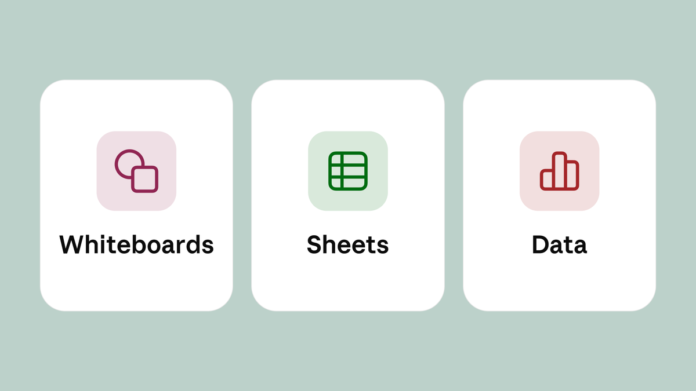

## Claude Sheets：会自己写公式的协作表格

### 能干什么

在 Claude Sheets 里，你的团队和 Claude **一起**建表格：

- 协作整理数据，Claude 和团队成员像同事一样在同一个表里干活
- 创建和编辑公式，不用自己背函数
- 跨多个 Sheet（标签页）工作

它和 Claude 已有的文档、幻灯片、设计能力是一套体系，可以互相接力。

### 实例演示：从一句话到项目追踪表

官方给的经典场景是 "build a tracker in a sheet"（用表格做追踪器）。实际用起来就是一句大白话：

> 帮我建一个新品上线项目追踪表：标签页分成「里程碑」「负责人」「风险清单」三个，里程碑表带上截止日期、状态（未开始/进行中/已完成）下拉选项和逾期自动变红的条件格式。

Claude 会直接把表搭出来，后续你可以继续口语化追加：

> 风险清单里加一列「缓解措施」，把已经延期超过 3 天的里程碑自动同步到风险清单里。

以前这种活儿要么自己吭哧吭哧搭半天格式，要么等 BI 同学排期；现在一段对话就出来了。

### 适合谁

- 项目经理：状态板、排期表、RACI 矩阵
- 运营/市场：内容排期表、投放数据汇总表
- 销售：客户跟进表（配合 Salesforce 连接器更顺）
- HR：招聘进度表、入离职清单

## Claude Whiteboards：开会时 Claude 也在白板前

### 能干什么

Claude Whiteboards 是一块数字白板，团队可以：

- 在会议上一起把想法铺开、归类、连线
- 散会前直接让 **Claude 总结讨论结论**

### 实例演示：头脑风暴不再吃灰

传统流程是：白板拍张照发群里 → 没人整理 → 三天后没人记得。现在开会时把便利贴都贴到 Whiteboard 上，散会前一句：

> 总结一下今天白板上的讨论：按主题归类所有想法，标出大家投票最多的 3 个方向，整理成带负责人的行动项。

Claude 直接输出结构化总结。**白板 → 表格 → 仪表盘**是一条流水线，白板上确认过的想法，下一句就能说"把这三个方向落成 Sheets 里的执行追踪表"——上下文全程带着走，不用重新解释。

### 适合谁

- 产品团队：需求评审、用户旅程梳理
- 创业团队：战略讨论、OKR 拆解
- 任何要开会的人：会前铺材料，会后出纪要

## Claude Data：连着你的数据库讲故事

### 能干什么

Claude Data（前身是 Dashboards）这次**正式在付费计划上线（GA）**，官方推文明确了能力边界：

- 连接 **Snowflake、Salesforce** 等数据源
- 生成**数据仪表盘**
- 起草**数据故事（data stories）**和**带解说的短视频（narrated videos）**——从你的业务指标里自动生成，你审核确认后再分享
- **认证查询（Certified queries）**和**实时分享（live sharing）**目前是 beta，会使用数据团队认证过的指标定义，保证口径统一

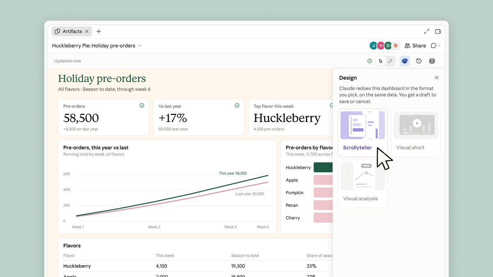

### 实例演示：业务同学不用再排队等报表

以前要一张"上周各渠道转化率对比图"，流程是提需求 → 排期 → 来回对口径 → 等三天。现在：

> 连接我们的 Snowflake，做一张上周销售仪表盘：按渠道拆分 GMV 和转化率，环比上周，异常波动超过 20% 的渠道高亮。

更进一步，直接让它讲给老板听：

> 基于这张仪表盘生成一个 1 分钟的数据故事视频：先讲整体盘子，再讲涨得最猛的渠道，最后给出下周建议。

生成的东西**先给你审核，确认后才分享**——这一点对汇报场景很重要，数据口径自己把控。

### 官方内部实测数据

Anthropic 自己的法务团队已经用起来：和 Claude 一起搭了一个基于 Slack 的法律审查工具，自动按团队审查手册标红修改意见，市场材料审核从 **3 天缩短到 24 小时**，很多小问题在律师介入前就改完了。财务团队把一份又长又枯燥的高管业务更新文档变成了交互式页面，全团队和 Claude 一起维护。

这两个团队都不写代码——这正是这波更新的定位：**让各领域的专家把自己的知识变成工具**。

## 交互式连接器：把整个 App 直接装进 Claude

这是本次更新里对打工人最实用的一个。官方原话：

> with interactive connectors, you can now open the full version of a tool inside Claude. Work in Adobe, Atlassian, and Box beside your conversation. Make changes yourself, or ask Claude to make them with you.

翻译一下：

- 可以在 Claude 里**打开工具的完整版本**（不是阉割版预览）
- **Adobe、Atlassian、Box** 直接嵌在对话旁边，不用切标签页
- 你可以自己动手改，也可以**让 Claude 跟你一起改**

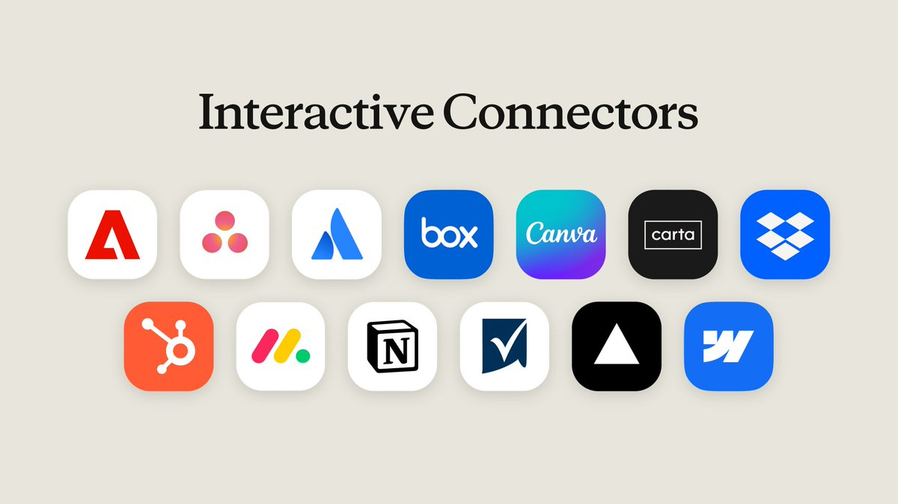

此外，**Salesforce（beta）、NetSuite、Workday（beta）** 的插件自带内置技能：销售可以准备客户拜访，财务可以分析报表，HR 可以处理请假和报销。底层是 Anthropic 发起的 MCP 开放标准，Claude Marketplace 上已经有超过 **9000 个连接器和插件**。

方便归方便，权限边界也讲清楚了：Claude 遵循你现有的权限体系，管理员可以限制每个连接器能做什么——比如 Claude 可以读 Slack，但不能替你发消息。Team/Enterprise 计划还有 **Claude auto-connect**（beta）：管理员一次性配置，员工第一次用到 Notion、Atlassian、Dropbox 时自动连接，不用一个个手动授权。

## Claude Meetings 即将上线

官方预告的下一块拼图：把 Claude 拉进电话会议，它一边记笔记，一边**在你们开会的同时更新团队正在写的文档**。开完会，纪要和文档都已经就位。配合 Whiteboards，以后开会的完整形态大概是：白板铺想法 → Claude 实时记 → 散会出总结和执行表。

## Fable 5.2 作品案例：代码搭出来的细胞 3D 模型

另外，官方同一天还发了一组 [Fable 5.2 早期实验作品帖](https://x.com/claudeai/status/2120174844822298730)，第一个作品就相当惊艳：**一个完全用代码搭出来的细胞 3D 模型**，一个细胞器一个细胞器地建起来的（由 @kevin_t_ngo 制作）。

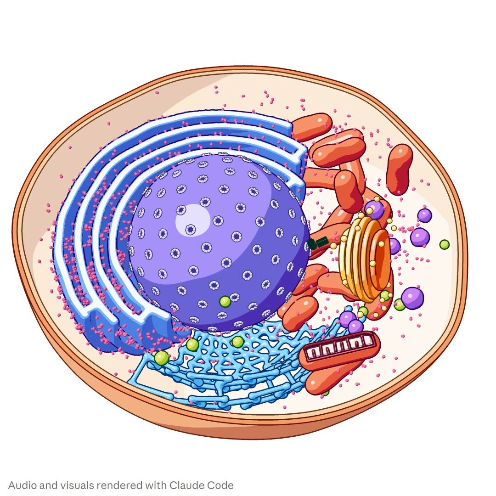

这个帖子里还包括**折纸模拟**和**黑板讲题**等作品，适合做团队内部演示和教学素材找灵感，感兴趣的可以直接去原帖看视频版。

## 如何使用这些新功能？

### 哪些用户可以用？

| 套餐 | 能否使用 | 说明 |
| --- | --- | --- |
| Free 免费 | 部分受限 | 新 Artifact 主要面向付费计划 |
| Pro | 能 | Sheets/Whiteboards/Data 可用 |
| Max | 能 | 额度更高 |
| Team | 能 | + auto-connect beta |
| Enterprise | 能 | + 完整管控/审计/隔离 VM |

覆盖平台：**网页端和桌面端**，分批推送中，刷不到就多等几天。

### 基本使用步骤

1. 打开 Claude（网页版或桌面版），确认账号已升级到付费计划；
2. 在对话里让 Claude 创建 Sheet / Whiteboard / Data 仪表盘，或直接从 Artifact 入口选择类型；
3. 用自然语言描述需求，Claude 搭好初版后继续对话修改；
4. 连接器：在应用入口选择 Adobe/Atlassian/Box 等授权连接，之后在对话旁直接操作完整版应用；
5. Claude Data：先连接 Snowflake/Salesforce 数据源，再让 Claude 出仪表盘，数据故事和视频确认后再分享。

### 实用提示词合集（可直接复制，附效果展示）

**① 一句话搭项目追踪表（Sheets）**

> 建一个产品发布追踪表：三个标签页（里程碑/负责人/风险），带状态下拉、截止日期和逾期高亮，后续我口语化说要改什么你就改。

Claude 搭出来的表格长这样：状态列是下拉选项（未开始/进行中/已完成），逾期的「应用商店审核提交」整行自动标红，并同步进「风险清单」标签页——

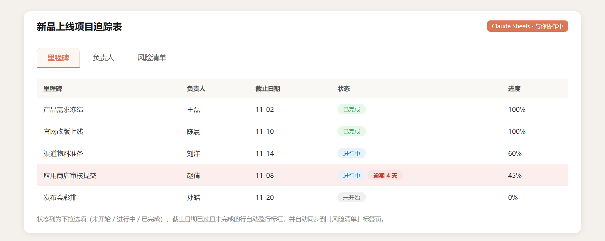

**② 会议白板收尾总结（Whiteboards）**

> 总结白板上的讨论：按主题归类，标出投票最多的 3 个方向，转成带负责人和截止日期的行动项表格。

左边是开会时大家贴的便利贴，右边是散会前 Claude 秒出的总结：得票 Top3 方向 + 带负责人和截止日期的行动项表——

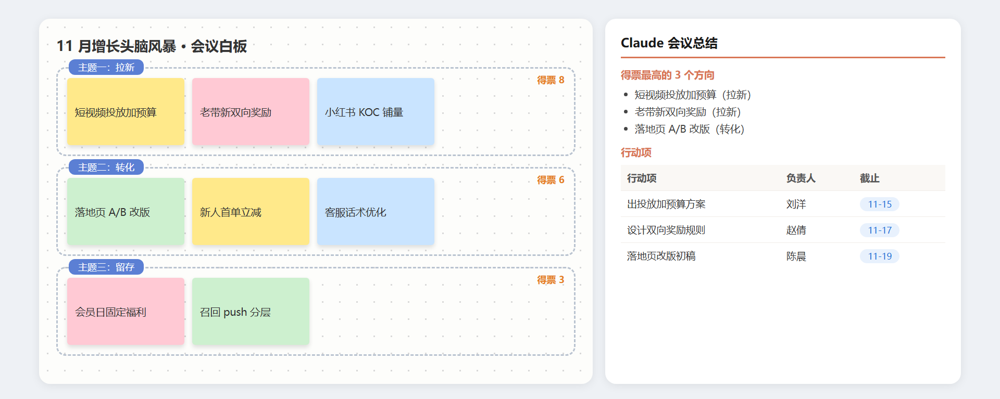

**③ 竞品对比表（Sheets）**

> 做一张竞品对比表：我们和竞品 A、B、C 在定价、核心功能、目标客户、短板四个维度对比，帮我先填上公开信息，留出我们内部判断的空列。

公开信息 Claude 直接填好，「内部判断」一列留空留给团队自己填，拿来就能开评审会——

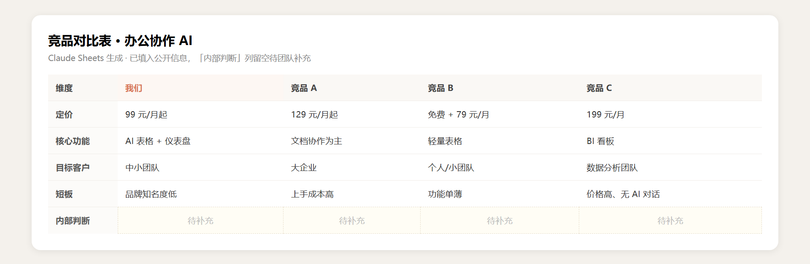

**④ 预算表自动公式（Sheets）**

> 这是各部门的预算申报数据，帮我建表：自动算汇总、各部门占比，超预算 10% 的部门标黄，生成一张能直接给 CFO 看的版本。

研发部超预算 12%，整行自动标黄并打上「超预算」标签，合计行直接算好，CFO 版本一步到位——

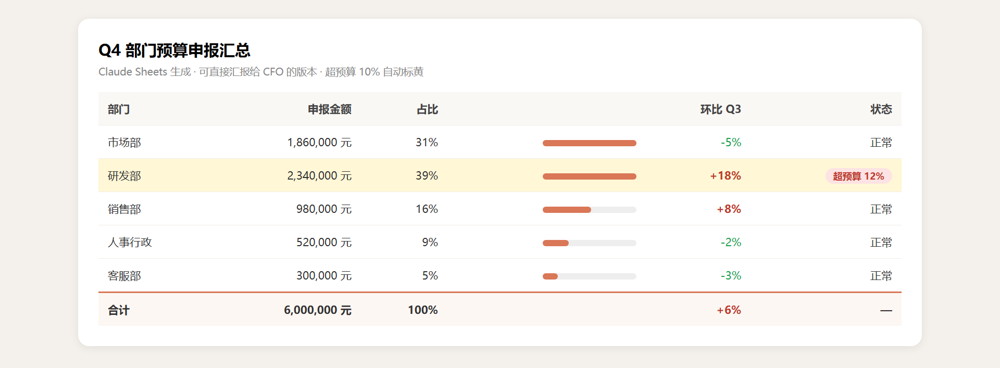

**⑤ 销售仪表盘（Data）**

> 连接 Snowflake，做上周销售仪表盘：按渠道拆 GMV 和转化率，环比，波动超 20% 的高亮。

KPI 卡片 + 分渠道条形图，短视频渠道环比 +34% 自动标红高亮，右边 Claude 还自动附了三条分析提示——

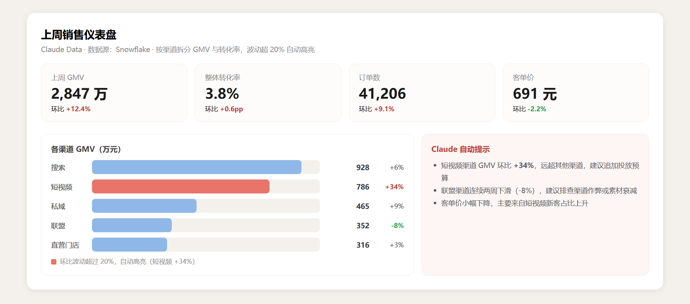

**⑥ 数据故事视频（Data）**

> 基于这张仪表盘生成 1 分钟解说视频：先讲大盘，再讲增长最猛的渠道，最后给下周三条建议。

Claude 会把仪表盘重新组织成三幕式视频：大盘 → 最猛渠道 → 建议，每一幕都带解说词，审核确认后才能分享——

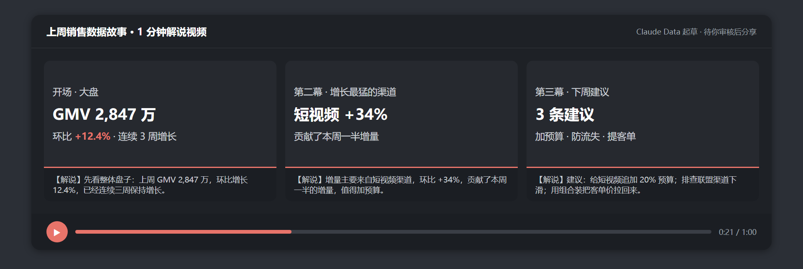

**⑦ 白板想法直通执行（Whiteboards → Sheets）**

> 把白板上确认的三个方向，直接落成 Sheets 执行追踪表，每个方向拆 5 个以内的里程碑。

这条是①和②的连招：白板上确认过的方向，一句话直接变成带里程碑的执行表，上下文全程不用重新解释——这正是三个新 Artifact 一起用的最大价值。

**⑧ 合同审查加速（连接器场景）**

> 参考我们团队之前确认过的审查清单，帮我把这份合同里不符合 Playbook 的条款标出来，逐条给修改建议。

文档里不符合 Playbook 的条款自动标红，右侧逐条给出修改建议，符合的条款也明确标注"无需修改"，律师复核前先筛掉 80% 的活——

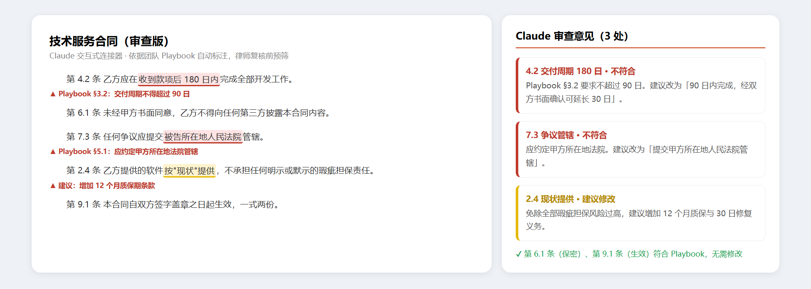

> 说明：以上配图为按官方功能描述绘制的效果示意图，帮助你直观理解产出形态；实际界面以 Claude 产品内实时效果为准。

## 常见问题

**1. 免费用户能用吗？**

Claude Data 官方明确 GA on paid plans，Sheets/Whiteboards 也是面向付费计划分批推送，免费账号大概率刷不到，想用建议上 Pro 或 Max。

**2. 为什么我还没刷到？**

分批推送中，和以往一样有先后，刷不到就多等几天。

**3. 数据安全吗？企业怎么管控？**

官方给了三层保障：Enterprise 数据传输和存储全程加密；审计日志 + Compliance API 兼容 Splunk、CrowdStrike 等 100+ 安全合规工具；Enterprise 每个云端会话跑在独立隔离的虚拟机里，连接器凭据放在虚拟机之外。管理员还能细粒度控制谁能用哪些连接器，并设置消费限额。

**4. Claude Data 的「认证查询」是什么？**

就是让 Claude 使用数据团队认证过的指标定义（beta），保证全公司口径统一，避免"同一个 GMV 三种算法"的经典惨案。

**5. 连接器会替我乱操作吗？**

Claude 遵循你现有的应用权限，管理员可以限制每个连接器的能力边界（比如只读不发），改动前你也可以要求 Claude 先给方案再动手。

**6. 什么时候支持中文界面？**

官方未提，目前以英文界面为准，但提示词可以用中文写，产出表格和白板内容中文没问题。

## 总结一句话

这波更新是 Claude 从"写文档写代码的助手"走向"团队协作操作系统"的关键一步：**白板想清楚 → 表格落地 → 数据讲故事**，一条上下文贯穿到底，法务、财务这些不写代码的团队已经先跑起来了（审核从 3 天到 24 小时）。对普通用户来说，配上交互式连接器，Claude 第一次真正"住进"了你的办公软件。

想第一时间玩上这些新功能，需要 Claude 付费计划：

> tips: 如需订阅 Claude Pro/Max，可参考图文教程：https://littlemagic8.github.io/gptplus/purchase-claude.html

### 参考资料

- [Anthropic 官方博客：More ways to work with Claude](https://claude.com/resources/articles/more-ways-to-work-with-claude-sheets-whiteboards-and-interactive-connectors)
- [官方发布帖：Starting to roll out today](https://x.com/claudeai/status/2120206365759094857)
- [交互式连接器说明](https://x.com/claudeai/status/2120206375137484875)
- [Claude Data 正式上线说明](https://x.com/claudeai/status/2120206372478566799)
- [Mike Krieger 的表态](https://x.com/mikeyk/status/2120254420105806188)
- [Fable 5.2 早期实验作品帖](https://x.com/claudeai/status/2120174844822298730)

## 联系我们

充值过程中遇到任何问题，或有其他业务需求，请联系我们。

请保存网址 [https://littlemagic8.github.io/gptplus/](https://littlemagic8.github.io/gptplus/) ，并加上联系方式，防止失联。

防失联客服微信：

```
aicygg888
```

添加好友请备注：**Claude代充**（加的人多，微信防频繁，请扫码）

## 小提示：想用更多 AI 产品，可以联系 V: aicygg888

> **如果不想开通信用卡，可参考：无需开通信用卡完成 ChatGPT 订阅教程。**
>
> ChatGPTplus 独享账号升级充值自助平台：[https://littlemagic8.github.io/gptplus/](https://littlemagic8.github.io/gptplus/)（网站下方有购买卡密和使用教程）
>
> 开通自己的 ChatGPT Plus、Claude Pro 个人独享账号，可参考：[使用支付方式订阅开通 ChatGPT Plus、Claude Pro 教程](https://littlemagic8.github.io/2024/09/04/update-ChatGPT-Plus/)
>
> **国内使用 ChatGPT / Claude 镜像账号，有两种方式：**

**方式一：官网镜像（官网共享账号，国内网络可访问）按教程自行购买**

遇到问题联系微信：aicygg888

登录地址：https://chatshare.biz/ （复制到浏览器打开，用购买成功后的账号密码登录）
购买地址：https://littlemagic8.github.io/buychat/

- [ChatGPT Plus 独享账号教程](https://littlemagic8.github.io/2025/07/17/chatgptplus-auto-system/)
- [Claude Pro 订阅指南](https://littlemagic8.github.io/2024/12/09/ChatGPT-and-Cluade/)
- [镜像账号使用说明](https://littlemagic8.github.io/2025/07/17/chatgptplus-chatshare/)

**方式二：不想自己注册，添加微信购买**

微信：**aicygg888**（备注：镜像账号）

欢迎加微信：


公众号也可以哦：


