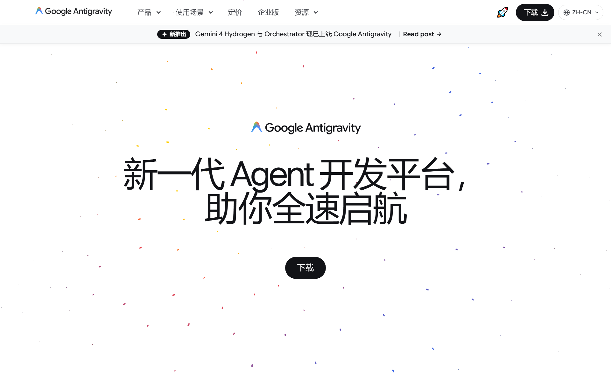
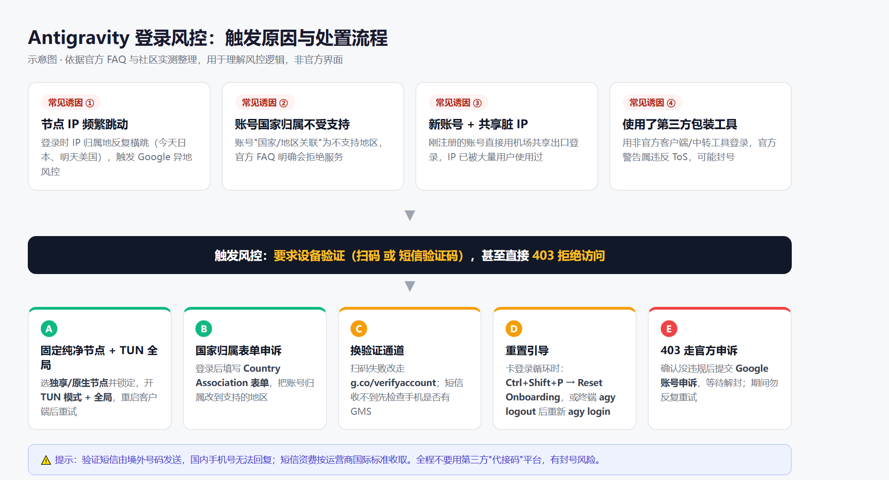
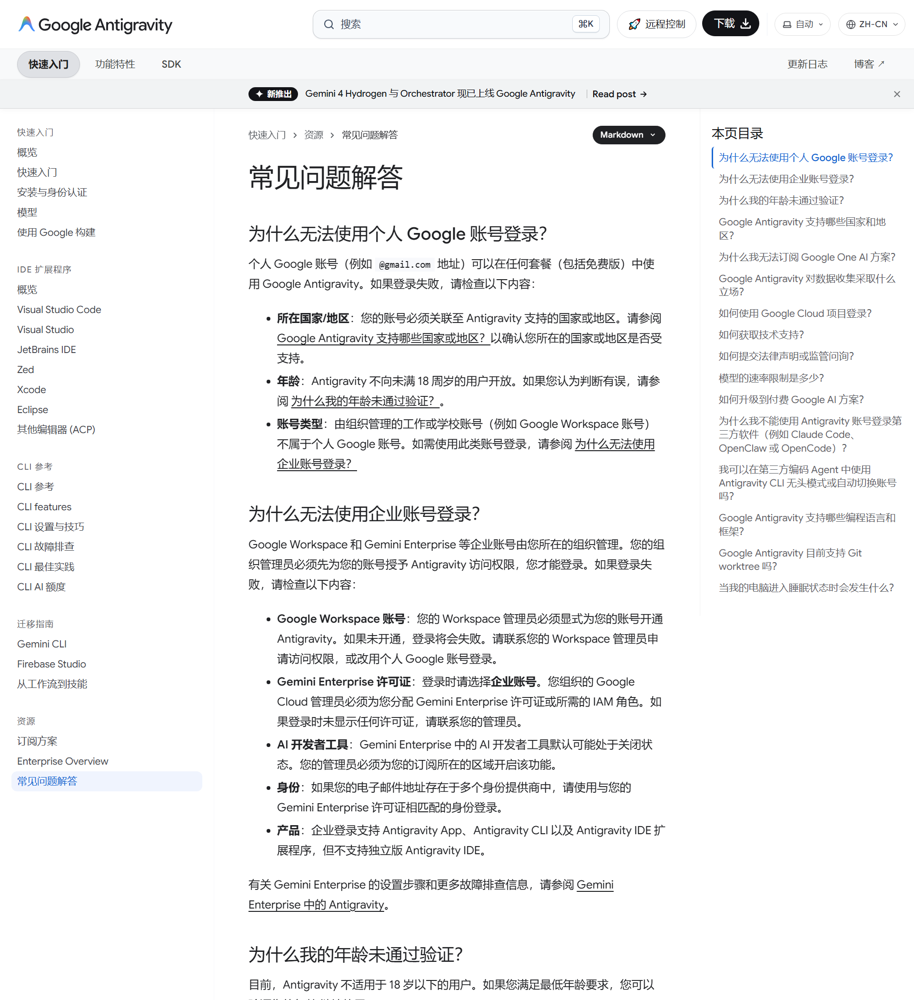
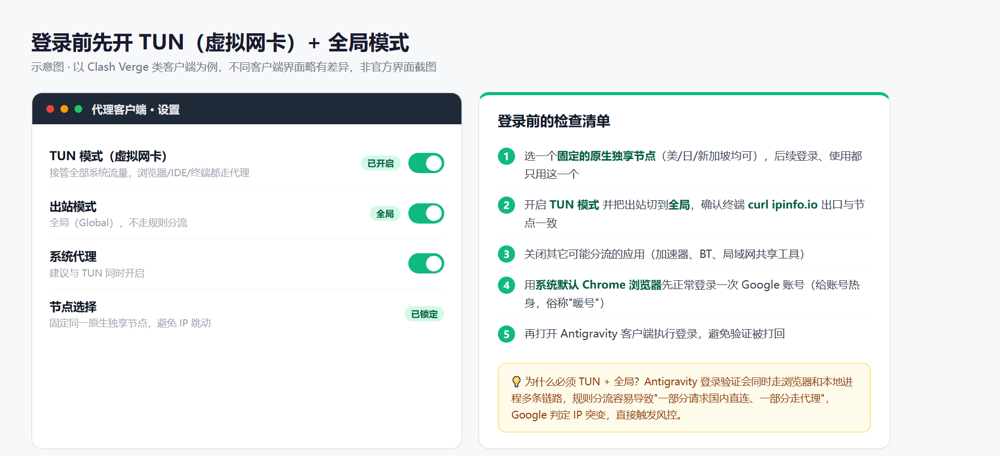
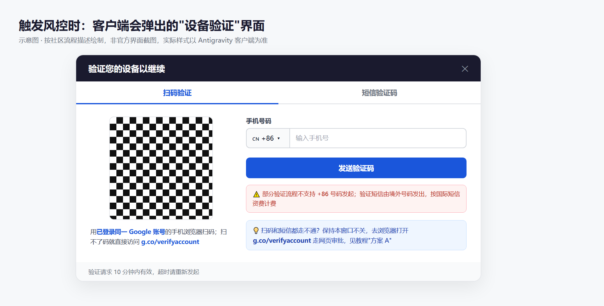
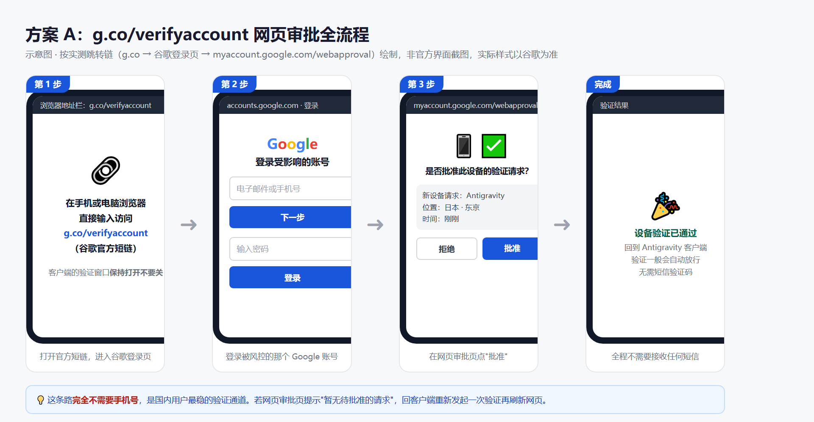
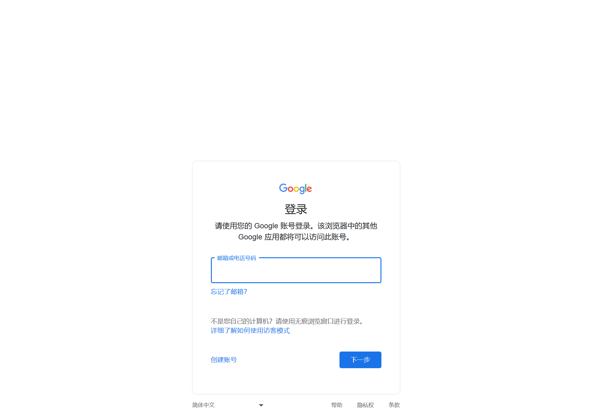
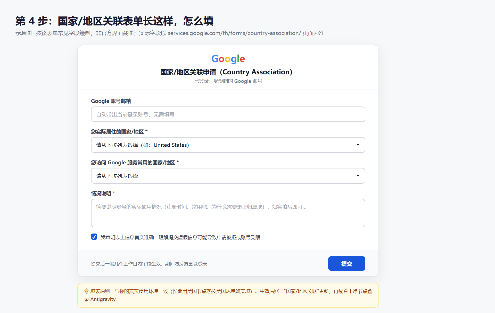
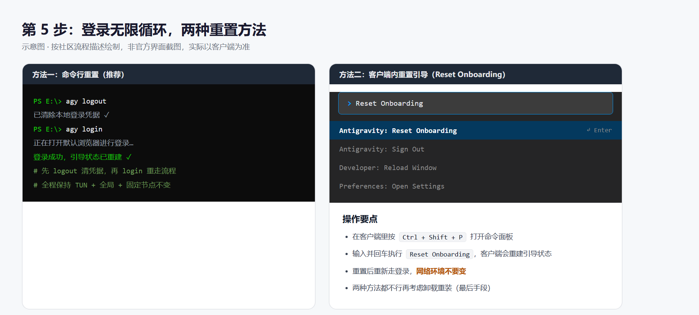
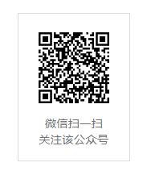

Google 的 **Antigravity（反重力）** 是谷歌新一代 Agent 开发平台，内置 Gemini 3 系列模型，编辑器形态基于 VS Code 魔改，个人 Gmail 账号就能**免费**用，热度直接拉满。

但最近后台收到最多的问题不是"怎么用"，而是——

- 打开就提示**无法使用个人 Google 账号登录**？
- 登录到一半被要求**扫码验证 / 短信验证码**，短信死活收不到？
- 更惨的直接 **403 拒绝访问**？
- 或者卡在登录界面**无限循环**，账号密码都对就是进不去？



这篇手把手图文教程把这些坑一次性讲清楚：**为什么会触发风控 → 先自查什么 → 每种报错怎么一步步解**，全部基于官方 FAQ 和社区实测方案整理。

> tips: Antigravity 目前对**个人 Gmail 账号免费开放**，但账号"国家/地区归属"必须在支持列表内（中国大陆不在列表中），这也是大部分风控的根源。不想折腾账号和网络的，可以直接充值 Gemini 会员：https://littlemagic8.github.io/gptplus/purchase-gemini.html
>
> 遇到问题联系微信：aicygg888

---

## 一张图看懂：你为什么会被风控

先别急着乱试。Antigravity 登录风控的触发逻辑和对应解法，一张图看懂：



四个最常见的诱因：

| 诱因 | 典型场景 |
| --- | --- |
| 节点 IP 频繁跳动 | 今天用日本节点、明天换美国，Google 判定异地异常登录 |
| 账号国家归属不受支持 | 账号"国家/地区关联"是不支持的地区（中国大陆就在此列） |
| 新账号 + 共享脏 IP | 刚注册的 Gmail 直接用机场共享出口登录 |
| 使用了第三方包装工具 | 非官方客户端/中转工具登录，官方明确警告违反 ToS，可能封号 |

触发后通常有两种表现：**要求设备验证（扫码或短信）**，或者更严重的**直接 403**。下面按顺序一步步解决。

---

## 第 0 步：先自查官方硬性条件，别白折腾

很多"登录失败"其实不是风控，而是账号本身不符合官方条件。官方 FAQ 写得很清楚：



对照自查表：

| 检查项 | 要求 | 不满足的表现 |
| --- | --- | --- |
| 账号类型 | **个人 @gmail.com 账号**（"可供日常使用的免费 Google 账号"） | 企业/学校账号直接报"不支持该账号类型" |
| 年龄 | **年满 18 周岁** | 无法完成登录 |
| 国家/地区归属 | 账号归属地必须在**支持列表**内 | 提示所在国家/地区不提供服务 |
| Workspace 账号 | 需**管理员开通** Antigravity 服务后才能用 | 用公司账号登录被拒 |

几个关键点展开说：

**① 工作/学校账号别瞎试。** Google Workspace 和 Gemini Enterprise 账号都要管理员在后台开通 Antigravity 后才能登录，个人瞎试只会反复报错，还可能给账号留下异常记录。用个人 Gmail 最省事。

**② 你的账号"国家归属"是哪国，不看 IP，看账号属性。** 很多人以为挂了美国节点就算美国账号——错。Google 判断的是账号的"国家/地区关联"（Country Association），注册地、常用地、账单地址都会影响它。这就是为什么有人挂了美国节点还是被拒：**IP 在美国，账号归属却不支持**。

**③ 官方明确警告第三方工具。** 用任何非官方的包装客户端、中转工具去登录 Antigravity，都属于违反服务条款，轻则风控重则封号。认准官网 https://antigravity.google/ 下载的官方客户端。

---

## 第 1 步：把网络环境弄干净（80% 的问题在这一步就解决了）

社区实测里，绝大多数扫码/短信验证、甚至 403，根因都是 **IP 不干净或者不稳定**。登录前请按这个清单操作：



手把手操作：

1. **选一个固定的原生独享节点**（美国/日本/新加坡都可以），记住它，后续登录和日常使用都只用这一个，不要换来换去。尽量避开人多的热门共享出口。
2. **开启 TUN 模式（虚拟网卡）并把出站切到全局**。这一步非常关键：Antigravity 登录验证会同时走浏览器和本地进程多条链路，规则分流下很容易出现"一部分请求直连、一部分走代理"，Google 判定 IP 突变，直接把你打进风控。
3. **验证出口 IP 是否一致**：终端里跑 `curl ipinfo.io`，确认返回的国家和节点一致。
4. **关掉其它可能干扰分流的软件**：加速器、BT 客户端、局域网共享工具等。
5. 重启 Antigravity 客户端，再走登录流程。

> **小提示：** 没有干净稳定的网络环境，后面所有步骤都是白搭。机场节点是共享的，一条线路背后是几百上千个用户；如果很多人拿同一个出口 IP 去注册/登录谷歌，这个 IP 在谷歌眼里就是"高风险 IP"，你再登录就是连坐风控。换独享或冷门地区节点往往立竿见影。

---

## 第 2 步：先把 Chrome 弄成默认浏览器，先在网页端登录一次 Google 账号（俗称"暖号"）

这是社区验证过很多次的细节：**Antigravity 桌面客户端的登录流程依赖系统默认浏览器**，默认浏览器不是 Chrome 时，验证回调容易失败、或者验完又被打回。

操作步骤：

1. 系统设置里把 **Chrome 设为默认浏览器**（Windows：设置 → 应用 → 默认应用 → Google Chrome → 设为默认）。
2. 用 Chrome 先正常登录一次 Google 账号，随便浏览几分钟。这一步俗称"暖号"，意思是给账号热身：让 Google 的风控系统提前认识"这个浏览器 + 这个账号 + 这个 IP"是正常搭配，之后再登录 Antigravity 就不容易被打回。
3. 再打开 Antigravity 客户端，点击登录，此时会拉起 Chrome 完成授权。
4. 如果还是反复被打回，**重装一次 Antigravity 客户端**再试（保留网络环境不变）。

---

## 第 3 步：被要求扫码 / 短信验证怎么办

如果前面都做了，登录时还是被要求**设备验证**，别慌，这是 Google 的二次验证机制，本身说明账号没被封，只是需要证明"是本人在用"。客户端会弹出类似这样的验证窗口：



先说结论，**国内用户按"网页审批 → 扫码 → 短信"的顺序试，大部分情况根本用不到手机号**：

### 方案 A：优先试 g.co/verifyaccount 网页验证通道

**g.co 是谷歌官方的短链接域名**（谷歌自家所有，类似官方版短网址）。打开 `g.co/verifyaccount` 会先跳到谷歌登录页，登录受影响的账号后，会进入"网页审批"页面——在这里直接批准 Antigravity 正在等待的那条设备验证请求，等于绕开客户端里卡住的扫码/短信流程，改在网页上完成确认。

手把手操作：

1. 保持 Antigravity 客户端停留在验证页面，不要关。
2. 手机或电脑浏览器打开 **g.co/verifyaccount**，登录受影响的 Google 账号。
3. 在打开的网页审批页里，按提示批准设备/登录请求。
4. 回到客户端，验证一般会自动放行。很多人反馈这个通道比客户端里的验证更容易过。

四步全流程一览（全程不需要接收任何短信）：



### 方案 B：短信验证码，先搞清楚为什么收不到

先讲一个多数教程不写的关键机制（社区亲测经验）：**扫码验证走到短信这一步，八成是因为你的安卓手机缺谷歌原生服务（GMS）**。国产安卓（小米/OPPO/vivo 等）出厂没有谷歌移动服务，扫码确认没法直达手机，验证就退化成发短信。给安卓机装上 GMS（谷歌服务框架）后，扫码验证可以直接通过，根本不用短信——三星、Pixel 原生支持最好，小米/OPPO/vivo 可装，华为鸿蒙难度较大（系统底层不同）。

收不到短信的六大原因，逐一排查：

| 原因 | 说明 | 对策 |
| --- | --- | --- |
| 手机没有 GMS 服务 | 没有谷歌服务框架，扫码验证退化为短信验证 | 给安卓机装 GMS，或换带 GMS 的手机/iPhone |
| 设备无 SIM 卡 | 平板/随身 WiFi 收不了短信 | 插实体 SIM 卡 |
| 运营商拦截国际短信 | 验证码是**境外号码**发出的 | 联系运营商开通国际短信接收；检查骚扰拦截 |
| +86 号码发不出验证 | 部分验证流程不支持大陆号码发起 | 改用扫码或 g.co/verifyaccount |
| 接码平台已失效 | 便宜的接码平台号码早被 Google 拉黑 | **别用接码平台，封号风险极高** |
| 电脑没摄像头 | 桌面端扫码无摄像头可扫 | 用手机端登录同一账号完成验证 |

注意两点：

- 验证短信按运营商**国际短信资费**收费，一般几毛到一块钱一条，正常现象。
- 验证码有时效（通常几分钟），收到后尽快输入。

#### 国内手机号到底能不能用？直说结论

| 用途 | 国内行不行 | 说明 |
| --- | --- | --- |
| 收验证短信 | ✅ 大多数能收 | 国际短信接收是手机基础功能，**接收免费**；先向运营商确认已开通国际短信，再关掉手机管家/骚扰拦截；虚拟运营商卡（170/171 号段）成功率低一些 |
| 发短信发起验证 | ⚠️ 能发但别依赖 | 国际短信约 1 元/条；且部分流程根本不支持 +86 发起，卡住就换路 |
| 接收谷歌"设备提示"确认 | ⚠️ 看手机 | 这种确认靠谷歌 Play 服务推送，手机必须有 GMS 才收得到 |

**结论：能解决，但最优解恰恰是绕开手机号。** 优先级排序：**g.co/verifyaccount 网页审批（完全不用手机号）→ 扫码验证（装好 GMS 的安卓机/iPhone 直接过）→ 短信验证码（兜底）**。国内手机号本身不是拦路虎，别在短信这一棵树上硬耗。

### 方案 C：换设备登录绕过

PC 端扫码困难时，直接在**手机 Google App 或手机浏览器**登录同一账号完成安全确认，PC 端再重试客户端登录。

---

## 第 4 步：账号国家归属问题 → 填 Country Association 表单

如果怀疑是"账号归属地不支持"导致的拒登（比如 IP、设备都干净了还是提示地区不受支持），官方提供了**国家/地区关联申诉表单**：

表单地址：**https://services.google.com/fh/forms/country-association/**

（老的 policies.google.com/country-association 地址已经失效，会 404，别找了。）



登录成功后会看到类似这样的表单：



手把手操作：

1. 打开表单地址，会先跳转 Google 登录页，**用受影响的那个账号登录**（截图里这一步）。
2. 按表单要求如实填写：常居地、常用 IP 所在地等信息。
3. 提交后等待 Google 审核，**一般几个工作日内生效**，期间不要反复尝试登录。
4. 生效后，账号的"国家/地区关联"会更新，再配合干净的节点登录 Antigravity。

> **提示：** 填表不能伪造信息，填一个与你实际使用环境一致的地区（比如你长期用美国节点，就如实按美国环境填）。虚报可能被判定滥用。

---

## 第 5 步：卡在登录无限循环 → 重置引导

症状：账号密码都对，验证也过了，但客户端每次启动又回到登录页，无限循环。

这是客户端本地引导（Onboarding）状态损坏，两个方法：

**方法一：命令行重置（推荐）**

```bash
agy logout   # 清除本地登录凭据
agy login    # 重新走登录流程
```

**方法二：重置 Onboarding**

在 Antigravity 里按 `Ctrl + Shift + P` 打开命令面板，输入并执行 **Reset Onboarding**，客户端会重置引导状态，重新走一遍登录。



做完之后再从头检查一遍第 1 步的网络环境（TUN + 全局 + 固定节点），循环基本都能解掉。

---

## 第 6 步：直接 403 拒绝访问 → 走官方申诉

如果登录直接给你 403，说明账号被 Google 风控系统**限制了服务访问**。这时候：

1. **先停止反复重试。** 每次失败的尝试都在给账号加深"异常"标签。
2. 自查有没有踩线：第三方工具登录过？节点环境脏？短时间大量异常请求？有则先纠正环境。
3. 前往 **Google 账号帮助中心**（support.google.com/accounts）按"无法登录/账号被限制访问"的指引提交申诉，说明自己的正常使用情况。
4. 等待处理，一般几天内邮件答复。期间保持环境干净。

如果申诉通过，账号恢复正常后，先按本文第 1-2 步把网络环境配置好，再登录。

---

## 防封清单：这些事做 / 千万别做

| ✅ 推荐做法 | ❌ 千万别做 |
| --- | --- |
| 固定一个原生独享节点长期使用 | 今天日本、明天新加坡，频繁换节点 |
| 开 TUN 模式 + 全局出站 | 规则分流挂着就登录 |
| 官网下载官方客户端 | 用第三方包装版/中转工具 |
| 个人 Gmail 账号登录 | 拿公司 Workspace 账号硬试 |
| 验证码自己手机收 | 淘宝/接码平台买"验证服务" |
| 先在 Chrome 网页端登录一次 Google 账号，再登客户端 | 新装完直接反复登客户端 |
| 一台设备固定使用 | 多设备多地同时登录 |

一句话总结：**账号、IP、设备三样都"稳定且一致"，Google 就不会找你麻烦；任何一样漂移，风控就来。**

---

## FAQ：高频问题快问快答

**Q1：Antigravity 收费吗？个人账号能用吗？**
免费。个人 @gmail.com 账号、年满 18 岁且账号归属地在支持列表内即可使用。企业账号需要管理员开通。

**Q2：为什么我挂了美国节点还是提示地区不支持？**
因为 Google 判断的是**账号的国家/地区归属**，不是当前 IP。去第 4 步填国家归属表单。

**Q3：短信验证码收不到，是不是号就废了？**
不是。先按第 3 步的六大原因排查（GMS、SIM、运营商拦截等），多数是通道问题不是账号问题。优先试 g.co/verifyaccount。

**Q4：扫码验证一直转圈/失败？**
检查系统默认浏览器是否为 Chrome（第 2 步），换手机端登录同一账号完成验证，或改走 g.co/verifyaccount。

**Q5：登录循环卡死，卸载重装有救吗？**
重装不如重置。先 `agy logout` + `agy login`，或 `Ctrl+Shift+P` → Reset Onboarding。重装只是最后手段，且重装时保持网络环境不变。

**Q6：用 Claude Code 这类第三方工具连 Antigravity 会封号吗？**
官方 FAQ 明确警告使用非官方方式接入违反服务条款，存在被暂停/封禁风险。想要 AI 编程能力，直接用 Antigravity 内置的 Gemini 3 即可，别冒险。

---

## 总结

Antigravity 的登录风控看着吓人，其实逻辑很朴素：

1. **先自查硬性条件**（个人 Gmail、18+、归属地支持）；
2. **网络环境弄干净**（固定节点 + TUN 全局）；
3. **验证走对通道**（Chrome 默认浏览器、g.co/verifyaccount、手机端代验）；
4. **归属地问题填表单**，循环问题重置引导，403 就老实申诉。

按顺序排查，绝大多数情况都能救回来。

参考资料：

- [Google Antigravity 官方 FAQ](https://antigravity.google/docs/faq)
- [Google 国家/地区关联表单](https://services.google.com/fh/forms/country-association/)
- [Google Antigravity 官网](https://antigravity.google/)
- [Antigravity 登录问题社区指南（GitHub）](https://github.com/air-rem/antigravity-guide)
- [扫码验证退化为短信的 GMS 机制与解决思路（社区亲测帖）](https://mbd.pub/o/bread/YZaTmJ9sZA==)

---

## 小提示：想用更多 AI 产品，可以联系 V: aicygg888

> **如果不想开通信用卡，可参考：无需开通信用卡完成 ChatGPT 订阅教程。**
>
> ChatGPTplus 独享账号升级充值自助平台：[https://littlemagic8.github.io/gptplus/](https://littlemagic8.github.io/gptplus/)（网站下方有购买卡密和使用教程）
>
> 开通自己的 ChatGPT Plus、Claude Pro 个人独享账号，可参考：[使用支付方式订阅开通 ChatGPT Plus、Claude Pro 教程](https://littlemagic8.github.io/2024/09/04/update-ChatGPT-Plus/)
>
> **国内使用 ChatGPT / Claude 镜像账号，有两种方式：**

**方式一：官网镜像（官网共享账号，国内网络可访问）按教程自行购买**

遇到问题联系微信：aicygg888

登录地址：https://chatshare.biz/ （复制到浏览器打开，用购买成功后的账号密码登录）
购买地址：https://littlemagic8.github.io/buychat/

- [ChatGPT Plus 独享账号教程](https://littlemagic8.github.io/2025/07/17/chatgptplus-auto-system/)
- [Claude Pro 订阅指南](https://littlemagic8.github.io/2026/08/16/how-to-sub-claudepro/)
- [Gemini 充值购买页](https://littlemagic8.github.io/gptplus/purchase-gemini.html)
- [镜像账号使用说明](https://littlemagic8.github.io/2025/07/17/chatgptplus-chatshare/)

**方式二：不想自己注册，添加微信购买**

微信：**aicygg888**（备注：镜像账号）

欢迎加微信：


公众号也可以哦：


