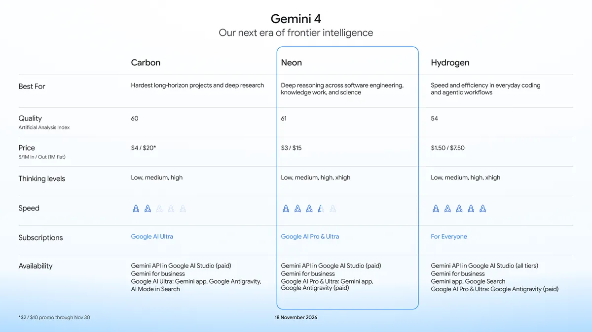
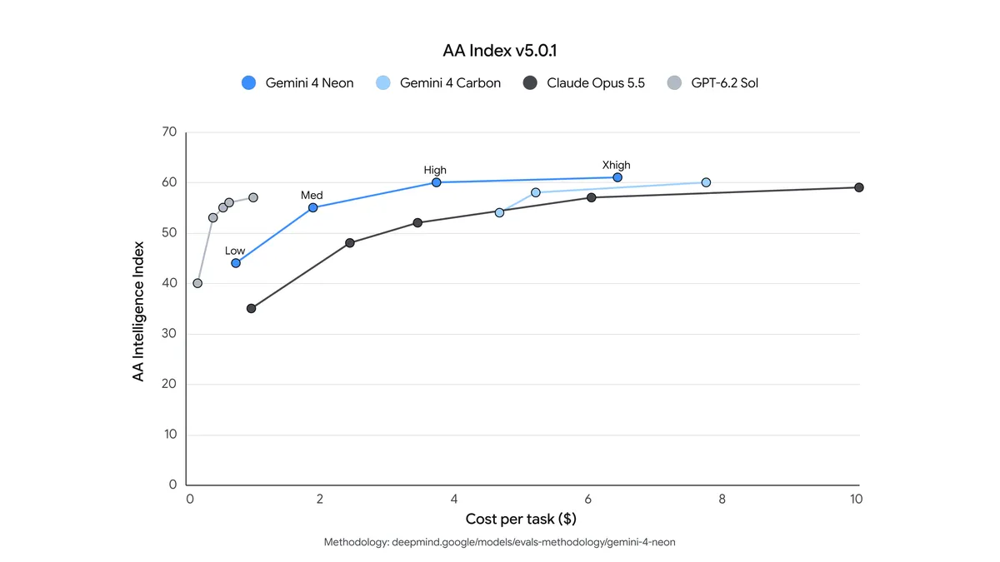
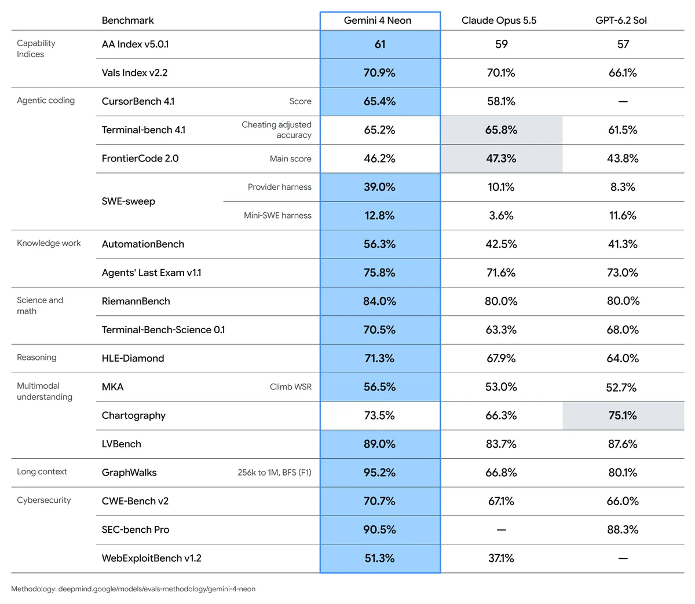
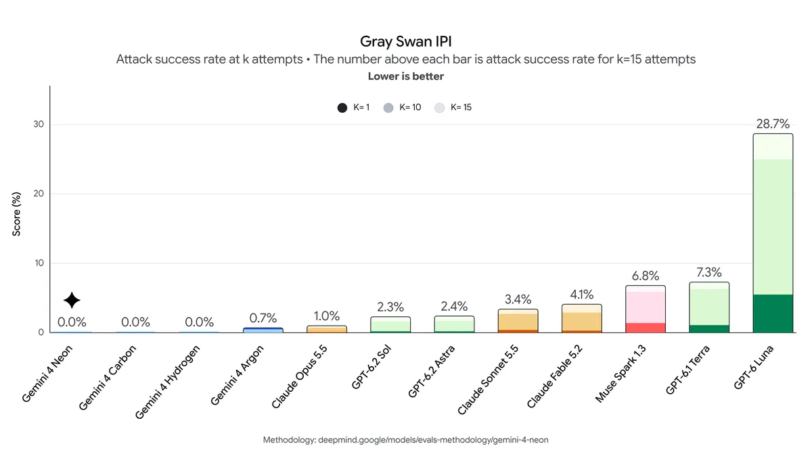
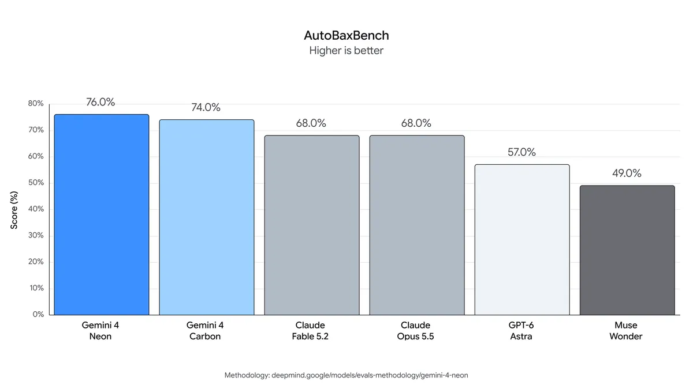
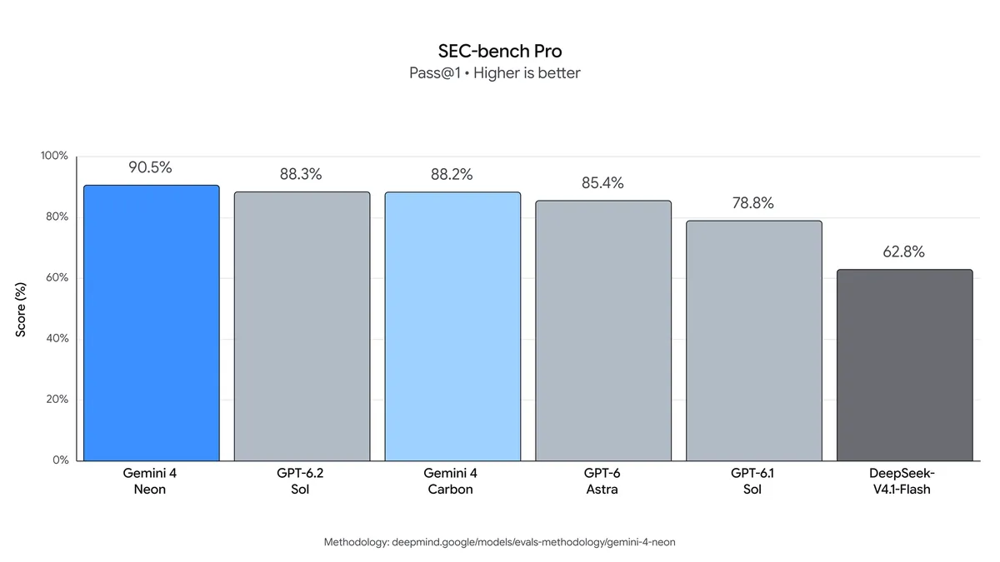
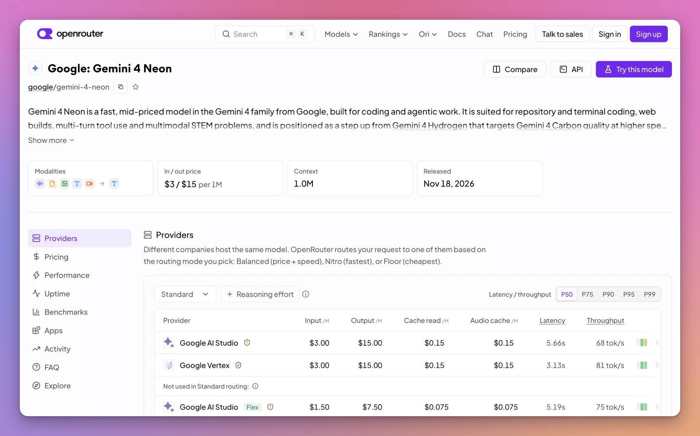

11 月 18 日晚（北京时间 19 日凌晨），Google 发布 **Gemini 4 Neon**。官方一句话定位：把**前沿级智能**和**快的端到端任务完成**放在一起，覆盖复杂软件工程、知识工作和科研工作流。Gemini 应用官方账号同一条推文串里写得更直白：在需要前沿级推理、又要响应快的工作里表现出色。


本文主要包含：

1. **Gemini 4 Neon 是什么**，在 Gemini 4 家族里的位置
2. **哪些用户能用**，怎么切换到 Neon
3. **官方跑分速览**，直接放官方图表
4. **开发者真实实测**：两个编程题、写作、100k token 长文检索，全部数据来自开发者公开测试
5. **社区真实反馈**：HN 728 分热帖、Reddit 各版第一手评价
6. **API 价格**和省钱要点
7. **国内怎么开通** Gemini Pro

> ps：Neon 只有 **Google AI Pro 和 Ultra** 订阅用户能用。有银行卡的可以按 [Gemini Pro 怎么订阅](https://littlemagic8.github.io/2026/10/20/how-to-use-gemini-pro/) 自己开通。没有外币卡的，联系客服微信：**aicygg888** （大家需要Ultra成品号直接找客服），或直接打开代充页：https://littlemagic8.github.io/gptplus/purchase-gemini.html （浏览器打开）

---

## 一、Gemini 4 Neon 是什么？

官方博客的标题是 [Introducing Gemini 4 Neon](https://blog.google/innovation-and-ai/models-and-research/gemini-models/introducing-gemini-4-neon/)，作者署名 Koray Kavukcuoglu。核心信息：

- **排名**：Artificial Analysis Intelligence Index 在 **xhigh 思考档位拿下 61 分，总榜第 3**，只落后更大更慢的模型；Vals Index 排 **第 2**（70.9%），落在 Pareto 前沿上
- **可用性**：Google AI Pro / Ultra 订阅用户，移动端、桌面端、网页版都能用
- **上下文**：**100 万 token**，表格、PDF、图表、音频、视频可以一次性塞进去
- **价格**：输入 $3 / 输出 $15 每百万 token，缓存输入 $0.15（**95% 折扣**）

### 在 Gemini 4 家族里的位置

官方发布里有一张三款模型的对比表，信息量比文字大得多：



把这张表整理一下：

| 模型 | AA 智能指数 | 价格（每百万 token） | 思考档位 | 订阅要求 |
|------|------|------|------|------|
| Gemini 4 Carbon | 60 | $4 / $20（11 月 30 日前促销价 $2/$10） | low / medium / high | 仅 Google AI Ultra |
| **Gemini 4 Neon** | **61** | **$3 / $15** | low / medium / high / **xhigh** | **Google AI Pro & Ultra** |
| Gemini 4 Hydrogen | 54 | $1.50 / $7.50 | low / medium / high / xhigh | 所有人 |

两个值得划重点的地方：

1. **Neon 的智能指数 61 分，比 Carbon 的 60 还高一分**——更小、更快、更便宜，分数反而更高，这是官方敢把它放在家族中间位置的底气
2. **Carbon 只有 Ultra 能用，Neon 放开到了 Pro**，所以本文后面讲代充只按 Pro 算

一句话分工：**Carbon 干最重的活，Hydrogen 干最碎的活，Neon 干又复杂又要快的活。**

### 四个思考档位

Neon 有四个思考档位（Carbon 只有三个，没有 xhigh），官方说这次把档位之间的过渡做得更平滑，团队可以按工作量的需要拨「智能和 token 花费」：

- 默认 **high**：性价比档，官方口径下**单任务成本比 Carbon 低 32%**
- **xhigh**：最难工程、分析、科研用，智能分最高，但单任务成本仍比对手最高档低 **36% 以上**
- high 档在 Vals Index 和 Agent Arena 上都站在 Pareto 前沿，比顶级前沿模型便宜 **50%–80%**

---

## 二、哪些用户能用？怎么切换？

| 入口 | 谁能用 |
|------|--------|
| [Gemini 应用](https://gemini.google.com/)（手机/桌面/网页） | **Google AI Pro、Ultra** |
| Gemini 应用里的 Tasks | **Google AI Pro、Ultra** |
| [Google Antigravity](https://antigravity.google/) | 付费 **Google AI Pro、Ultra** |
| [AI Studio](https://ai.google.dev/aistudio) + Gemini API 付费档 | 开发者；Pro/Ultra 也能试用 |
| Android Studio | 开发者 |
| Gemini for business（API 或模型下拉） | 企业 |

### 切换方法

在 Chat 或 Tasks 界面打开**模型下拉菜单**，选 **"4 Neon"**——注意它在菜单里显示的名字是 **"Deeper analysis"（更深入的分析）**。

> tips：官方推文串里还提到，Tasks（后台任务）现在也能跑在 Neon 上——同样的多步骤活，比大模型更快完成，还**省额度**。

---

## 三、官方跑分速览（附官方图表）

官方博客放了两张总览图，比文字直观。

第一张是 **AA Index v5.0.1 的「智能-成本」曲线**：横轴是单任务花费（美元），纵轴是智能指数。Neon 从 low 到 xhigh 四个档位连成的蓝色曲线，整体压在 Claude Opus 5.5 和 GPT-6.2 Sol 的左上方——**xhigh 档约 $6 一个任务拿下 61 分，Opus 5.5 要花到约 $10 才有 59 分**：



第二张是 **20 项基准的完整对照表**（Neon vs Opus 5.5 vs GPT-6.2 Sol）：



几行值得单独圈出来（Neon vs Opus 5.5）：

- **CursorBench 4.1**：65.4% vs 58.1%
- **GraphWalks 长上下文**（256k–1M）：**95.2% vs 66.8%**——1M 上下文不是白给的
- **SWE-sweep**：接官方 harness **39.0% vs 10.1%**；mini-SWE 单跑 12.8% vs 3.6%
- **AutomationBench**：56.3% vs 42.5%
- 也有输的：Terminal-bench 4.1 上 Opus 以 65.8% 对 65.2% 小幅领先——官方把这张表全放出来了，包括自己落后的行

**综合与知识工作**

| 基准 | 成绩 |
|------|------|
| Artificial Analysis Intelligence Index（xhigh） | **61 分，总榜第 3** |
| Vals Index | **第 2**（70.9%），Pareto 前沿 |
| Agent Arena Index（4200+ 真实 agent 会话） | **1336 分，全球第 2** |
| Agent Arena 可控性（steerability，接受任务中途纠正） | **第 2** |
| Legal Research Bench / Tax Agent Bench | **双第 1** |
| Surge AI（金融、会计、表格建模、复杂约束） | 多项 **第 1** |
| Chartography（读密集专业图表） | 73.5% |
| Agents' Last Exam v1.1 | 75.8% |
| Zapier AutomationBench | **第 1**（56.3%） |
| Vending-Bench 2（经营模拟长任务） | **第 1**（$16,843） |

**科学与数学**

| 基准 | 成绩 |
|------|------|
| Terminal-Bench Science | **同类最佳**（70.5%） |
| RiemannBench | 84.0% |
| HLE-Diamond | 71.3% |

**编程**

| 基准 | 成绩 |
|------|------|
| Artificial Analysis Coding Agent Index | **总榜第 1**（58.6） |
| Terminal-Bench 4.1 | 65.2% |
| FrontierCode 2.0（默认 high 档） | 46.2% |
| SWE-sweep（mini-SWE 单跑） | 12.8% |
| SWE-sweep（**接官方 harness**，即 Antigravity 环境） | **39.0%，SOTA** |

最后两行的差距值得单独说：同一个模型，放在 Antigravity 的 harness 里跑，成绩是单跑的 **3 倍**——官方就是用这组数字证明 Antigravity 环境的价值。想在里面跑的，登录遇到风控参考这篇：[Antigravity 登录风控怎么办](https://littlemagic8.github.io/2026/11/15/how-to-solve-antigravity-login/)。

**安全（官方放了两张图）**



Gray Swan 间接提示注入基准里，Gemini 全家族（Neon / Carbon / Hydrogen）攻击成功率都是 **0.0%**；对比 Claude Opus 5.5 的 1.0%、GPT-6.2 Sol 的 2.3%、GPT-6 Luna 的 28.7%。





其余安全口径：内部 Antigravity 测试里**迄今最低的捏造率**（fabrication rate）；Terminal-Bench 4.0 作弊率 **0.0%**，整个 Gemini 4 家族里「抄近路率」最低（2.45%）；agent 诚实度评估通过率 **99.2%**；欠服务（under-service）比 Carbon 再降 43%–56%，越界（overreach）再降 15%–35%。

网络安全方向（Neon for cyber）拿了 AutoBaxBench hard 76%、SEC-bench Pro 90.5% 等 SOTA，通过 **Fairwind Program** 向可信防御者逐步开放，普通用户不用管这条。

---

## 四、开发者真实实测：Neon vs Opus 5.5 vs Carbon

官方数字都是厂商自报。发布当天，开发者 Flavio Copes 用 OpenRouter API 跑了一组独立对比测试：**同一份提示词喂给 Neon、Gemini 4 Carbon 和 Claude Opus 5.5**，耗时、token 数、真实花费全部公开，文章在 [Gemini 4 Neon: I tested it against Opus 5.5](https://flaviocopes.com/gemini-4-neon)。

测试方法说清楚：一个 Node 脚本调 OpenRouter 接口，用 `reasoning: { effort }` 控制思考档位；编程题的「通过」标准是**他提前写好的测试文件全部跑过**，不是「看起来对」。

他用的是 OpenRouter 上的 `google/gemini-4-neon`：



顺带一个细节：他截图里 Carbon 是 $2/$10——对照上面官方对比表的脚注，那是 **11 月 30 日前的促销价**，Carbon 原价其实是 $4/$20，比 Neon 贵。

### 实测 1：两个编程题

第一题写一个 `parseDuration()` 函数：`'1h30m'` 要解析成 5400 秒、`'2h5s'` 是 7205，遇到 `'30m1h'`、`'1.5h'`、`'1h 30m'` 这类要抛 `RangeError`，一共 30 个测试用例。

第二题更难，写一个 `parseCSV()`：带引号字段、`""` 转义引号、引号内换行、`\r\n` 和单独 `\r`、结尾换行不能多出一行、游离引号要抛 `SyntaxError`，27 个用例。

三个模型**全部满分通过**，差距全在时间和钱上：

| 题目 | 模型 | 通过 | 耗时 | 输出 token | 花费 |
|------|------|------|------|------|------|
| parseDuration | Gemini 4 Neon | 30/30 | 12.7s | 1,275 | $0.020 |
| parseDuration | Gemini 4 Carbon | 30/30 | 78.0s | 4,920 | $0.050 |
| parseDuration | Claude Opus 5.5 | 30/30 | 6.8s | 571 | $0.012 |
| parseCSV | Gemini 4 Neon | 27/27 | 49.3s | 6,032 | $0.091 |
| parseCSV | Gemini 4 Carbon | 27/27 | 308.5s | 19,702 | $0.198 |
| parseCSV | Claude Opus 5.5 | 27/27 | 12.4s | 1,392 | $0.029 |

他记录的几个细节：

- parseDuration 上三个模型写出了**一模一样的正则** `/^(?:([0-9]+)h)?(?:([0-9]+)m)?(?:([0-9]+)s)?$/`
- CSV 题上 Neon 花了 **5,495 个推理 token** 才动笔写约 70 行代码，Opus 只用了 694 个——所以 Neon 单 token 更便宜，**单题成本却约为 Opus 的 3 倍**（默认 high 档）
- Carbon 慢出另一个次元：一道 CSV 5 分多钟、近 2 万 token。HN 帖子吐槽 Carbon 的也是这一点
- Neon 写码输出速度约 **122 token/秒**，Carbon 约 64

### 实测 2：把思考档位拨到 low

既然 Neon 在小题上「想太多」，他把同一道 CSV 题用 low / medium / high 各跑了一遍：

| 档位 | Neon | Neon 成本 | Opus 5.5 | Opus 成本 |
|------|------|------|------|------|
| low | 27/27，24.5s | $0.040 | 27/27，6.2s | $0.016 |
| medium | 27/27，39.1s | $0.065 | 27/27，9.4s | $0.021 |
| high | 27/27，49.3s | $0.091 | 27/27，12.4s | $0.029 |

**Neon 的 low 档依然 27/27 全对，成本不到 high 档的一半。**他的建议：小而明确的函数直接从 low 开始，high 留给 agent 场景——那里有更多值得思考的东西。

### 实测 3：写作

HN 上很多人说 Gemini 4 的英文写得比 Claude 好。他给三个模型一段混乱的 commit message 让它们重写，原文是：

```
fixed the thing where the newsletter form was sending twice, it was because the submit handler got attached on every astro page transition so after navigating 3 pages you got 3 emails lol. now we check a data attribute before attaching. also removed console.log
```

Neon 的输出：

```
fix: prevent duplicate newsletter form submissions

Astro page transitions were re-attaching the submit handler on each navigation, triggering multiple emails per submission. Guard listener attachment with a data attribute so it only binds once, and remove a leftover `console.log`.
```

Opus 5.5 的输出：

```
Fix duplicate newsletter form submissions

The submit handler was re-attached on every Astro page transition, so each navigation added another listener (3 pages = 3 emails). Now we check a data attribute before attaching.

Also remove stray console.log.
```

他的评价：两版都不错，但 **Neon 这版更像真实仓库里的 commit**——标准 `fix:` 前缀加一段紧凑正文；Opus 保留了「3 pages = 3 emails」这个最直观的细节；Carbon 输出成了两个短 bullet。

### 实测 4：100k token 长文检索

Neon 输入价低，优势应该在大 prompt 上。他把自己 11 月 10–18 日发的 23 篇文章合成一个 385KB 的 prompt，让它找出提到 OpenRouter 的文章 slug（`grep` 验证正确答案是 `openrouter-models` 和 `small-ai-models`）：

| 模型 | 答案 | 输入 token | 耗时 | 成本 |
|------|------|------|------|------|
| Gemini 4 Neon | 两个都对，没有多余输出 | 103,361 | 13.9s | $0.33 |
| Claude Opus 5.5 | 两个都对，没有多余输出 | 139,963 | 6.3s | $0.57 |

同样的 385KB 内容，Gemini 的分词器比 Claude **少算 26% 的 token**；叠加更低的输入单价，**同样的正确答案，Neon 便宜 42%**。

他对 Neon 的定位总结：适合「**读很多、答很少**」的活——整个代码库、一堆 PDF、长日志、一年的笔记。短编程题它和 Opus 一样对，但默认 high 档下更慢更贵，记得拨到 low。他还没在真实项目上把 Neon 当 agent 跑，那是 Google 宣传里加分的部分，留作下一个测试。

---

## 五、社区真实反馈：HN 728 分热帖 + Reddit

### Hacker News

HN 讨论帖发布首日冲到 **728 分、600+ 评论**。主流观点（转述自 Flavio 的整理）：

- 多数人把 Neon 放在 **Opus 5.5 同一档**，编程场景仍有不少人偏好 Opus
- 很多人夸 Gemini 4 的写作，有人专门拿它重写 commit message
- 有人实测 OpenRouter 上 Neon 约 **127 token/秒**（Carbon 约 46），和 Flavio 的数字对得上
- 也有人对 Gemini 系模型的工具调用（tool use）仍不信任，早期版本留下过阴影
- 没人喜欢 Carbon / Hydrogen / Neon 这批命名

### Reddit

各版第一手反馈，挑了几条有代表性的：

- [r/GeminiAI 发布帖](https://www.reddit.com/r/GeminiAI/comments/1xzrkin/google_launches_gemini_4_neon)：「This model is FLYING.」——不是 Carbon 那种深度，但**非常快，比 Hydrogen 有深度得多**
- [r/codex「Neon 拿下 AA 编程指数第 1」帖](https://www.reddit.com/r/codex/comments/1xzx8vc/just_released_gemini_4_neon_takes_1_spot_in_aa)（榜首领先 GPT-6.2 Astra 6 分）：有人给它一道开放数学题，「它想了 5 分钟」；同时热评也提醒：**早期印象正面，但详细实测还很少，真正的考验是实际干活**
- [r/GeminiAI「Neon 卡在 Carbon 和 Hydrogen 中间」讨论帖](https://www.reddit.com/r/GeminiAI/comments/1xza6pu/gemini_4_neon_coming_today_it_sits_right_between)：很多人表示对 Carbon 唯一的抱怨就是慢，Neon 正好接住这个需求
- r/google_antigravity：「Sheesh，上周我还在感叹 Hydrogen 厉害」
- 角色扮演社区 r/SillyTavernAI：测了一会儿，智力介于 Argon/Carbon 和 Hydrogen 之间，「Sonnet/Terra 级」
- 也有负面帖：[r/GeminiAI「Gemini Neon is incredibly bad…」](https://www.reddit.com/r/GeminiAI/comments/1y00yaf/gemini_neon_is_incredibly_bad_i_genuinely_think)——发布初期评价两极是常态，自己上手最准

第三方榜单 Artificial Analysis 的模型页补充了两个数字：**默认档 59.6、xhigh 61.4，单任务约 $6.44**，和官方口径基本一致。

---

## 六、API 价格和省钱要点

标准价，每百万 token：

| 项目 | 价格 |
|------|------|
| 输入 | $3 |
| 缓存输入 | $0.15（**95% 折扣**） |
| 输出 | $15 |
| 上下文窗口 | 1M tokens |

四条省钱要点，前三条都有上面的实测数据撑着：

1. **重复上下文务必用缓存**——长系统提示、大文档反复引用时，缓存输入只要 $0.15，是原价的 5%。
2. **小任务把档位拨到 low**——Flavio 实测同一道题 low $0.040 vs high $0.091，一样全对，**省一半以上**。
3. **读大量材料的活交给 Neon**——100k token 检索实测比 Opus 5.5 **便宜 42%**，长上下文正是它的主场。
4. **agentic 长任务放 Antigravity 里跑**——SWE-sweep 12.8% → 39.0% 说明环境本身就在帮你省重试成本。

---

## 七、国内怎么开通：Gemini Pro 代充

想用上 Neon，账号必须是 **Google AI Pro 或 Ultra**（免费号和 Google AI Plus 都不行）。有外币银行卡的，打开 [Google One](https://one.google.com/) 自己订阅，步骤、价格和取消续费写在：[Gemini Pro 怎么订阅](https://littlemagic8.github.io/2026/10/20/how-to-use-gemini-pro/)。

没有外币卡的，两个办法：

1. **联系客服微信 aicygg888**，代升级到 Pro 或 Ultra，支付宝/微信付款；
2. **选一年的 Gemini Pro 成品号**：[https://littlemagic8.github.io/gptplus/purchase-gemini.html](https://littlemagic8.github.io/gptplus/purchase-gemini.html)（浏览器打开）。

成品号 = 交付一个可登录的账号；代充 = 在你自己的 Google 账号上开通。**2 分钟快速到账，无需海外信用卡**，支持企业批量代充。

> 代充和成品号解决的都是开通 **Google AI Pro**（也可代升级 Ultra）。开通后在 Gemini 应用的模型下拉菜单里选 **"Deeper analysis"** 就是 Neon。想玩 Antigravity 里的 Argon 的，看这篇：[Gemini 4 Argon 怎么用](https://littlemagic8.github.io/2026/10/14/how-to-use-Gemini-Agron/)。

---

## 总结

- Gemini 4 Neon：**前沿推理 + 快的端到端完成**，卡在 Carbon（最重）和 Hydrogen（最快）中间；官方对比表显示它 **AA 智能指数 61 分，比 Carbon 的 60 还高**，而价格只要 $3/$15，且 Pro 就能用（Carbon 要 Ultra）。
- 跑分：AA Coding Agent Index 第 1（58.6）、Vals 第 2、Agent Arena 全球第 2；长上下文 GraphWalks **95.2%** 对 Opus 5.5 的 66.8%；SWE-sweep 接官方 harness 跑出 39.0% SOTA。
- 独立实测（Flavio Copes，OpenRouter 真实计费）：编程题三个模型全对，但 Neon 默认档「想太多」（5,495 推理 token），**小任务拨 low 档省一半**；100k token 长文检索**比 Opus 5.5 便宜 42%**；写作更接近真实 commit 风格。
- 社区：HN 首日 **728 分、600+ 评论**，主流评价「Opus 5.5 同档、写字更好、速度飞快（约 122–127 token/秒）」；r/codex 提醒详细实测还少；也有负面反馈，评价尚在两极期。
- 安全：Gray Swan 提示注入攻击成功率 **0.0%**（对手最高 28.7%），AutoBaxBench 76%、SEC-bench Pro 90.5% 双第一。
- 价格：$3 / $15，缓存 $0.15，1M 上下文；默认档单任务成本比 Carbon 便宜 32%，比顶级对手便宜 50%–80%。
- 国内开通：微信 **aicygg888**，或代充页 https://littlemagic8.github.io/gptplus/purchase-gemini.html

## 联系我们

充值过程中遇到任何问题，或有其他业务需求，请联系我们。

请保存网址 [https://littlemagic8.github.io/gptplus/](https://littlemagic8.github.io/gptplus/) ，并加上联系方式，防止失联。

防失联客服微信：

```
aicygg888
```

添加好友请备注：**GPT代充**（加的人多，微信防频繁，请扫码）

## 小提示：想用更多 AI 产品，可以联系 V: aicygg888

> **如果不想开通信用卡，可参考：无需开通信用卡完成 ChatGPT 订阅教程。**
>
> ChatGPTplus 独享账号升级充值自助平台：[https://littlemagic8.github.io/gptplus/](https://littlemagic8.github.io/gptplus/)（网站下方有购买卡密和使用教程）
>
> **Gemini Pro 成品号：[https://littlemagic8.github.io/gptplus/purchase-gemini.html](https://littlemagic8.github.io/gptplus/purchase-gemini.html)（浏览器打开）**
>
> GPT 代充直达：[https://littlemagic8.github.io/gptplus/purchase-gpt.html](https://littlemagic8.github.io/gptplus/purchase-gpt.html)（支付宝/微信付款，几分钟到账，无需账密）
>
> 开通自己的 ChatGPT Plus、Claude Pro 个人独享账号，可参考：[使用支付方式订阅开通 ChatGPT Plus、Claude Pro 教程](https://littlemagic8.github.io/2024/09/04/update-ChatGPT-Plus/)
>
> **国内使用 ChatGPT / Claude 镜像账号，有两种方式：**

**方式一：官网镜像（chatgpt官网共享账号，国内网络可访问）按教程自行购买**

遇到问题联系微信：aicygg888

登录地址：https://chatshare.biz/ （复制到浏览器打开，用购买成功后的账号密码登录）
购买地址：https://littlemagic8.github.io/buychat/

- [ChatGPT Plus 独享账号教程](https://littlemagic8.github.io/2025/07/17/chatgptplus-auto-system/)
- [Claude Pro 订阅指南](https://littlemagic8.github.io/2024/12/09/ChatGPT-and-Cluade/)
- [镜像账号使用说明](https://littlemagic8.github.io/2025/07/17/chatgptplus-chatshare/)

**方式二：不想自己注册，添加微信购买**

微信：**aicygg888**（备注：镜像账号）

欢迎加微信：


公众号也可以哦：


