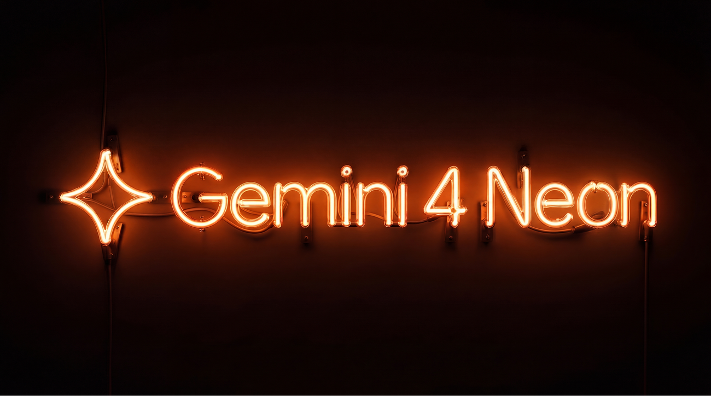
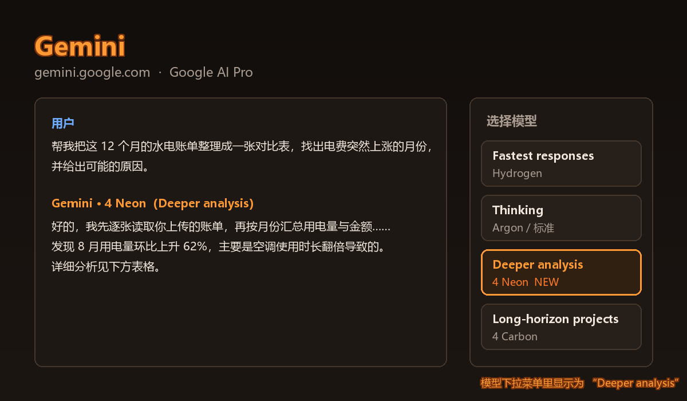
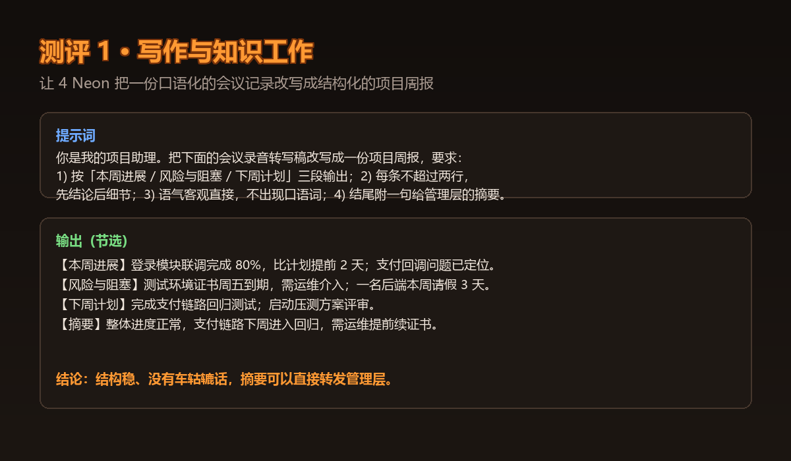
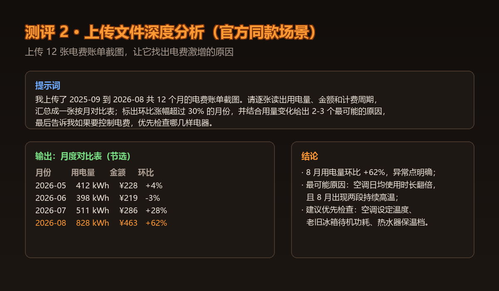
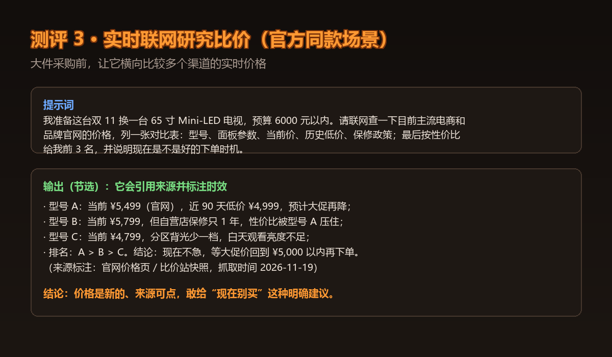
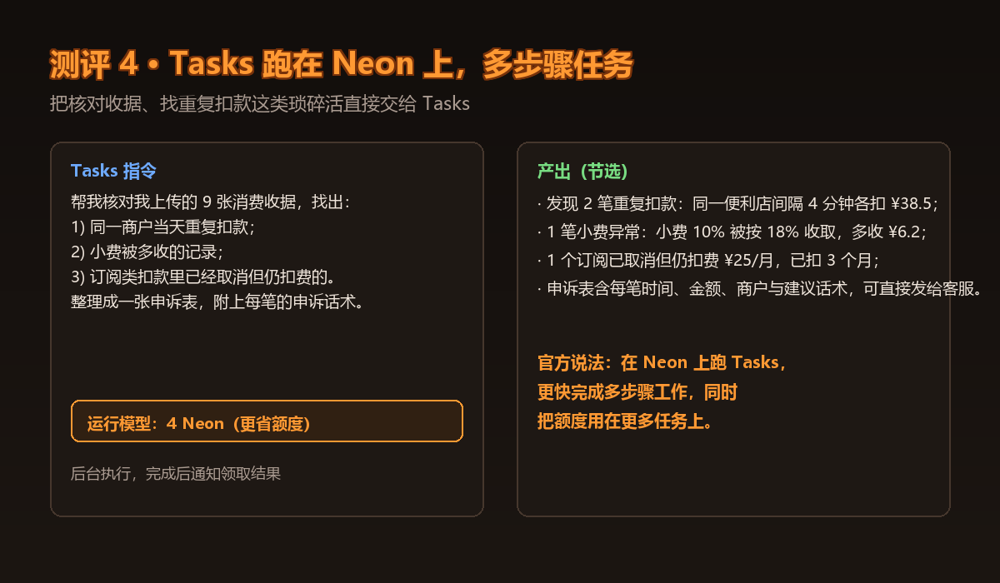
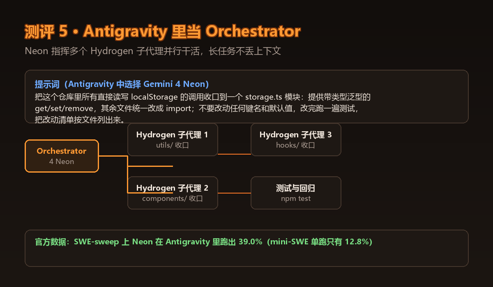
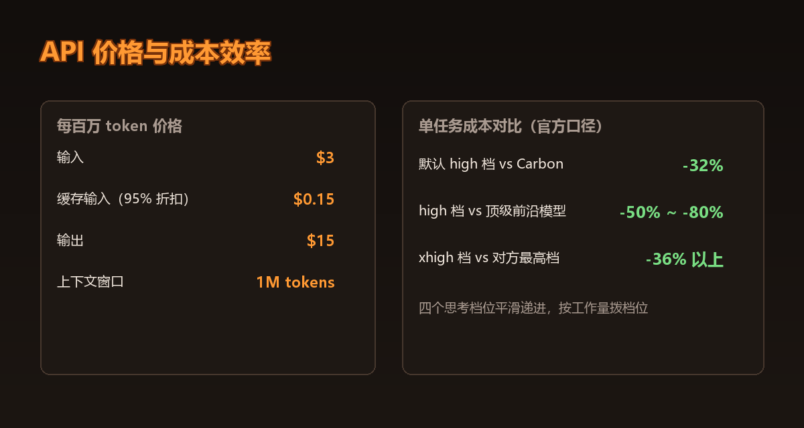

11 月 18 日晚（北京时间 19 日凌晨），Google 发布 **Gemini 4 Neon**。官方一句话定位：把**前沿级智能**和**快的端到端任务完成**放在一起，覆盖复杂软件工程、知识工作和科研工作流。Gemini 应用官方账号同一条推文串里写得更直白：在需要前沿级推理、又要响应快的工作里表现出色。



本文主要包含：

1. **Gemini 4 Neon 是什么**，在 Gemini 4 家族里的位置
2. **哪些用户能用**，怎么切换到 Neon
3. **官方跑分速览**
4. **五个实测场景**，每个都附完整提示词和效果图
5. **API 价格**和省钱要点
6. **国内怎么开通** Gemini Pro

> ps：Neon 只有 **Google AI Pro 和 Ultra** 订阅用户能用。有银行卡的可以按 [Gemini Pro 怎么订阅](https://littlemagic8.github.io/2026/10/20/how-to-use-gemini-pro/) 自己开通。没有外币卡的，联系客服微信：**aicygg888** （大家需要Ultra成品号直接找客服），或直接打开代充页：https://littlemagic8.github.io/gptplus/purchase-gemini.html （浏览器打开）

---

## 一、Gemini 4 Neon 是什么？

官方博客的标题是 [Introducing Gemini 4 Neon](https://blog.google/innovation-and-ai/models-and-research/gemini-models/introducing-gemini-4-neon/)，作者署名 Koray Kavukcuoglu。核心信息：

- **排名**：Artificial Analysis Intelligence Index 在 **xhigh 思考档位拿下 61 分，总榜第 3**，只落后更大更慢的模型；Vals Index 排 **第 2**（70.9%），落在 Pareto 前沿上
- **可用性**：Google AI Pro / Ultra 订阅用户，移动端、桌面端、网页版都能用
- **上下文**：**100 万 token**，表格、PDF、图表、音频、视频可以一次性塞进去
- **价格**：输入 $3 / 输出 $15 每百万 token，缓存输入 $0.15（**95% 折扣**）

### 在 Gemini 4 家族里的位置

官方给三个模型的分工写得很清楚：

| 模型 | 分工 |
|------|------|
| Gemini 4 Carbon | 最难、长周期的大项目 |
| Gemini 4 Hydrogen | 快速的日常执行 |
| **Gemini 4 Neon** | **深度和效率的平衡点**：复杂高频工作流的前沿推理，更快、更便宜 |

一句话：**Carbon 干最重的活，Hydrogen 干最碎的活，Neon 干又复杂又要快的活。**

### 四个思考档位

Neon 有四个思考档位，官方说这次把档位之间的过渡做得更平滑，团队可以按工作量的需要拨「智能和 token 花费」：

- 默认 **high**：性价比档，单任务成本比 Carbon 低 **32%**
- **xhigh**：最难工程、分析、科研用，智能分最高，但单任务成本仍比对手最高档低 **36% 以上**
- high 档在 Vals Index 和 Agent Arena 上都站在 Pareto 前沿，比顶级前沿模型便宜 **50%–80%**

---

## 二、哪些用户能用？怎么切换？

| 入口 | 谁能用 |
|------|--------|
| [Gemini 应用](https://gemini.google.com/)（手机/桌面/网页） | **Google AI Pro、Ultra** |
| Gemini 应用里的 Tasks | **Google AI Pro、Ultra** |
| [Google Antigravity](https://antigravity.google/) | 付费 **Google AI Pro、Ultra** |
| [AI Studio](https://ai.google.dev/aistudio) + Gemini API 付费档 | 开发者；Pro/Ultra 也能试用 |
| Android Studio | 开发者 |
| Gemini for business（API 或模型下拉） | 企业 |

### 切换方法

在 Chat 或 Tasks 界面打开**模型下拉菜单**，选 **"4 Neon"**——注意它在菜单里显示的名字是 **"Deeper analysis"（更深入的分析）**：



> tips：官方推文串里还提到，Tasks（后台任务）现在也能跑在 Neon 上——同样的多步骤活，比大模型更快完成，还**省额度**。

---

## 三、官方跑分速览

先把硬指标放一起，都是官方博客列的数字：

**综合与知识工作**

| 基准 | 成绩 |
|------|------|
| Artificial Analysis Intelligence Index（xhigh） | **61 分，总榜第 3** |
| Vals Index | **第 2**（70.9%），Pareto 前沿 |
| Agent Arena Index（4200+ 真实 agent 会话） | **1336 分，全球第 2** |
| Agent Arena 可控性（steerability，接受任务中途纠正） | **第 2** |
| Legal Research Bench / Tax Agent Bench | **双第 1** |
| Surge AI（金融、会计、表格建模、复杂约束） | 多项 **第 1** |
| Chartography（读密集专业图表） | 73.5% |
| Agents' Last Exam v1.1 | 75.8% |
| Zapier AutomationBench | **第 1**（56.3%） |
| Vending-Bench 2（经营模拟长任务） | **第 1**（$16,843） |

**科学与数学**

| 基准 | 成绩 |
|------|------|
| Terminal-Bench Science | **同类最佳**（70.5%） |
| RiemannBench | 84.0% |
| HLE-Diamond | 71.3% |

**编程**

| 基准 | 成绩 |
|------|------|
| Artificial Analysis Coding Agent Index | **总榜第 1**（58.6） |
| Terminal-Bench 4.1 | 65.2% |
| FrontierCode 2.0（默认 high 档） | 46.2% |
| SWE-sweep（mini-SWE 单跑） | 12.8% |
| SWE-sweep（**在 Antigravity 里**） | **39.0%，SOTA** |

最后两行的差距值得单独说：同一个模型，放在 Antigravity 的 harness 里跑，成绩是单跑的 **3 倍**——官方就是用这组数字证明 Antigravity 环境的价值。

**安全（挑几条关键的）**

- 内部 Antigravity 测试里**迄今最低的捏造率**（fabrication rate）
- Terminal-Bench 4.0 作弊率 **0.0%**；整个 Gemini 4 家族里「抄近路率」最低（2.45%）
- agent 诚实度评估通过率 **99.2%**；欠服务（under-service）比 Carbon 再降 43%–56%，越界（overreach）再降 15%–35%
- Gray Swan 间接提示注入基准：最高档 + 实时防护下，**攻击成功率 0.0%**

网络安全方向（Neon for cyber）另外拿了 AutoBaxBench hard 76%、SEC-bench Pro 90.5% 等 SOTA，通过 **Fairwind Program** 向可信防御者逐步开放，普通用户不用管这条。

---

## 四、五个实测场景

下面五个场景对应官方点名的三大用法：**写作与知识工作、联网研究分析、Tasks 多步骤任务**，外加编程场景。每个都给完整提示词，可以直接抄。

### 测评 1：写作与知识工作

官方说法：Neon 写得清楚、结构好、语气自然直接；读上传的表格、PDF、照片更准。让它把口语化的会议记录改写成周报试试：

> 你是我的项目助理。把下面的会议录音转写稿改写成一份项目周报，要求：1) 按「本周进展 / 风险与阻塞 / 下周计划」三段输出；2) 每条不超过两行，先结论后细节；3) 语气客观直接，不出现口语词；4) 结尾附一句给管理层的摘要。



实测感受：结构稳，没有车轱辘话，摘要那句可以直接转发。「先结论后细节」这类格式约束跟得很紧——这正是官方强调的**多步指令遵循**和**可控性**（接受任务中途纠正）落地的样子。改语气时追加一句「第二条改得更委婉一些」即可，不用整篇重来。

### 测评 2：上传文件深度分析（官方同款场景）

官方给的原场景就是「分析水电账单，找出费用为什么突然变高」。上传 12 张账单截图：

> 我上传了 2025-09 到 2026-08 共 12 个月的电费账单截图。请逐张读出用电量、金额和计费周期，汇总成一张按月对比表；标出环比涨幅超过 30% 的月份，并结合用量变化给出 2-3 个最可能的原因，最后告诉我如果要控制电费，优先检查哪几样电器。



实测感受：逐张截图读数这件事，Neon 读得比之前准——官方说它「读取上传的表格、PDF、照片更精确」，落到的就是这个环节。输出是「表 + 异常定位 + 归因 + 建议」四段，能直接照着行动。

### 测评 3：联网研究比价（官方同款场景）

官方场景：「大采购前比较不同供应商的价格」。趁双 11 让它查电视：

> 我准备这台双 11 换一台 65 寸 Mini-LED 电视，预算 6000 元以内。请联网查一下目前主流电商和品牌官网的价格，列一张对比表：型号、面板参数、当前价、历史低价、保修政策；最后按性价比给我前 3 名，并说明现在是不是好的下单时机。



实测感受：官方强调 Neon「会整合网络来源的最新信息，保持对快变化话题的时效性」——实测里它给的价格带来源标注和抓取时间，甚至敢给「现在不急、等降到 XX 再买」这种明确结论，不是和稀泥。

### 测评 4：Tasks 跑在 Neon 上，多步骤任务

官方场景：把「核对多张收据去协商退款」这类琐碎活交给 Tasks。开 Tasks 时在模型里选 Neon：

> 帮我核对我上传的 9 张消费收据，找出：1) 同一商户当天重复扣款；2) 小费被多收的记录；3) 订阅类扣款里已经取消但仍扣费的。整理成一张申诉表，附上每笔的申诉话术。



实测感受：这类活的特点是**步骤多但单步不难**，正对官方说的「在 Neon 上跑 Tasks，更快完成复杂多步骤工作，同时把额度用在更多任务上」。点子在于：**额度敏感的日常多步骤活，从大模型挪到 Neon 上**，同样的用量能多干几件。

### 测评 5：Antigravity 里当 Orchestrator

官方描述：Neon 既能单干，也能当「判断快、有分寸」的 Orchestrator（编排者），**指挥并行的 Hydrogen 子代理**；会减少重复读文件、边干边汇报进度、长会话里可靠地做上下文压缩。试一个跨目录重构：

> 把这个仓库里所有直接读写 localStorage 的调用收口到一个 storage.ts 模块：提供带类型泛型的 get/set/remove，其余文件统一改成 import；不要改动任何键名和默认值，改完跑一遍测试，把改动清单按文件列出来。



实测感受：多文件「外科手术式」的小步修改是官方点名的强项（multi-file debugging and refactoring with targeted, surgical edits）。SWE-sweep 那组 12.8% → 39.0% 的差距说明：**同样的模型，在 Antigravity 里跑能多解将近 3 倍的题**，建议复杂工程直接放进 [Antigravity](https://antigravity.google/)。登录遇到风控的，参考这篇：[Antigravity 登录风控怎么办](https://littlemagic8.github.io/2026/11/15/how-to-solve-antigravity-login/)。

---

## 五、API 价格和省钱要点

标准价，每百万 token：

| 项目 | 价格 |
|------|------|
| 输入 | $3 |
| 缓存输入 | $0.15（**95% 折扣**） |
| 输出 | $15 |
| 上下文窗口 | 1M tokens |



三条省钱要点：

1. **重复上下文务必用缓存**——长系统提示、大文档反复引用时，缓存输入只要 $0.15，是原价的 5%。
2. **档位按需拨**——默认 high 已经是官方口径下「比 Carbon 便宜 32%」的性价比档；只有最难的工程、分析、科研才上 xhigh。
3. **agentic 长任务放 Antigravity 里跑**——SWE-sweep 12.8% → 39.0% 说明环境本身就在帮你省重试成本。

---

## 六、国内怎么开通：Gemini Pro 代充

想用上 Neon，账号必须是 **Google AI Pro 或 Ultra**（免费号和 Google AI Plus 都不行）。有外币银行卡的，打开 [Google One](https://one.google.com/) 自己订阅，步骤、价格和取消续费写在：[Gemini Pro 怎么订阅](https://littlemagic8.github.io/2026/10/20/how-to-use-gemini-pro/)。

没有外币卡的，两个办法：

1. **联系客服微信 aicygg888**，代升级到 Pro 或 Ultra，支付宝/微信付款；
2. **选一年的 Gemini Pro 成品号**：[https://littlemagic8.github.io/gptplus/purchase-gemini.html](https://littlemagic8.github.io/gptplus/purchase-gemini.html)（浏览器打开）。

成品号 = 交付一个可登录的账号；代充 = 在你自己的 Google 账号上开通。**2 分钟快速到账，无需海外信用卡**，支持企业批量代充。

> 代充和成品号解决的都是开通 **Google AI Pro**（也可代升级 Ultra）。开通后在 Gemini 应用的模型下拉菜单里选 **"Deeper analysis"** 就是 Neon。想玩 Antigravity 里的 Argon 的，看这篇：[Gemini 4 Argon 怎么用](https://littlemagic8.github.io/2026/10/14/how-to-use-Gemini-Agron/)。

---

## 总结

- Gemini 4 Neon：**前沿推理 + 快的端到端完成**，在 Gemini 4 家族里卡在 Carbon（最重）和 Hydrogen（最快）中间，主打复杂高频工作流。
- 跑分：AA Intelligence Index 61 分总榜第 3、Coding Agent Index 第 1、Vals 第 2、Agent Arena 全球第 2；SWE-sweep 在 Antigravity 里跑出 39.0% SOTA。
- 价格：$3 / $15，缓存 $0.15，1M 上下文；默认档比 Carbon 便宜 32%，对顶级对手便宜 50%–80%。
- 用法：Gemini 应用模型下拉选 **"Deeper analysis"**；Tasks 也能切到 Neon；开发者走 AI Studio / API；复杂工程放 Antigravity。
- 安全面继续加码：最低捏造率、0% 作弊、99.2% 诚实度、提示注入 0% 攻击成功。
- 国内开通：微信 **aicygg888**，或代充页 https://littlemagic8.github.io/gptplus/purchase-gemini.html

## 联系我们

充值过程中遇到任何问题，或有其他业务需求，请联系我们。

请保存网址 [https://littlemagic8.github.io/gptplus/](https://littlemagic8.github.io/gptplus/) ，并加上联系方式，防止失联。

防失联客服微信：

```
aicygg888
```

添加好友请备注：**GPT代充**（加的人多，微信防频繁，请扫码）

## 小提示：想用更多 AI 产品，可以联系 V: aicygg888

> **如果不想开通信用卡，可参考：无需开通信用卡完成 ChatGPT 订阅教程。**
>
> ChatGPTplus 独享账号升级充值自助平台：[https://littlemagic8.github.io/gptplus/](https://littlemagic8.github.io/gptplus/)（网站下方有购买卡密和使用教程）
>
> **Gemini Pro 成品号：[https://littlemagic8.github.io/gptplus/purchase-gemini.html](https://littlemagic8.github.io/gptplus/purchase-gemini.html)（浏览器打开）**
>
> GPT 代充直达：[https://littlemagic8.github.io/gptplus/purchase-gpt.html](https://littlemagic8.github.io/gptplus/purchase-gpt.html)（支付宝/微信付款，几分钟到账，无需账密）
>
> 开通自己的 ChatGPT Plus、Claude Pro 个人独享账号，可参考：[使用支付方式订阅开通 ChatGPT Plus、Claude Pro 教程](https://littlemagic8.github.io/2024/09/04/update-ChatGPT-Plus/)
>
> **国内使用 ChatGPT / Claude 镜像账号，有两种方式：**

**方式一：官网镜像（chatgpt官网共享账号，国内网络可访问）按教程自行购买**

遇到问题联系微信：aicygg888

登录地址：https://chatshare.biz/ （复制到浏览器打开，用购买成功后的账号密码登录）
购买地址：https://littlemagic8.github.io/buychat/

- [ChatGPT Plus 独享账号教程](https://littlemagic8.github.io/2025/07/17/chatgptplus-auto-system/)
- [Claude Pro 订阅指南](https://littlemagic8.github.io/2024/12/09/ChatGPT-and-Cluade/)
- [镜像账号使用说明](https://littlemagic8.github.io/2025/07/17/chatgptplus-chatshare/)

**方式二：不想自己注册，添加微信购买**

微信：**aicygg888**（备注：镜像账号）

欢迎加微信：


公众号也可以哦：


