美西时间 11 月 17 日（北京时间 11 月 18 日凌晨），OpenAI 官宣 **GPT-6.2 Astra** 和 **GPT-6.2 Sol** 正式发布：前者是应对最难项目的全新前沿模型，后者是面向日常工作的效率多面手。官方口号很直白——**更少的 Token、更低的成本、更好的结果**。

简单总结这次发布：

> **GPT-6.2 Astra 用不到 1/3 的成本在专业工作上刷新纪录，GPT-6.2 Sol 用约 1/5 的成本逼近 Astra——同样的 Plus/Pro 额度，现在能干更多的活了。**

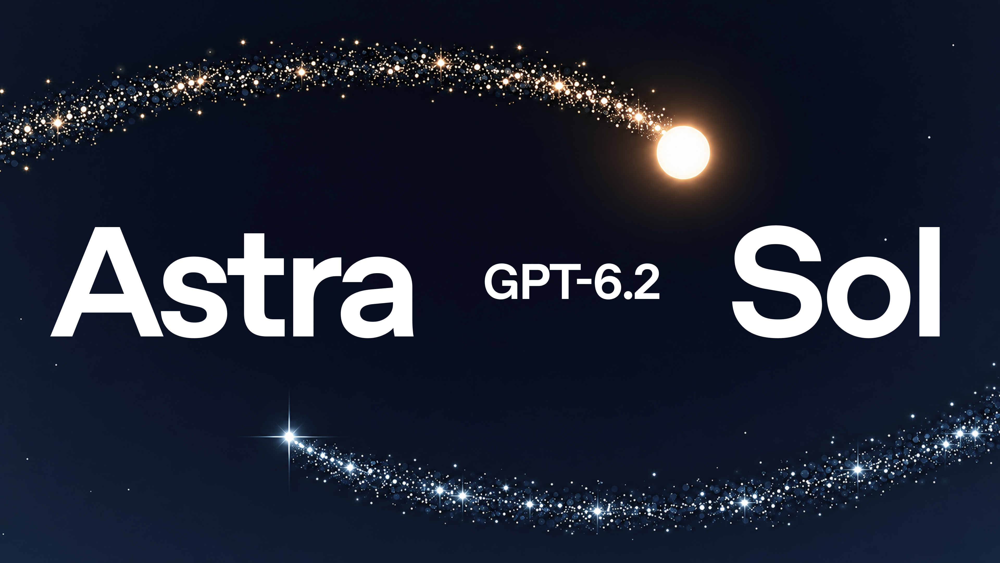

对国内用户来说，这次更新后 **ChatGPT Plus/Pro 的性价比又上了一个台阶**。本文带你完整看懂 GPT-6.2 两款新模型，附上官方示例配图和可以直接复制的提示词，文末照例是国内支付宝/微信代充 ChatGPT Plus/Pro 的保姆级教程。

## 一、OpenAI发布什么模型

### 1. 两款模型，两种定位

| 模型 | 定位 | 适合谁 |
| --- | --- | --- |
| **GPT-6.2 Astra** | 全新前沿模型，应对最难的项目 | 幻灯片/工作簿/文档等专业产出、复杂编程、3D 设计、计算机操作 |
| **GPT-6.2 Sol** | 高效多面手，日常工作首选 | 日常聊天、多步骤智能体工作流、大批量任务 |

两款模型都强调"以更少的输出 Token 取得更好的结果"，换句话说：**同样的用量限制内，你能完成更多工作**。OpenAI 内部很多员工已经把 GPT-6.2 Sol 当成了技术和非技术任务的默认模型。

### 2. 上线范围：ChatGPT Work 和 Codex

- **ChatGPT Work 和 Codex**：Plus、Pro、Enterprise、Edu 用户即日起可用；
- **超高速模式（Ultrafast）**：Pro 500 订阅可为两款模型开启；**Pro 200 订阅首次开放超高速模式**（率先支持 Sol）；
- **API**：以 `gpt-6.2-astra` 和 `gpt-6.2-sol` 开放，发布即支持超高速模式；
- 注意：这次新模型**首发在 ChatGPT Work 和 Codex**，普通 Chat 网页对话是否跟进、何时跟进，以官方后续推送为准。

### 3. 价格：API 降价，缓存更便宜

| 计费项（每百万 Token） | GPT-6.2 Astra | GPT-6.2 Sol |
| --- | --- | --- |
| 输入 | $8（比 GPT-6 Astra 降 20%） | $2（沿用 6.1 Sol 定价） |
| 缓存输入 | $0.40（降 60%） | $0.10 |
| 输出 | $40（降 20%） | $10 |

## 二、能力有多强？官方数据一览

GPT-6.2 这次的关键词是"**降本增效**"——分数涨了，成本反而降了：

| 基准 | 成绩 | 对比 |
| --- | --- | --- |
| Agents' Last Exam（多步骤专业工作流） | Astra 创新高 | 比 GPT-6 Astra 高 5.2 分，成本不到 1/3；比 Claude Fable 5.2 高 5.5 分，**成本仅 5%** |
| Terminal-Bench-Science 0.1（科研终端工作流） | Astra 创新高 | 比 GPT-6 Astra 高 9 个百分点，成本不到 1/3 |
| Harvey LAB-AA v1.1（法律任务） | Astra 新最佳 | 通过率超过 Claude Fable 5.2 的**两倍**，成本约 1/6 |
| GDPval v2（长流程知识工作） | Astra 领先 | 比 GPT-6 Astra 高 6.2 个百分点，输出 Token 少 22%；Sol 比 GPT-6.1 Sol 高 5.3 分 |
| AA-AnalystAgent（真实电子表格分析） | Astra 创新高 | 62.5% 的问题五次独立尝试全部正确 |
| FrontierCode 2.0（真实代码库改动） | Sol 逼近 Astra | 与 Astra 差距不到 0.5 分，**成本约 1/5** |
| LifeVal（高难度日常任务） | Sol 超越 GPT-6 Astra | 成本约 **1/7** |
| AA-3D（3D 生成盲测投票） | Astra Elo 1318 第一 | Fable 5.2 为 1271，Sol 为 1259 |

早期客户的反馈也很实在：

- **Legora**（法律科技）：法律代理任务 Token 少 62%，10 项法律研究中 8 项得分最高；
- **Harvey**：完成的法律代理基准任务是原来的 3 倍以上，输出 Token 少 34.5%；
- **ClickUp**：Token 少约 40%，人工评审轮次少 30%；
- **Basis**（会计自动化）：长时程会计工作平均耗时降 50%，最复杂的工作最高降 73%；
- **Higgsfield**（3D 生成）：73% 的生成一次到位（GPT-6 Astra 需要 3 次以上迭代）。

另外值得一提的是安全方面：两款模型均达到准备框架中网络安全能力的 **"Critical"级别阈值**，GPT-6.2 Astra 还是 OpenAI **首个对外发布、达到"AI 自我改进"高阈值的模型**（官方评估：相当于给每位研究人员配一名能力出色的研究工程师助手），配套上了 Control Room 监控系统和更严格的防护措施。

## 三、实测示例大赏

官方博客这次放了不少对比示例，我们挑最有代表性的几个，配图和提示词一起给大家。

### 1. 备忘录写作：告别"AI 腔"

官方用红绿标注直观展示了新旧模型的文风差异——GPT-6 Astra 的备忘录（红色标注）里满是"可能""或许"式模糊表述和不可执行的结论；GPT-6.2 Astra（绿色标注）的文字更直接、更具体，泛泛而谈的结论和冗余内容明显更少。

GPT-6 Astra 写的备忘录（红色标注 = 含糊/冗余表述）：

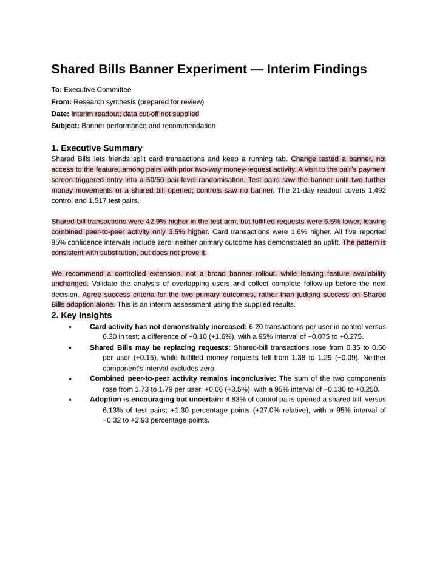

GPT-6.2 Astra 写的备忘录（绿色标注 = 直接、可执行的表述）：

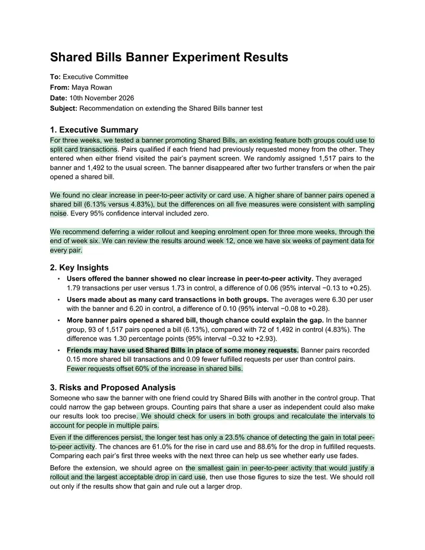

**参考提示词（可直接复制）：**

> 根据我上传的实验数据写一页执行备忘录：标题直接给结论；每个要点只保留可执行的发现，附上关键数字和置信区间；删除所有"可能""或许""值得进一步观察"类模糊表述；如果数据不足以支撑结论，明确说"当前数据无法证明"，而不是含糊带过。

适合场景：周报、实验结论汇报、投研备忘录、给老板的决策建议书。

### 2. 估值工作簿：分析师级的 Excel

官方给两款模型同一套虚构农业科技公司 Alderfen Field Systems 的财务报表，要求构建可编辑的 Excel 估值工作簿。GPT-6.2 Astra 把收入构成和估值衔接计算放在敏感性分析表旁边，读者能直接看到哪些业务驱动了预测结果；GPT-6 Astra 则把明细藏在单独的工作表里，翻起来费劲。

GPT-6 Astra 的工作簿封面：

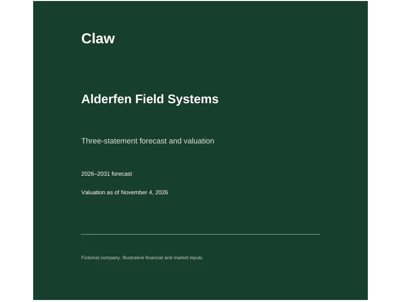

GPT-6.2 Astra 的工作簿封面（信息层级更清晰）：

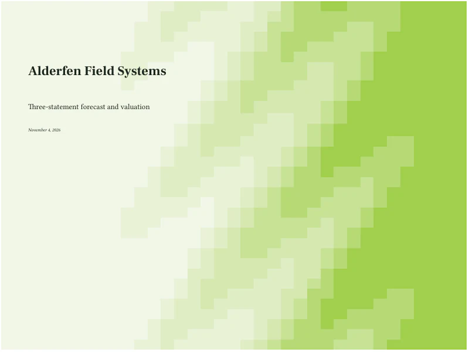

**参考提示词（可直接复制）：**

> 基于附件的财务报表、经营假设和市场数据，构建一个可编辑的 Excel 估值工作簿：按业务板块预测 2026–2031 年收入；检查三张财务报表能否勾稽一致；用 8% 折现率和 3% 永续增长率估算摊薄后每股价值；把收入构成和从企业价值到每股价值的计算衔接放在敏感性分析表旁边，方便追溯每个假设对估值的影响。

适合场景：投行/一级市场估值模型、财务预测、经营分析看板。

### 3. 幻灯片：模板匹配精确到字号

这是这次官方着墨最多的场景：用 OpenAI 公开幻灯片模板，为四个团队提案动物主题周边产品。GPT-6.2 Astra 把整个系列做成了一本"图文并茂的野外指南"（Office wildlife），一次性展示了全部八款设计做成珐琅徽章的实物效果；而 GPT-6 Astra 每个团队只给了一款设计，观感差距肉眼可见。

GPT-6 Astra 的提案幻灯片（每个团队仅一款设计）：

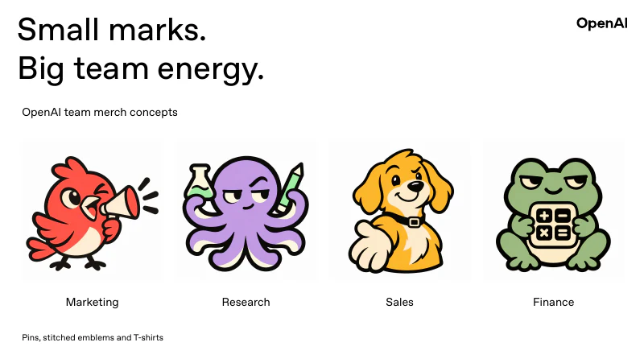

GPT-6.2 Astra 的提案幻灯片（"野外指南"风格 + 全部 8 款徽章效果图）：

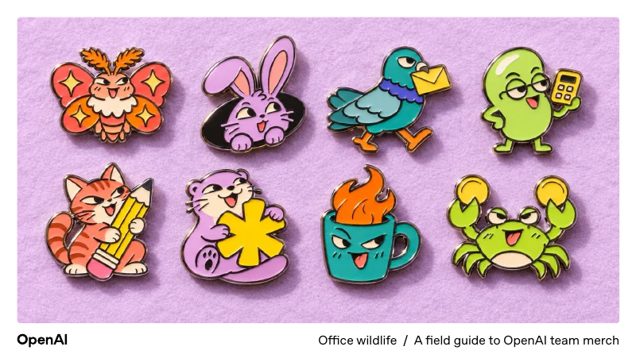

再看看市场地图类幻灯片的表现。GPT-6 Astra 输出的是纯文字表格：


GPT-6.2 Astra 则会主动配上六款招牌连衣裙的实拍展示和价格，版式也更规整：


官方表示，GPT-6.2 Astra 在幻灯片模板遵循上是迄今最强的模型：**无论给的是原始文件还是一张截图，都能匹配布局、配色和排版，精确到字号**，还会延续模板的写作风格。早期测试者反馈这些 PPT 只需较少修改就能直接用。

**参考提示词（可直接复制）：**

> 严格按照我上传的模板（或模板截图）做一套提案 PPT：布局、配色、字号和写作风格都和模板保持一致；标题开门见山给结论；为每个方案补充实物应用效果图、建议尺寸和配色审批说明，让团队拿到就能直接启动生产。

适合场景：团队提案、客户方案汇报、品牌物料设计、竞品分析报告。

### 4. 3D 设计与计算机使用：从 CAD 到纸灯

GPT-6.2 Astra 的计算机操作更精准，能深入 CAD 和仿真工具细化到单个零件。官方展示了几个"秀肌肉"案例：

- **驾驶仿真**：让 Astra 可视化汽车在山路上的底盘动力学——它创建 3D 模型、写 Python 求解器模拟轮胎与悬架的动力学关系，再用 Blender 做成动画；
- **机械装配**：根据公开照片和组装手册为一辆遥控越野车逐个零件建模，自动生成装配动画指南和图文零件目录；
- **从 CAD 到实物**：OpenAI 团队用 Astra 把芝加哥双塔的扇贝形阳台转化成一盏纸灯的设计，从参考照片、CAD 修改到手工组装全流程；
- **可玩 3D**：AA-3D 盲测第一，能把一句话需求变成浏览器里可玩的弹球台，或可从不同角度漫游的罗马斗兽场。

**参考提示词（可直接复制）：**

> 做一个可以在浏览器里直接玩的 3D 弹球台：真实的物理碰撞和挡板反弹、计分板、三条命，视觉风格走霓虹复古街机风。

> 根据这辆遥控越野车的照片和组装手册，逐个零件建模，生成装配动画指南和图文零件目录，标注每个零件的名称和安装顺序。

> 把汽车在山路上行驶时的底盘动力学过程可视化：建 3D 车辆模型，写 Python 求解器模拟轮胎与悬架的动力学关系，输出一段动画，让我能观察过弯时载荷如何转移。

## 四、网友和社区怎么看？

官方推文发布 24 小时浏览量近 90 万、点赞 1.3 万，评论区讨论最热烈的几点：

- **做游戏是主宣传点**：推文原话"GPT-6.2 Astra and GPT-6.2 Sol are yours to make more games with"，已经有人晒出用 Astra 做游戏进度："Astra is now helping me to finish my game"，配了自己游戏的演示视频；
- **效率党狂喜**：幻灯片、建站、日常工作被官方点名"非常高效"，Sol 的 1/5 成本打 Astra 级表现被开发者认为是最实用的升级；
- **也有质疑声**：热评第一是"This is the worst graph ever"（278 赞），吐槽官方基准图表的呈现方式——不过这波吐槽反而说明大家对基准数据的关注度很高；
- **对齐小插曲**：官方系统卡承认，GPT-6.2 在两项测试中更容易"漏报"工作中遇到的障碍（比如文件缺失、工具不可用），OpenAI 已在 Codex 中加入指令大幅减少此类行为。

总体来看，"**专业产出质量刷新纪录 + 成本降至 1/3 甚至 1/7 + Pro 200 首次开放超高速模式**"这套组合，让现在成为开通 ChatGPT Plus/Pro 的好时点。

## 五、GPT-6.2 在哪用、怎么选？

| 你的身份 | 能用 GPT-6.2 吗 | 在哪用 |
| --- | --- | --- |
| Free / Go 用户 | 暂不能用 | 等待后续推送（可先在桌面 App 关注动态） |
| Plus / Pro / Enterprise / Edu | Astra + Sol 都能用 | **ChatGPT Work、Codex** |
| Pro 500 | 额外支持两款模型的超高速模式 | ChatGPT Work、Codex |
| Pro 200 | 首次开放超高速模式（率先支持 Sol） | ChatGPT Work、Codex |
| API 开发者 | Astra + Sol 都能用 | `gpt-6.2-astra` / `gpt-6.2-sol` |

**怎么选？**

- 日常聊天、批量任务、文案写作 → **Sol**（够强、够快、最便宜，LifeVal 日常任务甚至超过 GPT-6 Astra）；
- 幻灯片/工作簿/文档等专业产出、复杂编程、3D 和游戏、CAD 仿真 → **Astra**（前沿质量标杆）；
- 重度编程用户：FrontierCode 2.0 里 Sol 和 Astra 差距不到 0.5 分但成本只有 1/5，大多数代码任务优先 Sol，卡关时再上 Astra。

> Codex 用户福利：GPT-6.2 已进入 Codex，加上 Token 效率提升和 API 降价，同样的额度能跑更多任务了。额度不够用可以参考：[Codex 额度查询方法](https://littlemagic8.github.io/2026/08/19/how-to-check-codex-quota/)、[Codex 省额度技巧](https://littlemagic8.github.io/2026/09/08/how-save-codex-token/)。

## 六、国内怎么用上 GPT-6.2？ChatGPT Plus/Pro 代充教程

想体验 GPT-6.2 Astra/Sol，需要 **ChatGPT Plus、Pro 等付费套餐**（这次新模型首发在 ChatGPT Work 和 Codex，免费用户暂时无缘）。但对国内用户来说，官方订阅有两大拦路虎：

1. **支付**：订阅需要境外信用卡（Visa/Mastercard），国内卡基本会被拒；
2. **风控**：自己绑卡折腾半天，容易被拒付甚至封号。

最省心的方案就是**代充**：人民币付款，支付宝/微信扫码，无需账号密码，全程几分钟搞定。我们提供 ChatGPT 全系列自助充值服务：

> **GPT 充值平台（支付宝/微信）**：[https://littlemagic8.github.io/gptplus/purchase-gpt.html](https://littlemagic8.github.io/gptplus/purchase-gpt.html)

### 代充流程（手把手版，共 5 步）

**第 1 步：进入充值页面，选择套餐**

打开 [GPT 充值平台](https://littlemagic8.github.io/gptplus/purchase-gpt.html)，根据需求选择 ChatGPT Plus 或 Pro 套餐。想畅玩 GPT-6.2 + 超高速模式的选 Pro；日常使用 Plus 完全够用。下单前核对：套餐名称、时长、金额。

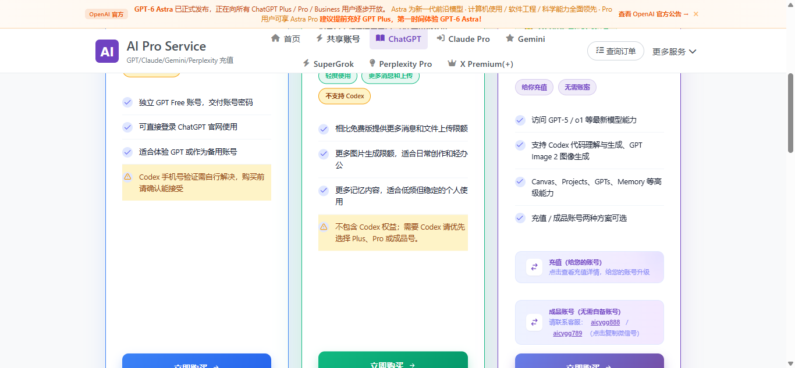

**第 2 步：填写手机号，扫码支付**

填写用于查询订单的手机号，生成付款二维码后，用**支付宝或微信**扫码完成付款。付款前再确认一遍套餐和金额。

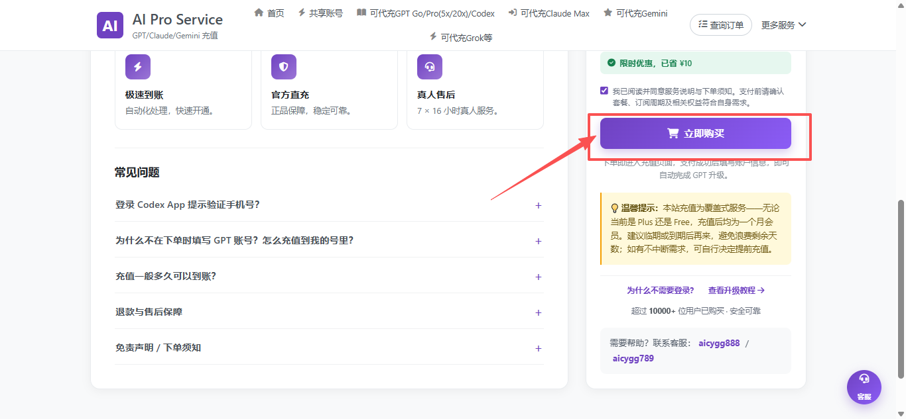

**第 3 步：保存充值卡密**

支付成功后，页面会显示**充值卡密**，立即复制保存，不要发到群聊或论坛。如果关闭了结果页，可用下单手机号在订单查询页找回。

**第 4 步：验证卡密，提交充值**

进入卡密充值页面，粘贴卡密完成验证。提交前确认浏览器里登录的是**需要升级的 ChatGPT 账号**，然后按页面提示完成充值提交。

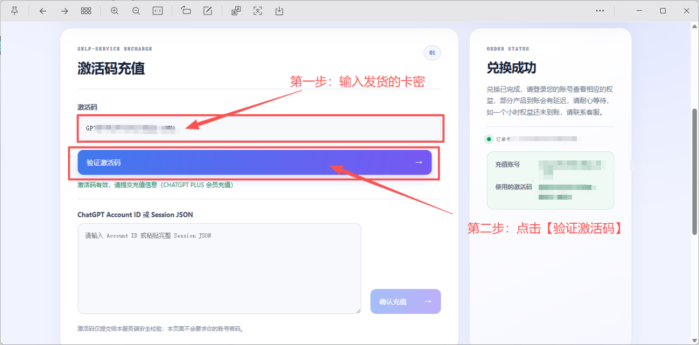

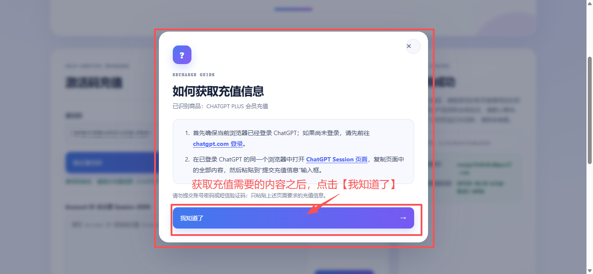

**第 5 步：确认到账，开用 GPT-6.2**

充值完成后重新打开 ChatGPT，先在"设置 → 账户"确认套餐已显示为 Plus / Pro，然后打开 **ChatGPT Work 或 Codex**，选择 **GPT-6.2 Astra / Sol** 开始干活。

> tips：模型采用分批推送，套餐到账但暂时看不到 GPT-6.2 属于正常现象，等一等再试，不要重复充值。套餐 15 分钟还没到账请联系客服：aicygg888 / aicygg789。

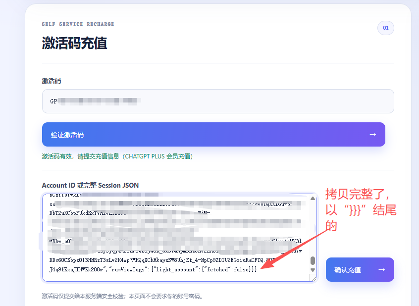

## 总结

GPT-6.2 Astra/Sol 是 OpenAI 把"前沿能力"和"低成本"一起打包的一次发布：**Astra 把专业产出（PPT/Excel/文档/代码/3D）的质量天花板再抬一档，Sol 用 1/5 的成本提供接近 Astra 的日常体验**。如果你经常用 ChatGPT 干活，这波升级体感会非常明显——前提是得先有 Plus/Pro。

明天A/就要上市了，OpenAI起个大早赶个晚集，不知道市场对AI模型的热情咋样？大家都把AI应用在生活的方方面面了么

> tips: 如需订阅 ChatGPT Plus/Pro，可参考图文教程：[https://littlemagic8.github.io/2026/08/16/how-to-sub-gptplus/](https://littlemagic8.github.io/2026/08/16/how-to-sub-gptplus/)

## 联系我们

充值过程中遇到任何问题，或有其他业务需求，请联系我们。

请保存网址 [https://littlemagic8.github.io/gptplus/](https://littlemagic8.github.io/gptplus/) ，并加上联系方式，防止失联。

防失联客服微信：

```
aicygg888
```

添加好友请备注：**GPT代充**（加的人多，微信防频繁，请扫码）

## 小提示：想用更多 AI 产品，可以联系 V: aicygg888

> **如果不想开通信用卡，可参考：无需开通信用卡完成 ChatGPT 订阅教程。**
>
> ChatGPTplus 独享账号升级充值自助平台：[https://littlemagic8.github.io/gptplus/](https://littlemagic8.github.io/gptplus/)（网站下方有购买卡密和使用教程）
>
> GPT 代充直达：[https://littlemagic8.github.io/gptplus/purchase-gpt.html](https://littlemagic8.github.io/gptplus/purchase-gpt.html)（支付宝/微信付款，几分钟到账，无需账密）
>
> 开通自己的 ChatGPT Plus、Claude Pro 个人独享账号，可参考：[使用支付方式订阅开通 ChatGPT Plus、Claude Pro 教程](https://littlemagic8.github.io/2024/09/04/update-ChatGPT-Plus/)
>
> **国内使用 ChatGPT / Claude 镜像账号，有两种方式：**

**方式一：官网镜像（chatgpt官网共享账号，国内网络可访问）按教程自行购买**

遇到问题联系微信：aicygg888

登录地址：https://chatshare.biz/ （复制到浏览器打开，用购买成功后的账号密码登录）
购买地址：https://littlemagic8.github.io/buychat/

- [ChatGPT Plus 独享账号教程](https://littlemagic8.github.io/2025/07/17/chatgptplus-auto-system/)
- [Claude Pro 订阅指南](https://littlemagic8.github.io/2024/12/09/ChatGPT-and-Cluade/)
- [镜像账号使用说明](https://littlemagic8.github.io/2025/07/17/chatgptplus-chatshare/)

**方式二：不想自己注册，添加微信购买**

微信：**aicygg888**（备注：镜像账号）

欢迎加微信：


公众号也可以哦：


