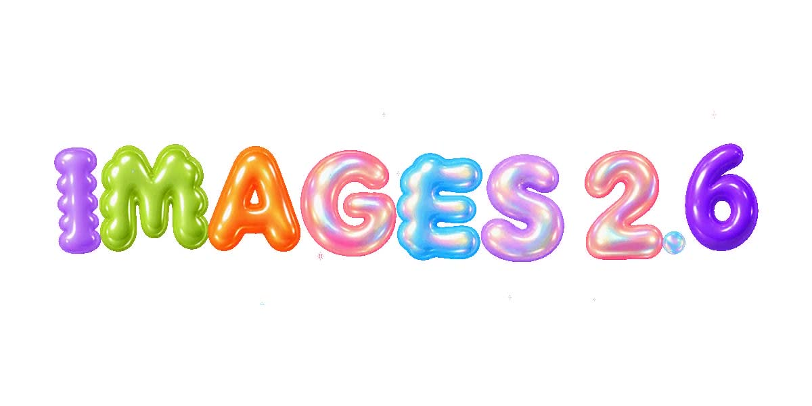
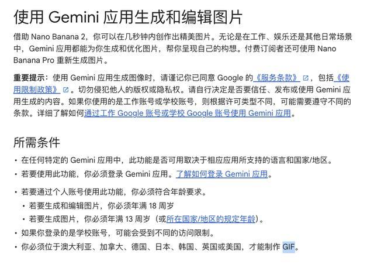
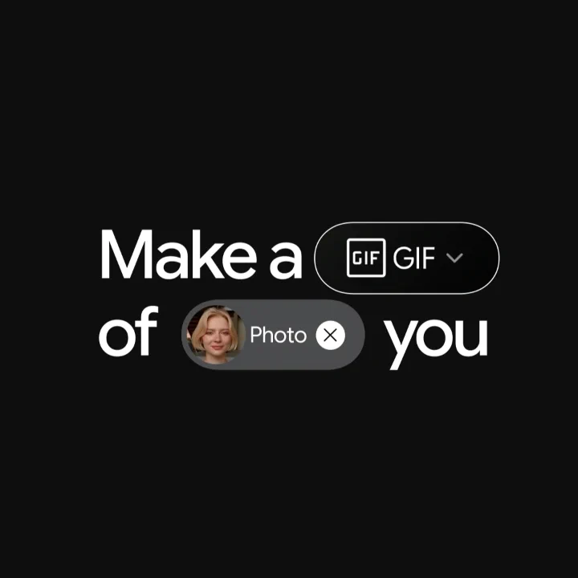
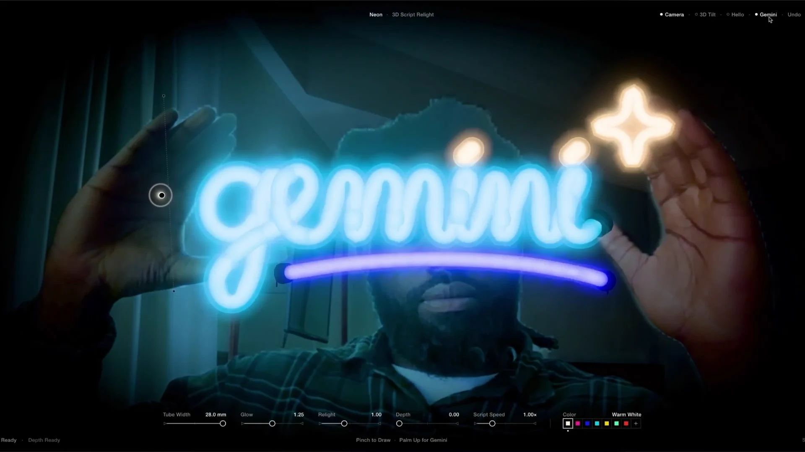
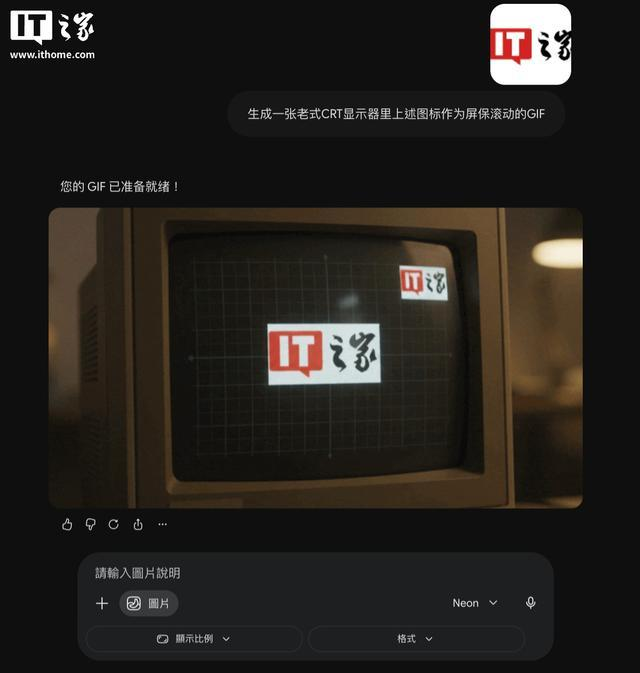
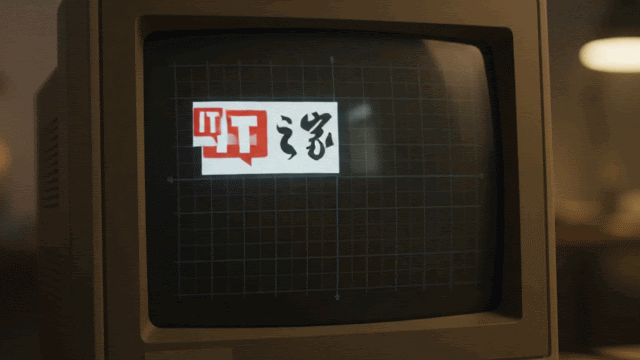
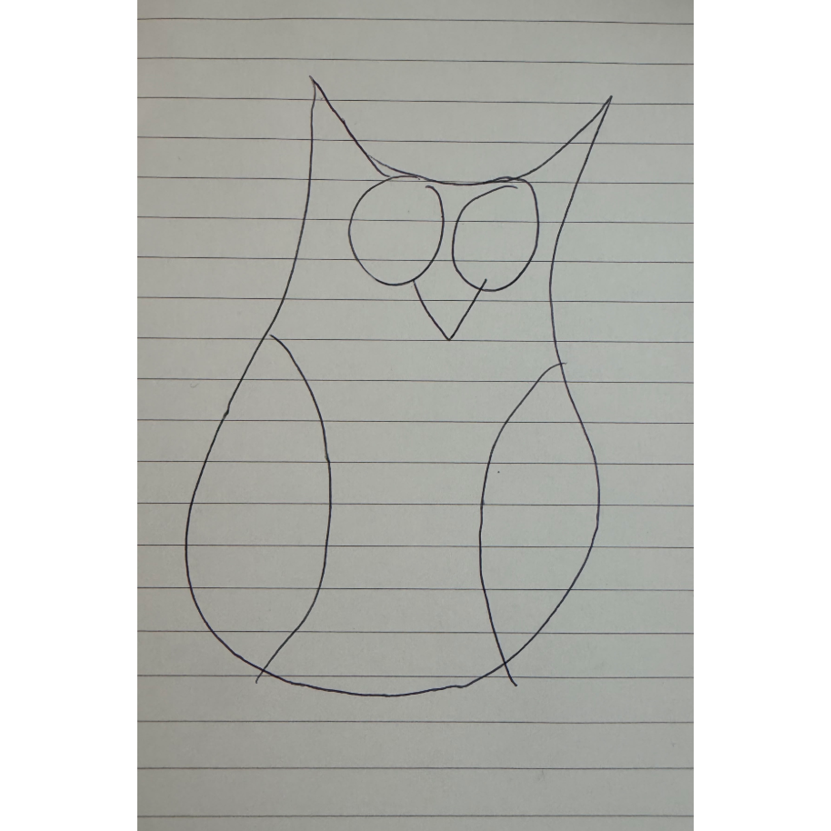
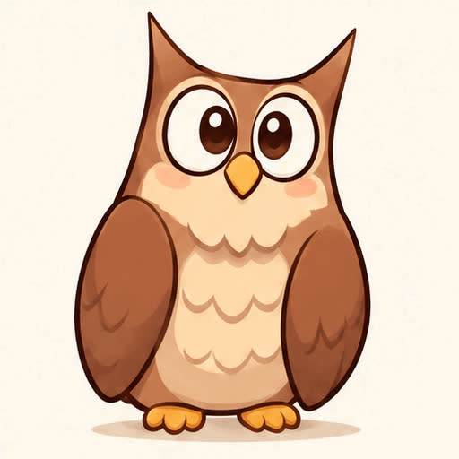
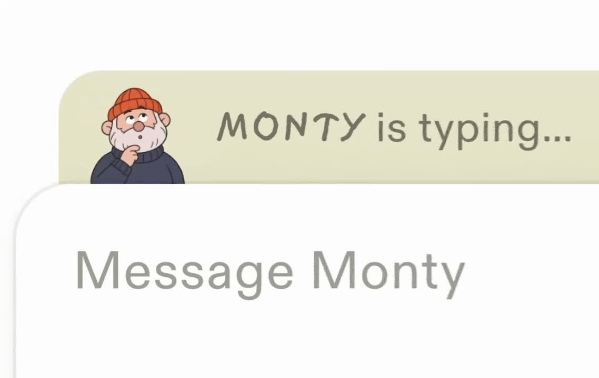
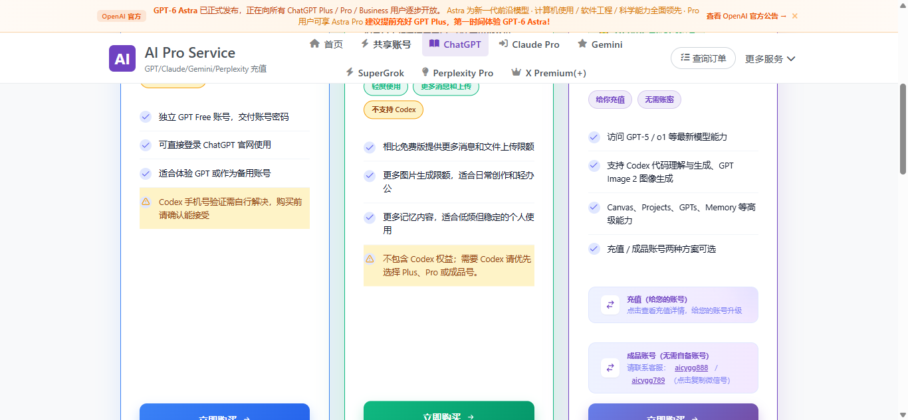

表情包、营销动图、照片循环特效……以前做一张能循环播放的 GIF，要么求设计师，要么在 Giphy/Tenor 里翻半天。11 月这两周，情况彻底变了：

- **11 月 4 日**，OpenAI 发布 **GPT-image-2.6（ChatGPT Images 2.6）**，ChatGPT 直接能一句话生成**循环 GIF 动图**，还能调速度、改单帧；
- **11 月 20 日**，Google 跟进官宣：**Gemini 应用也能做 GIF 了**，"Say hello to GIFs in Gemini. Say goodbye to searching for the perfect one."——底层是视频模型 **Gemini Omni 1.2 Flash**，官方强调"动作流畅、每一帧质量稳定"。



一句话总结这次"动图双雄会"：

> **GPT 走"图像模型直接出帧"路线，帧数、帧时长、循环节奏全都能控，还能接 API 批量生产；Gemini 走"视频模型转 GIF"路线，动作连贯不跳帧，默认效果更丝滑。做表情包、接工作流选前者，玩照片特效、要丝滑选后者。**

本文带你搞清楚：现在到底哪些 AI 能生成动图、两家 GIF 能力实测对比、可直接抄作业的提示词，以及国内怎么开通 ChatGPT Plus/Pro 和 Gemini Pro 把功能用起来~

## 一、当前哪些 AI 能生成动图？

先给一张总览表，现在"一句话直接出 GIF"的主流玩家就两家：

| 产品 | 上线时间 | 技术路线 | 谁能用 | 说明 |
| --- | --- | --- | --- | --- |
| **ChatGPT（Images 2.6）** | 2026-11-04 | 图像模型直接产出 GIF 帧 | 所有套餐（免费有限次） | 帧数 2–16 帧、每帧 20–2000ms 可调，涂鸦/照片都能变动图，API 可批量 |
| **Gemini 应用（GIF）** | 2026-11-20 | 视频模型 Omni 1.2 Flash 生成后转 GIF | Google AI 订阅用户全球推送中；美/日/韩/澳/加/英/德/法 8 国免费用户也能用；18+ | 文字、照片、视频都能做参考，约 3 秒循环，应用内直接复制/下载 |
| Nano Banana 2.1（Gemini 图像模型） | — | 仅静态图 | — | **不支持 GIF** |
| Grok Imagine、可灵、即梦等视频工具 | — | 生成视频 | 各家订阅 | 输出的是视频，要自己再转一次 GIF（多一步） |

**划重点：**

- ChatGPT 这边，Images 2.6 已向**所有套餐全球推送**（桌面/移动/网页），免费用户也能试，只是次数有限；
- Gemini 这边，GIF 功能向**所有 Google AI 订阅用户**开放（全球分批推送中）；在美国、日本、韩国、澳大利亚、加拿大、英国、德国、法国这 8 个地区，**免费用户也能直接用**；未满 18 周岁不可用；
- 玩法入口有两个：**主聊天框直接描述**，或在**图像/视频创建工具里选 GIF 格式**再描述动效，还有现成的表情包 GIF 模板可以套（IT之家实测截图见下文）。



## 二、路线之争：图像模型出帧 vs 视频模型转 GIF

两家的技术路线完全不同，这也直接决定了各自的优劣势。

### ChatGPT：图像模型"一帧一帧画出来"

GPT-image-2.6 本身是图像模型，生成 GIF 时直接规划 2–16 帧画面，末帧平滑衔接回首帧。API 里两个参数全开放：

| 参数 | 取值 | 默认值 |
| --- | --- | --- |
| `frame_count` | 2–16 帧 | 9 |
| `frame_duration_ms` | 每帧 20–2000 毫秒 | 200 |

也就是说，**循环多长、节奏多快，你说了算**：可以做 0.4 秒的鬼畜快闪，也可以做 16 帧 × 2 秒的慢速展示。配合参考图锚定（五官、品牌色不跑偏）和圈画标注编辑（指哪改哪），它更像一条"可控的动图生产线"。

### Gemini：视频模型"拍一段再变成 GIF"

Gemini 的 GIF 由最新的视频模型 **Gemini Omni 1.2 Flash** 驱动——先生成一段约 **3 秒**的视频，再转成无缝循环的 GIF。官方推文原话：

> From looping photo effects to funny memes, create any GIF you can imagine with our latest video model, Gemini Omni 1.2 Flash, for smooth motion and consistent quality across every frame.
> （从照片循环特效到搞笑梗图，用我们最新的视频模型 Gemini Omni 1.2 Flash，创建你能想到的任何 GIF——动作流畅、每一帧质量稳定。）

玩法上：**输入文字描述，或上传照片/视频作为参考**，即可生成动图；可以调整播放速度，生成后直接在应用内复制或下载。视频模型拍出来的动作天然连贯，不会像少帧 GIF 那样有"定格感"——这是这条路线的最大优势。



## 三、实测对比：同一组题目，两家怎么表现？

我们按国内用户最高频的三个场景出了三道题，综合官方样张和公开实测（科技博主"蚁工厂"第一时间对比了两家，结论：**Gemini 默认效果比 ChatGPT 更流畅、更完整，但人物形象还原度一般**；博主 Gorden_Sun 也提到 Gemini 的方案是"生成视频然后转成 GIF"，"效果会比 GPT 的好非常非常多，动作会很连贯不跳帧"），给大家一份可直接抄作业的对比。

### 题目一：打工人表情包动图（社区最火玩法）

**提示词（GPT 官方博客收录的 OpenArt 同款思路，可直接复制）：**

> 生成一张 6 帧无缝循环的 GIF 精灵图：Q 版上班族坐在工位盯着电脑，股价曲线先是微微上扬，他露出期待的微笑，然后曲线暴跌，他瞪大眼睛、崩溃大哭，最后抹着眼泪继续盯着屏幕。6 帧按 3 列 2 行排列，机位固定，人物、桌子、背景完全一致，可爱 3D 黏土风。


**结果对比：**

- **ChatGPT**：精灵图分镜的思路下，6 帧动作到位、表情夸张，末帧衔接首帧没压力；想改"跌了哭"为"涨了撒钱"，圈画+一句话就行；
- **Gemini**：约 3 秒的视频式循环**动作更连贯**，同一个梗图场景下 motion 更丝滑，但 chibi 人物的设定还原（发型、脸型一致性）不如 GPT 稳。

### 题目二：照片循环特效（Gemini 官方主打玩法）

**提示词（上传一张手指照片）：**

> 让一只粉色闪粉质感的蝴蝶缓缓落在我伸出的食指上，扇动两下翅膀，再飞走回到画面外，无缝循环，电影感浅景深。



**结果对比：**

- **Gemini**：视频模型的主场——蝴蝶起落、翅膀扇动全是一镜到底式的连贯动作，"照片活过来了"的观感最强，这也是官方主打的 looping photo effects 玩法；
- **ChatGPT**：上传同一张照片当参考图也能做，帧数拉到 16、帧时长调高后接近视频感，但极限动作流畅度还是略逊视频模型；优势是**生成后可以圈着改细节**（比如"蝴蝶换成红色"）。

### 加练题：Logo 循环动图（IT之家实测，成品 GIF 直接看）

**提示词（IT之家在 Gemini 应用里的实测，可直接复制）：**

> 生成一张老式 CRT 显示器里上述图标作为屏保滚动的 GIF

在主聊天框输入这句话，Gemini 稍等片刻就回复"您的 GIF 已准备就绪！"，直接给出可下载的成品动图——整个流程和普通对话一样，不需要切换任何专门工具：



生成结果就是下面这张真正的 GIF 动图（IT之家 Logo 在老式显示器里屏保式弹跳滚动，约 3 秒无缝循环）——动作连贯度和复古质感确实在线：



**结果对比：**这类"品牌 Logo + 复古场景"的循环动图，Gemini 一句话直接出成品，视频链路的运动质感（反光、景深、弹跳节奏）非常自然；ChatGPT 走精灵图分镜路线也能实现类似效果，且帧数节奏更可控，但运动细节的丰富度会略逊一筹。

### 题目三：涂鸦变动图 + 品牌吉祥物（生产力场景）

**提示词（GPT，上传手绘草图）：**

> （上传手绘草图）把我的涂鸦变成一张循环 GIF 动画：保持角色的造型特征，让它轻轻摇摆、眨眼，线条保持手绘质感，白色背景。






**结果对比：**

- **ChatGPT**：涂鸦秒变动图、API 里 `frame_count=9`、`frame_duration_ms=200` 生成 1.8 秒无缝循环，创业公司 Town 甚至用它在产品里做了"正在输入"的吉祥物动图 Monty——**从玩具到生产线的完整链路是它最大的护城河**；
- **Gemini**：这类"按帧交付"的活儿目前没有对等的 API，输出以应用内复制/下载为主，更适合个人创作场景。



### 实测结论总表

| 维度 | ChatGPT（Images 2.6） | Gemini（Omni 1.2 Flash GIF） |
| --- | --- | --- |
| 技术路线 | 图像模型直接出帧 | 视频模型生成后转 GIF |
| 循环长度 | 2–16 帧、每帧 20–2000ms，自由控制 | 约 3 秒固定循环 |
| 动作流畅度 | 帧少时有定格感，靠提示词技巧弥补 | **视频级连贯，实测更流畅完整** |
| 人物/角色还原 | **参考图锚定稳，五官品牌细节不跑偏** | 博主实测人物还原度一般 |
| 参考素材 | 照片、涂鸦、产品图 | 照片、视频（最多 1 视频+5 图片） |
| 后期编辑 | 圈画标注、多轮编辑一致性强 | 对话式多轮编辑（视频链路） |
| 播放速度 | 帧时长直接控制 | 应用内可调播放速度 |
| API 批量生产 | **有**（flare/sunburst） | 暂无 GIF 专用 API |
| 使用门槛 | 所有套餐可用（免费有限次） | 订阅用户全球推送中；美/日/韩/澳/加/英/德/法免费用户也能用；18+ |
| 获取方式 | 直接下载 | 应用内复制/下载 |

**一句话选购建议：**

- 做表情包、营销物料、电商动图，要**可控、可改、可批量** → **ChatGPT + GPT-image-2.6**；
- 玩照片循环特效、要**最丝滑的动作**，人不太挑还原度 → **Gemini GIF**；
- 小孩子才做选择，成年人当然是**两个都开**（文末有省心开通方案）。

## 四、国内怎么用上？ChatGPT Plus/Pro 与 Gemini Pro 代充教程

想在国内顺畅用上这两家的 GIF 功能，官方订阅有两大拦路虎：**没有境外信用卡付不了款**、**自己绑卡容易被风控拒付**。最省心的方案就是**代充**：支付宝/微信扫码付款，无需账号密码，几分钟到账。

我们提供 ChatGPT 和 Gemini 全系列自助充值服务，总入口：[https://littlemagic8.github.io/gptplus/index.html](https://littlemagic8.github.io/gptplus/index.html)

### ChatGPT Plus / Pro 代充（用 GPT-image-2.6 做 GIF）

> **GPT 充值平台（支付宝/微信）**：[https://littlemagic8.github.io/gptplus/purchase-gpt.html](https://littlemagic8.github.io/gptplus/purchase-gpt.html)
>
> - **ChatGPT Plus 充值**：¥179/月（限时立减），正规官方通道，**给你的账号充值、无需账密，不成功全额退款**；
> - **ChatGPT Pro 5x**：¥820/月，5 倍限额，GIF/生图重度用户首选；
> - **ChatGPT Pro 20x**：¥1520/月，20 倍限额，工作室/企业级体验。

**流程 5 步走：**

1. 打开 [GPT 充值平台](https://littlemagic8.github.io/gptplus/purchase-gpt.html)，选择 Plus 或 Pro 套餐；
2. 填写手机号，用**支付宝或微信**扫码付款；
3. 支付成功后**保存充值卡密**（不要外传）；
4. 在卡密充值页验证卡密，确认浏览器登录的是要升级的 ChatGPT 账号，提交充值；
5. 到账后打开 ChatGPT，直接说"生成一张循环播放的 GIF：……"即可开玩。



更完整的图文步骤参考：[GPT-6 Astra 怎么充值和使用？国内支付宝/微信充值开通 ChatGPT Plus、Pro 图文教程](https://littlemagic8.github.io/2026/09/15/how-to-use-gpt6/)。

### Gemini Pro / Ultra 代充（用 Gemini GIF 玩特效）

> **划重点：Gemini 的 GIF 功能对所有 Google AI 订阅用户开放**（全球分批推送中）；美国、日本、韩国、澳大利亚、加拿大、英国、德国、法国 8 个地区的**免费用户也能直接用**；未满 18 周岁不可用。国内用户想稳定用上、不受地区推送限制，订阅 Google AI Pro 是最稳的选择。

- **代充 Google AI Pro**（在你自己的 Google 账号上开通，2 分钟快速到账，无需海外信用卡）：[https://littlemagic8.github.io/gptplus/purchase-gemini.html](https://littlemagic8.github.io/gptplus/purchase-gemini.html)
- **一年期 Gemini Pro 成品号**（交付可直接登录的账号）：同上页面自选；
- 需要 **Ultra** 的（视频生成额度更高），直接联系客服微信：**aicygg888**。

开通后打开 Gemini 应用 → 输入 GIF 描述或上传照片 → 生成后复制/下载即可。自己有外币卡的也可以看教程手动开通：[Gemini Pro 怎么订阅](https://littlemagic8.github.io/2026/10/20/how-to-use-gemini-pro/)。

### 常见问题

**1. 免费用户能做 GIF 吗？**

ChatGPT 能——Images 2.6 对所有套餐开放，免费用户有次数限制；Gemini 的 GIF 在美国、日本、韩国、澳大利亚、加拿大、英国、德国、法国 8 个地区对**免费用户开放**，其他地区则需要 Google AI 订阅（订阅用户全球推送中）。

**2. 为什么我的 Gemini 里还没有 GIF？**

分批推送中，且对账号所在地区、App 版本有要求：需登录 Gemini 应用、**年满 18 周岁**，免费直用仅限美/日/韩/澳/加/英/德（法）等地区（官方条件截图见上文第一节）。不符合条件的话，订阅 Google AI Pro 后等推送或多切换网络环境试试。

**3. 两家生成的 GIF 能商用吗？**

按两家服务条款，生成内容归属用户，可用于商业用途，但需遵守使用政策；涉及真人肖像先拿授权，品牌素材注意商标权属。

**4. GIF 最长能做多长？**

ChatGPT 端帧数帧时长自由组合（2–16 帧 × 20–2000ms），想接近视频感就把帧数拉满；Gemini 固定约 3 秒循环。

## 总结一句话

GIF 动图这条赛道，11 月被 ChatGPT 和 Gemini 卷成了"双雄会"：**GPT-image-2.6 把 GIF 做成了可控、可改、可批量交付的生产资料；Gemini Omni 1.2 Flash 把 GIF 做成了最丝滑的照片特效玩具。** 做内容、做营销的优先上 ChatGPT Plus/Pro，爱玩特效、重度视频创作的同时配一个 Gemini Pro——两家现在国内都能支付宝/微信代充开通，几分钟到账。

### 参考资料

- [@GeminiApp 官方发布：Say hello to GIFs in Gemini（2026-11-20）](https://x.com/GeminiApp)
- [IT之家（凤凰科技转载）：谷歌为 Gemini 上线 GIF 动态图片生成功能，由 Omni 1.2 Flash 模型驱动（2026-11-21，含实测截图与成品 GIF）](https://tech.ifeng.com/c/8yEclu7lIQM)
- [博主 Gorden_Sun 实测：Gemini APP 也可以生成动图 GIF 了，动作连贯不跳帧](https://x.com/Gorden_Sun/status/2124049230566453321)
- [Neowin：Gemini GIF generation rolling out worldwide, free in 8 countries](https://www.neowin.net/news/google-brings-gif-generation-to-gemini-and-its-free-in-8-countries/)
- [Gemini 应用帮助：使用 Gemini 应用生成视频/动图（18+）](https://support.google.com/gemini/answer/16126339)
- [OpenAI 官方博客：Introducing Images 2.6](https://openai.com/index/introducing-images-2-6/)
- [OpenAI API 文档：Image generation（GIF 帧数/帧时长参数）](https://developers.openai.com/api/docs/guides/image-generation)
- 站内相关：[GPT-image-2.6 测评：能生成 GIF 动图了？](https://littlemagic8.github.io/2026/11/06/how-about-gpt-image-2-6/) · [Gemini 4 Neon 实测](https://littlemagic8.github.io/2026/11/19/how-to-use-gemini-4-neon/)

## 联系我们

充值过程中遇到任何问题，或有其他业务需求，请联系我们。

请保存网址 [https://littlemagic8.github.io/gptplus/](https://littlemagic8.github.io/gptplus/) ，并加上联系方式，防止失联。

防失联客服微信：

```
aicygg888
```

添加好友请备注：**GPT代充**（加的人多，微信防频繁，请扫码）

## 小提示：想用更多 AI 产品，可以联系 V: aicygg888

> **如果不想开通信用卡，可参考：无需开通信用卡完成 ChatGPT 订阅教程。**
>
> ChatGPTplus 独享账号升级充值自助平台：[https://littlemagic8.github.io/gptplus/](https://littlemagic8.github.io/gptplus/)（网站下方有购买卡密和使用教程）
>
> GPT 代充直达：[https://littlemagic8.github.io/gptplus/purchase-gpt.html](https://littlemagic8.github.io/gptplus/purchase-gpt.html)（支付宝/微信付款，几分钟到账，无需账密）
>
> **Gemini Pro 成品号/代充：[https://littlemagic8.github.io/gptplus/purchase-gemini.html](https://littlemagic8.github.io/gptplus/purchase-gemini.html)（浏览器打开，2 分钟到账）**
>
> 开通自己的 ChatGPT Plus、Claude Pro 个人独享账号，可参考：[使用支付方式订阅开通 ChatGPT Plus、Claude Pro 教程](https://littlemagic8.github.io/2024/09/04/update-ChatGPT-Plus/)
>
> **国内使用 ChatGPT / Claude 镜像账号，有两种方式：**

**方式一：官网镜像（chatgpt官网共享账号，国内网络可访问）按教程自行购买**

遇到问题联系微信：aicygg888

登录地址：https://chatshare.biz/ （复制到浏览器打开，用购买成功后的账号密码登录）
购买地址：https://littlemagic8.github.io/buychat/

- [ChatGPT Plus 独享账号教程](https://littlemagic8.github.io/2025/07/17/chatgptplus-auto-system/)
- [Claude Pro 订阅指南](https://littlemagic8.github.io/2024/12/09/ChatGPT-and-Cluade/)
- [镜像账号使用说明](https://littlemagic8.github.io/2025/07/17/chatgptplus-chatshare/)

**方式二：不想自己注册，添加微信购买**

微信：**aicygg888**（备注：镜像账号）

欢迎加微信：


公众号也可以哦：


