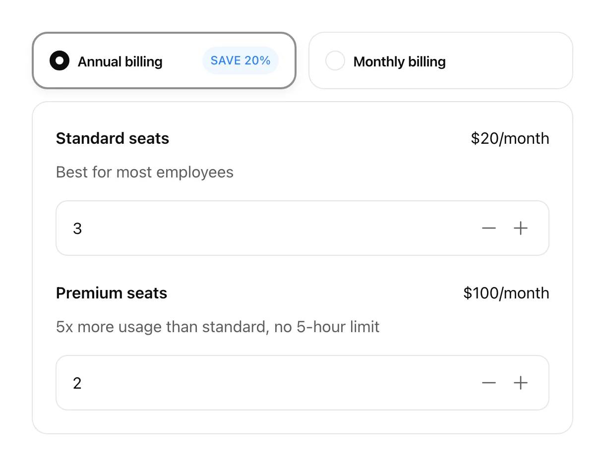
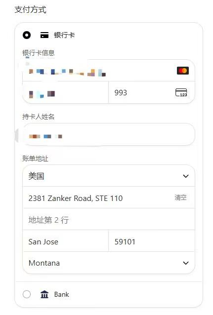
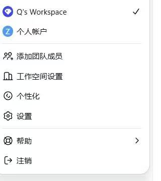

OpenAI 年底又发福利了！codex负责人Tibo官宣：**11 月 30 日前新建的 ChatGPT Business 工作区，每种席位的包含用量直接翻倍，一直持续到 12 月 31 日**。已经在用 Business 的老用户也有份——"We will have a gift for you, too"，礼物待官宣。


一句话总结：

> **11 月 30 日前开 Business，花一份钱拿双倍用量用到年底；12 月起 ChatGPT 和 Codex 额度还将打通共享——团队用户现在上车最划算。**

官方定价页：[https://chatgpt.com/pricing/?type=team](https://chatgpt.com/pricing/?type=team)

## 一、Business活动详解

Tibo 推文原文：

> "New ChatGPT Business workspaces created by Nov 30 get double the included usage for every seat type through Dec 31. Already on Business? We will have a gift for you, too. Stay tuned 👀"

划重点：

- **谁享受**：**11 月 30 日前创建**的 ChatGPT Business 工作区（新建即享）；
- **翻多少**：**每种席位类型**的包含用量 ×2，Standard 标准席和 Premium 高级席都翻；
- **到什么时候**：双倍用量持续到 **12 月 31 日**，之后恢复常规额度；
- **老用户**：已有 Business 工作区的用户会收到一份"礼物"（但是官方没说是什么，"Stay tuned 👀"），建议别取消订阅，蹲一个官宣。

算笔账（按月付）：

| 席位 | 平时 | 活动期间（11/30 前开通） |
| --- | --- | --- |
| Standard 标准席 | $25/席/月 | **$25 拿到 $50 的量** |
| Premium 高级席 | $125/席/月 | **$125 拿到 $250 的量** |

再叠加 12 月的"ChatGPT + Codex 共享额度"变更（见第三节），双倍用量正好能把聊天、Agent、编程三头开销全覆盖。

## 二、Business 席位和价格：Standard 和 Premium 两种

ChatGPT Business **1 个付费席位即可开通**（官方帮助中心口径），最多支持 200 席，支持月付/年付，两种席位可以在同一个工作区里**混搭**（比如重度用户上 Premium，其余人 Standard）：

| 席位 | 月付（/席/月） | 年付（/席/月） | 定位 |
| --- | --- | --- | --- |
| **Standard 标准席** | $25 | $20 | 日常工作够用 |
| **Premium 高级席** | $125 | $100 | Standard 的 **5 倍**用量，且**没有 5 小时限制** |

对比 2025 年 Team 时代只有"一档 $30/席/月"，现在拆成两档按需分配，Standard 月付价格还从 $30 降到了 $25——对小团队来说，现在的 Business 是历年来最友好的。

**席位怎么选？**

- 日常问答、写文档、轻量 Codex → **Standard**；
- 重度 Agent 任务、长时间跑 Codex、Deep Research 高频 → **Premium**（5 倍量 + 无 5 小时限制）；
- 非营利组织：官方定价页注明 Business 最高可享 **75% 折扣**，可以去页面申请。

## 三、Business 权益清单

根据官方定价页，Business 包含：

**模型与产品**

- 全部主力模型：**GPT-6.1 Sol、GPT-6 Astra、GPT-6 Sol/Luna、GPT-5.6 系列**；
- ChatGPT 全功能 + **ChatGPT Work** + **Codex**；
- 桌面端、网页端、移动端全覆盖；
- **ChatGPT Space** 团队空间；
- **Dots**：常驻运行的后台智能体（Business Premium 能力），任务挂着持续跑，不占对话窗口。

**协作与连接器**

- 连接 **Google Workspace、Slack、GitHub、Microsoft 365、Linear、Figma** 等工具，把工作区接进团队现有工作流；
- 团队内共享自定义 GPT 和提示词。

**API 额度**

- 每个付费席位每月附赠 API 额度，**整个工作区共享一个池**；年付用户一次性给全年额度；
- **12 月起，套餐用量将在 ChatGPT 和 Codex 之间共享限额**：不再出现"聊天额度没用完、Codex 额度先见底"的错配。

**管理与安全**

- **SAML SSO** 单点登录 + **MFA** 多因素认证；
- 集中计费、统一开票；
- 用量分析面板 + 花费控制（管理员可看每个席位的消耗）；
- **默认不使用你的业务数据训练模型**！！（对于注重数据安全的童鞋是非常好的选择）
- 域名验证、成员管理后台。

## 四、Business vs Plus/Pro，怎么选？

| 你的情况 | 推荐 |
| --- | --- |
| 个人日常使用 | ChatGPT Plus |
| 个人重度 Agent/Codex | ChatGPT Pro（或 Business 单开 1 席 Premium） |
| 2 人以上小团队/工作室 | **Business**（本次双倍活动性价比极高） |
| 200 人以上企业 | ChatGPT Enterprise（联系官方销售） |

注意：Business **1 个付费席位即可开通**，个人也能开一席蹭活动（重度选 Premium、日常选 Standard），团队按需混搭。活动 **11 月 30 日截止**，新建工作区才享双倍，别拖。

## 五、国内怎么订阅 ChatGPT Business？国际卡充值代充教程

### 为什么需要国际卡？

Business 只支持**国际主流信用卡**支付（Visa/Mastercard 等），国内银联卡基本会被拒，自己反复盲试还容易触发风控。所以国内用户最稳的路径是：

**人民币付款充值一张国际卡 → 拿到卡号/有效期/CVV → 自己去 OpenAI 官网绑卡订阅 Business。**

账号全程自己掌控，账密不经过任何第三方。

### 我们的代充方案：国际卡充值

我们提供国际卡充值服务：**支付宝/微信人民币付款**，给国际卡充值对应美元额度，几分钟到账，拿卡自己绑。

> ChatGPTPlus/Pro充值入口：[https://littlemagic8.github.io/gptplus/](https://littlemagic8.github.io/gptplus/)
>
> 客服微信：**aicygg888**（备注：Business 代充订阅）

### 手把手教程

**第 1 步：获取卡信息（卡号/有效期/CVV）**

> 联系客服微信：**aicygg888**（备注：Business 代充订阅）
>
> 供参考，卡信息实际以客服给的为准

**第 2 步：官网创建 Business 工作区并绑卡支付**

1. 登录 ChatGPT 后打开官方定价页：[https://chatgpt.com/pricing/?type=team](https://chatgpt.com/pricing/?type=team)；
2. 选择 Business，设置席位数（**最少 1 席**起）、席位类型组合、月付/年付；
3. 进入支付页，填入国际卡卡号、有效期、CVV、持卡人姓名和账单邮编。

选席位和计费周期的官方页面示意（年付立省 20%；截图中 Standard $20、Premium $100 均为年付价，月付为 $25/$125）：



绑卡表单的填写方式可以参考之前教程里的截图（字段类似：卡号/有效期/安全码/邮编，注意国家和邮编要跟卡的账单地址一致，不然会拒付）：



**第 3 步：确认开通，邀请成员开用**

支付成功后工作区即创建完成——**11 月 30 日前创建即自动享受双倍用量（至 12 月 31 日）**，不需要任何兑换码。点击头像就能看到新工作区，菜单里的【添加团队成员】和【工作空间设置】就是接下来的入口：



到【工作空间设置 → Members】邀请成员、分配 Standard/Premium 席位即可开用。

直达链接：[https://chatgpt.com/admin](https://chatgpt.com/admin)（登录管理员账号打开，左侧 Members 页签邀请成员，Manage seats 分配 Standard/Premium 席位）。

### 开通后记得做的三件事

1. 管理后台 → Billing/结算：确认账单金额、席位数无误；直达链接：[https://chatgpt.com/admin](https://chatgpt.com/admin)；
2. 邀请成员并分配席位类型（重度用户给 Premium）；
3. 蹲 12 月两件事：官方"老用户礼物"官宣、**ChatGPT/Codex 共享额度**上线。

## 六、常见问题

**1. 11 月 30 日之后新建的工作区还有双倍吗？**

没有。双倍用量只覆盖 11 月 30 日前创建的工作区，且优惠持续到 12 月 31 日。

**2. 老工作区怎么享受优惠？**

官方说会给老用户一份"礼物"，具体形式未官宣。建议保持订阅别取消，等 12 月官宣。

**3. 双倍用量包括 API 附赠额度吗？**

活动原文是 "included usage for every seat type"（各席位类型的包含用量），API 附赠额度是否同步翻倍官方未明确，以官方后续说明为准。

**4. 月付和年付哪个划算？**

年付便宜 20%（Standard $20、Premium $100），API 年度额度一次性到账；月付灵活，适合本次活动先试水、效果好再转年付。

**5. 个人能开 Business 吗？**

能。官方帮助中心明确：**最少购买 1 个付费 Standard 或 Premium 席位即可创建工作区**。纯个人轻度使用还是 Plus 更省；重度使用可对比 Pro 和 Business Premium。

**6. 国内卡直接绑会被拒吗？**

大概率被拒。按上文流程先给国际卡充值再绑卡，成功率最高；绑卡时账单国家、邮编要和卡信息一致。

**7. 12 月 31 日之后会怎样？**

双倍用量结束，恢复所选套餐的常规额度，工作区和数据不受影响。

## 总结

这次 Business 双倍用量活动的本质是：**用 Standard/Premium 两档席位 + 12 月额度共享 + 限时双倍，把团队用户全面拉进 Business**。对团队来说，11 月 30 日前开通等于花一份钱用到年底双倍量，是今年最值得上车的团队套餐活动；个人重度用户也可以借机单开 1 席 Premium 上车。

有 Business 开通、国际卡充值问题，联系客服微信：**aicygg888** 。

## 联系我们

充值过程中遇到任何问题，或有其他业务需求，请联系我们。

请保存网址 [https://littlemagic8.github.io/gptplus/](https://littlemagic8.github.io/gptplus/) ，并加上联系方式，防止失联。

防失联客服微信：

```
aicygg888
```

添加好友请备注：**Business代充**（加的人多，微信防频繁，请扫码）

## 小提示：想用更多 AI 产品，可以联系 V: aicygg888

> **如果不想开通信用卡，可参考：无需开通信用卡完成 ChatGPT 订阅教程。**
>
> ChatGPTplus 独享账号升级充值自助平台：[https://littlemagic8.github.io/gptplus/](https://littlemagic8.github.io/gptplus/)（网站下方有购买卡密和使用教程）
>
> GPT 代充直达：[https://littlemagic8.github.io/gptplus/purchase-gpt.html](https://littlemagic8.github.io/gptplus/purchase-gpt.html)（支付宝/微信付款，几分钟到账，无需账密）
>
> 开通自己的 ChatGPT Plus、Claude Pro 个人独享账号，可参考：[使用支付方式订阅开通 ChatGPT Plus、Claude Pro 教程](https://littlemagic8.github.io/2024/09/04/update-ChatGPT-Plus/)
>
> **国内使用 ChatGPT / Claude 镜像账号，有两种方式：**

**方式一：官网镜像（chatgpt官网共享账号，国内网络可访问）按教程自行购买**

遇到问题联系微信：aicygg888

登录地址：https://chatshare.biz/ （复制到浏览器打开，用购买成功后的账号密码登录）
购买地址：https://littlemagic8.github.io/buychat/

- [ChatGPT Plus 独享账号教程](https://littlemagic8.github.io/2025/07/17/chatgptplus-auto-system/)
- [Claude Pro 订阅指南](https://littlemagic8.github.io/2024/12/09/ChatGPT-and-Cluade/)
- [镜像账号使用说明](https://littlemagic8.github.io/2025/07/17/chatgptplus-chatshare/)

**方式二：不想自己注册，添加微信购买**

微信：**aicygg888**（备注：镜像账号）

欢迎加微信：


公众号也可以哦：


