**Google Antigravity（反重力）** 是谷歌推出的新一代 Agent 开发平台：编辑器形态，内置 Gemini 系列最新模型，主打“你下任务、Agent 干活”的开发方式。个人 Gmail 账号**免费**就能用，还有桌面客户端（macOS、Windows、Linux）、网页版和命令行工具，热度一直很高。就在上周（11 月 18 日），官方刚宣布 **Gemini 4 Neon 和 Orchestrator** 进入 Antigravity，模型能力又升了一级（见官网博客）。

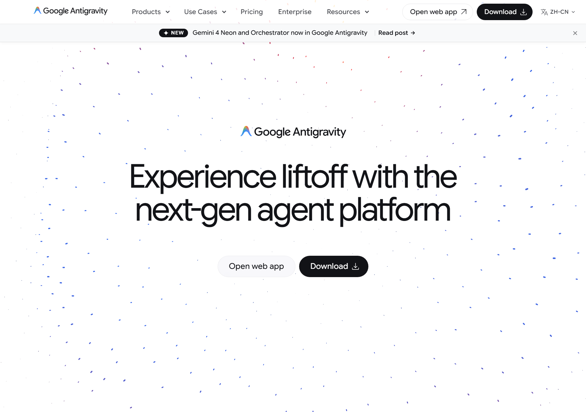

但后台被问得最多的不是“它强不强”，而是“**我怎么登不上、用不了**”：

- 安装好了，一登录就提示**资格检查失败**，弹出一串很长的验证地址？
- 提示**所在国家/地区不提供服务**，明明挂的还是美国节点？
- 好不容易走到验证那一步，**扫码、短信验证码**全都过不去？

这篇手把手图文教程按顺序讲清楚：**怎么下载安装 → 怎么检查和修改账号地区 → 登录验证卡点怎么一步步过 → 登进去之后怎么用**。每个操作步骤都配了图，跟着截图走就行。

> tips: Antigravity 对个人 Gmail 免费开放，但九成的“用不了”都卡在**账号地区归属**和**登录验证**这两关。不想折腾账号和网络的，可以直接上 Gemini 成品号 / 代充：https://littlemagic8.github.io/gptplus/purchase-gemini.html
>
> 遇到问题联系微信：aicygg888

---

## 全流程路线图：先看这张图再动手

Antigravity 从零到上手一共七步，按顺序走，每一步都别跳：

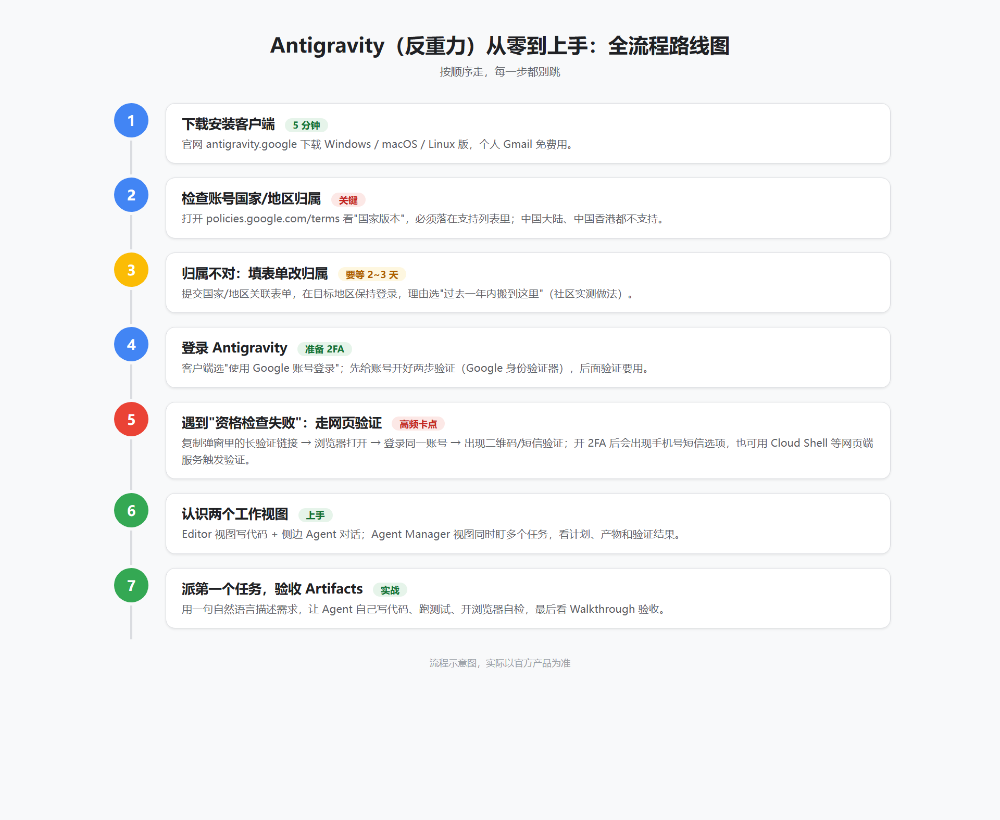

开始前的准备清单：

| 准备项 | 要求 | 说明 |
| --- | --- | --- |
| 谷歌账号 | 个人 @gmail.com 账号，年满 18 周岁 | 企业/学校账号默认只有很有限的额度，完整使用要管理员开通，建议直接用个人 Gmail |
| 账号地区归属 | 必须在官方支持列表内 | 第 2 步教你自查，中国大陆、中国香港都不在列表里 |
| 浏览器 | Chrome，并设为系统默认浏览器 | Antigravity 登录要拉起默认浏览器完成授权 |
| 网络 | 一个固定、尽量干净的代理线路 | 选一条独享线路长期用，不要今天换一条明天换一条 |
| 手机 | 装好 Google 身份验证器 App | 后面开两步验证（2FA）要用，见第 4 步 |

> **小提示：**“节点”这个词指的是你在代理软件里选的那条服务器线路。一条热门共享线路背后可能有几百上千个用户，如果很多人都拿同一个出口 IP 注册、登录谷歌，这个 IP 在谷歌眼里就是“高风险 IP”，你再登录就容易触发风控。所以尽量选独享或冷门地区的线路，并且固定用一条。

---

## 第 1 步：下载安装客户端

打开官网 **antigravity.google**，点击 Download 按钮：

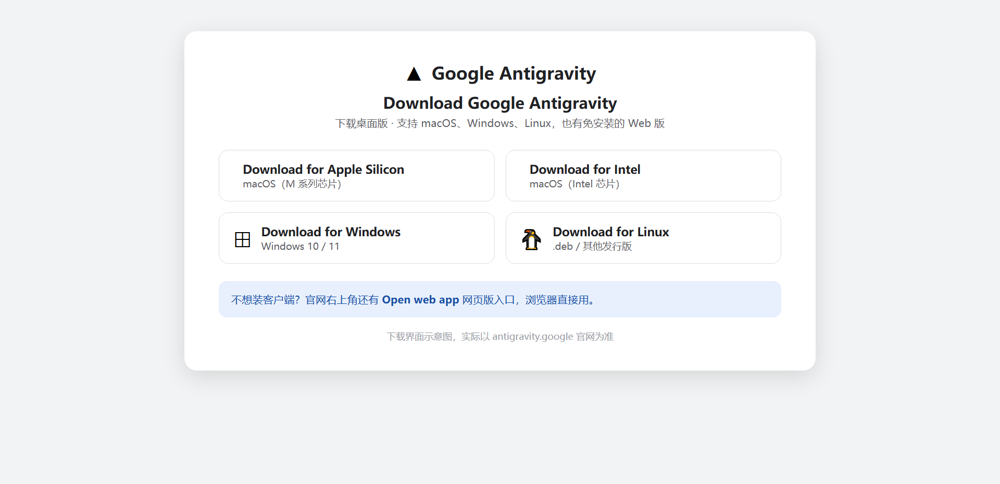

- **macOS**：分 Apple Silicon（M 系列芯片）和 Intel 两个版本，按自己机器选；
- **Windows**：下载 Windows 10 / 11 版安装包；
- **Linux**：提供 .deb 等格式；
- 不想装客户端，官网右上角还有 **Open web app** 网页版，浏览器直接打开就能用。

安装完成后首次启动，界面和 VS Code 长得很像（它就是编辑器形态），按引导走完即可。**先别急着点登录**，账号条件没检查过就登录，大概率白跑一趟。

---

## 第 2 步：检查账号的“国家/地区归属”

这是最关键、也最容易被忽略的一步。**谷歌判断你能不能用 Antigravity，看的是账号属性里的“国家/地区归属”，不是你当前挂在哪个地区的节点。**很多人挂着美国节点还是被拒，原因就在这。

自查方法：打开 **policies.google.com/terms**（谷歌服务条款页），**登录**你要用的那个谷歌账号，页面顶部会显示一行“国家/地区版本”：

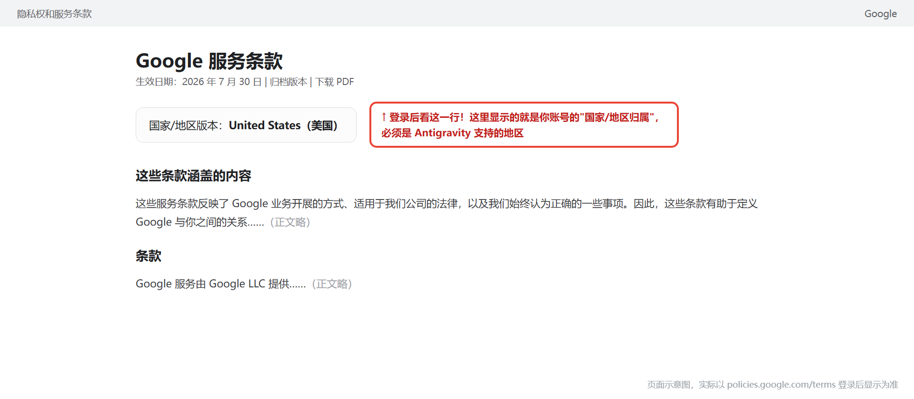

这行显示的地区，就是你账号的归属地。对照官方支持列表（完整列表见官方 FAQ，地址在文末参考资料）：

| 地区 | 是否支持 Antigravity | 常见地区举例 |
| --- | --- | --- |
| 美洲 | 支持 51 个国家和地区 | 美国、加拿大、巴西、墨西哥等 |
| 欧洲 | 支持 47 个国家和地区 | 英国、法国、德国、意大利等 |
| 亚洲 | 支持 43 个国家和地区 | 日本、新加坡、韩国、中国台湾、印度、越南等 |
| 中国大陆 | **不支持** | 不在任何支持列表里 |
| 中国香港 | **不支持** | 不在任何支持列表里 |

> **注意：** 上面表格只是速查。你账号具体能不能用，以官方 FAQ 页面那份完整名单为准；不在名单里的地区，目前都无法使用 Antigravity。

如果查出来是“United States（美国）”“Japan（日本）”这类支持地区，直接跳到第 4 步。如果是大陆、香港或其他不支持地区，进入第 3 步改归属。

---

## 第 3 步：归属不支持？提交“国家/地区关联”表单

官方给了一个**国家/地区关联（Country Association）申诉表单**，可以把账号归属地改成你实际长期居住/使用的地区。

表单地址：**https://services.google.com/fh/forms/country-association/**

（网上一些老教程里写的 policies.google.com/country-association 地址已经失效，打开会 404，别找了。）

打开表单会先要求登录，**用要改归属的那个谷歌账号登录**：

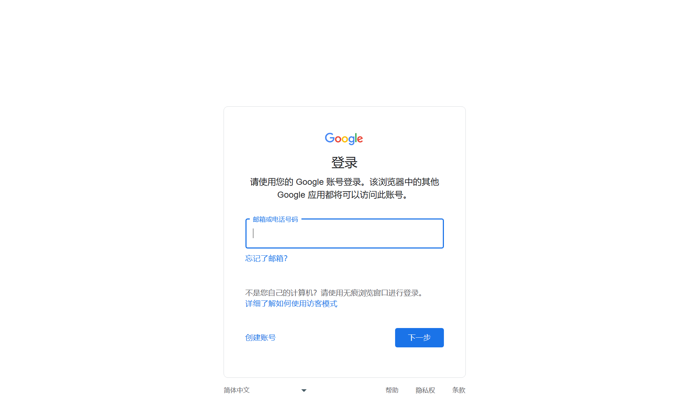

登录后看到的表单大致长这样（社区用户还原）：

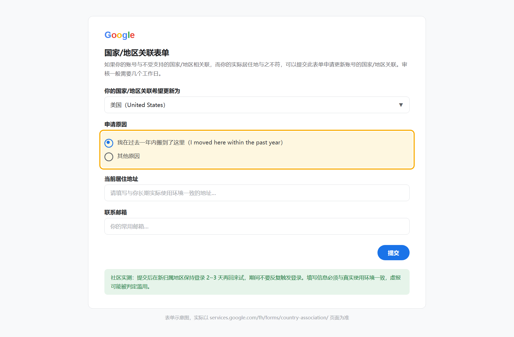

手把手操作（结合社区实测经验）：

1. 选择你希望更新成的地区（比如美国）；
2. 申请理由选 **“我在过去一年内搬到了这里”**（社区实测这个理由通过率高）；
3. 地址等信息**如实填写与你长期使用环境一致的内容**——你长期用美国线路，就按美国环境填。虚报信息可能被判定滥用，反而害了账号；
4. 提交后，在目标地区**保持登录 2~3 天**再回来尝试登录 Antigravity（社区实测做法），期间不要反复触发登录；
5. 归属更新一般几个工作日内生效，生效后账号的“国家/地区版本”那一行会变。

> **提示：** 第 4 步的登录和第 5 步的验证都依赖稳定的网络环境，别忘了把代理线路固定下来，全程用同一条。

---

## 第 4 步：登录前先把两步验证（2FA）开好

登录 Antigravity 时，谷歌大概率会要求验证“是本人在用”。**社区实测有一条重要经验：先给账号开启两步验证（2FA），后面的验证页面里才会出现“用手机号接收短信验证码”的选项**；没开 2FA 的账号，经常只剩“扫码”一条路，扫码又因为手机缺谷歌服务走不通，直接卡死。

设置方法：打开 **myaccount.google.com/security**，找到“两步验证”开始设置：

- 验证方式推荐绑定 **Google 身份验证器**（Google Authenticator）App，扫码绑定即可；
- 再添加一个**手机号短信**作为备用验证方式，手机号用国内的就可以；
- 顺手检查账号有没有绑定**手机号 + 辅助邮箱**，没有就补上（推荐 QQ 邮箱等常用邮箱），这是账号找回的生命线。

这些操作都对应下面这张图的 A 部分：

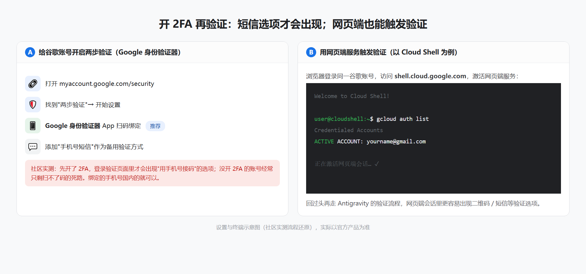

2FA 开好后，回到 Antigravity 客户端点 **Sign in with Google**：

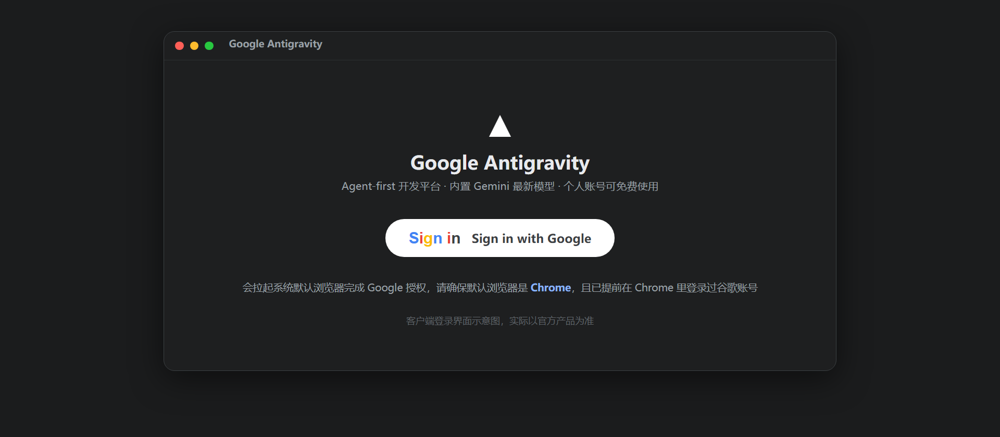

登录前再确认三件小事：

1. **Chrome 已设为系统默认浏览器**（Windows：设置 → 应用 → 默认应用 → Google Chrome）。Antigravity 的登录授权要拉起默认浏览器，默认浏览器不是 Chrome 时容易失败；
2. **先在 Chrome 里正常登录一次谷歌账号**，随便浏览几分钟。俗称“暖号”，意思是给账号热身：让谷歌的风控系统提前认识“这个浏览器 + 这个账号 + 这条线路”是正常搭配，再登客户端就不容易被打回；
3. 点击登录后，浏览器会弹出谷歌授权页，选择你的账号并同意授权，回到客户端。

顺利的话，到这一步你已经能进主界面了，直接跳到第 6 步。如果弹出**“资格检查失败”**，看第 5 步。

---

## 第 5 步：“资格检查失败”怎么办？复制长链接走网页验证

这是本文的核心卡点。登录时弹出类似这样的提示：

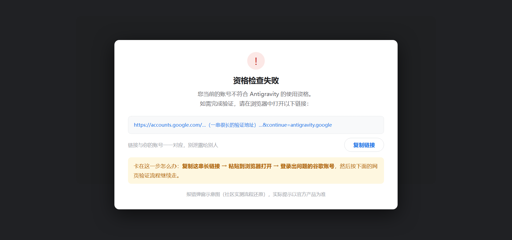

提示“您当前的账号不符合 Antigravity 的资格”，并附**一串很长的验证地址**。别慌，这说明账号没被封，只是要补一个“证明是本人”的流程。社区实测的解法分三步：

**① 复制长链接，浏览器打开。** 把弹窗里那串验证地址完整复制，粘贴到 Chrome 里打开，**登录出问题的那个谷歌账号**。

**② 按页面提示完成验证。** 打开后通常会出现二维码，用**已登录同一谷歌账号的手机**扫码确认，手机上点“是，是我本人”，浏览器这一侧就会自动通过：

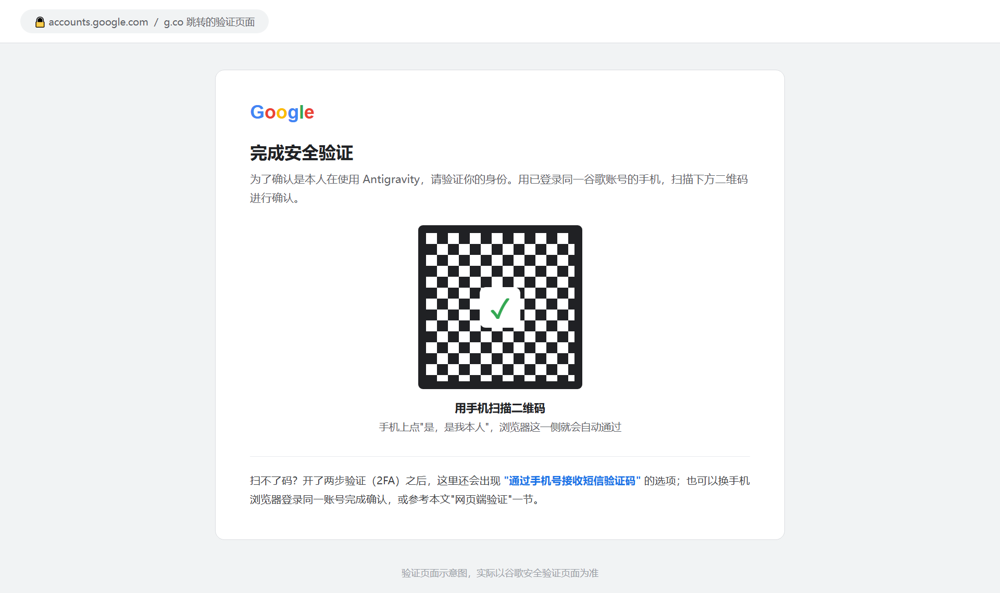

扫不了码（比如手机没有谷歌服务框架）时，按这个顺序换通道：

- **短信验证码**：第 4 步开好 2FA 之后，验证页面里会出现“通过手机号接收短信验证码”的选项（见第 4 步配图 A 部分）。国内手机号**接收**国际短信大多数情况没问题，接收本身免费；发不出/收不到时，检查运营商有没有开通国际短信、手机管家的骚扰拦截有没有拦掉境外号码。**千万别用接码平台**，那些号码早被谷歌拉黑，而且封号风险极高；
- **网页端触发验证**：用浏览器登录同一谷歌账号，访问谷歌的网页端服务（比如 Cloud Shell，地址 shell.cloud.google.com），激活一个网页端会话之后再回去走 Antigravity 的验证流程，验证选项更容易出来（见第 4 步配图 B 部分，社区实测做法）；
- **换设备验证**：直接在手机的谷歌 App 或手机浏览器里登录同一账号完成安全确认，电脑端再重试。

**③ 回到客户端。** 网页验证通过后，回 Antigravity 客户端重新走一遍登录，一般就能进去了。

上面这三步走完还不行的，说明踩的是更深的登录风控（扫码/短信收不到、403 拒绝访问、登录无限循环等），去看上一篇专门讲登录排障的文章：《Google Antigravity 登录风控怎么办？》（链接在文末参考资料），里面把 g.co/verifyaccount 网页审批、短信六大原因排查、Country 表单、Reset Onboarding 重置都讲全了。

---

## 第 6 步：登进来了，先认识两个工作视图

Antigravity 有两种工作方式，对应两类活：

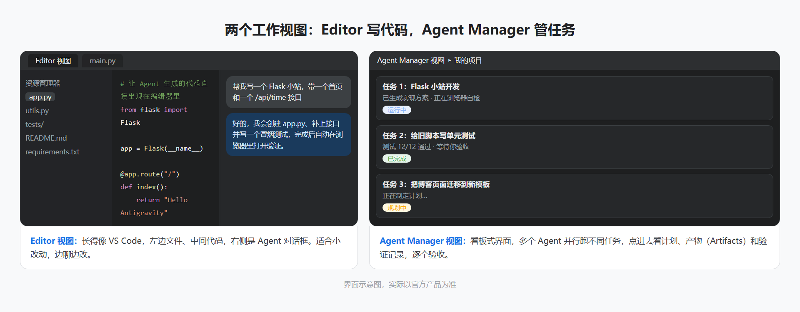

**Editor 视图：**长得和 VS Code 几乎一样，左边文件树、中间代码区，右侧多了一个 Agent 对话框。适合小改动——你用自然语言说需求，Agent 直接改代码，改完你能逐行看、能改回。

**Agent Manager 视图：**看板式界面，核心玩法在这里。你可以**同时开多个任务**，每个任务由一个 Agent 独立去跑：它自己列计划、写代码、跑测试，你像项目经理一样逐个检查验收。适合一次推进几件事，比如“一个任务写新功能、一个任务补测试、一个任务迁移旧代码”。

两个视图随时可以切换，不用纠结选哪个：小活用 Editor，大活和多线任务用 Manager。

---

## 第 7 步：派第一个任务，学会验收 Artifacts

在 Agent Manager 里新建任务，用一句自然语言描述需求就行。给你一个可以直接复制的入门提示词：

```text
做一个带首页和 /api/time 接口的 Flask 小站，
首页显示一句欢迎语，/api/time 返回当前时间，
要求带单元测试，写完自己跑一遍测试并打开浏览器检查页面。
```

点发送后，Agent 会自己走完整流程。你要做的不是盯着它敲代码，而是**验收它留下的“证据”（Artifacts，产物）**：

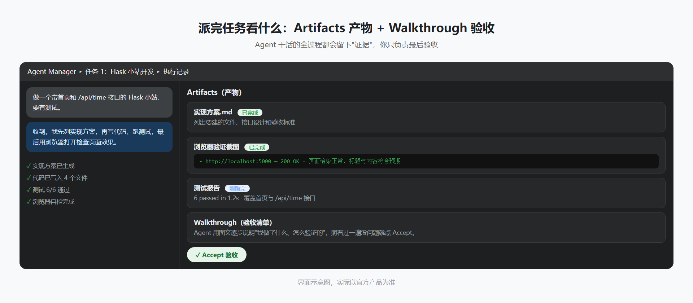

- **实现方案**：Agent 动手前先给出计划（要建哪些文件、接口怎么设计），不满意这时候拦住它最省时间；
- **测试报告**：它写的测试跑没跑过、通过几条，一目了然；
- **浏览器验证记录**：Antigravity 内置浏览器验证能力，Agent 会真的把页面跑起来截图自检，而不是嘴上说“做完了”；
- **Walkthrough（验收清单）**：任务完成后，Agent 用图文逐步说明“我做了什么、怎么验证的”，你照着过一遍，没问题就点 Accept 验收。

这是 Antigravity 和普通 AI 编程插件最大的区别：**它不只给你代码，还给你一套可检查的验证记录**。养成先看方案、再看测试、最后点 Accept 的习惯，Agent 的产出质量会稳定很多。

---

## 免费额度与升级：什么时候需要 Google AI Pro

官方 FAQ 写明：**个人 Gmail 账号在免费档位就能使用 Antigravity**。免费额度对偶尢单任务使用的轻量用户基本够用。

但有两类情况会明显感到额度不够：

- **任务重、任务多**：同时跑多个 Agent、长任务连续执行，消耗额度很快；
- **要用更强的模型**：付费的 **Google AI Pro / Google AI Ultra** 订阅包含更高的配额和更多前沿模型（官方 FAQ 原话：“更高的配额权益和额外的前沿模型”）。

| 使用强度 | 建议 |
| --- | --- |
| 偶尔跑一两个小任务 | 免费档够用 |
| 日常用 Agent 写项目 | Google AI Pro，配额更宽裕 |
| 重度多任务并行 + 最新最强模型 | Google AI Ultra |

> tips: 升级 Google AI Pro 需要境外支付方式，国内信用卡走不通。想直接升级 Pro / Ultra 的，可以走我们的 Gemini 代充：https://littlemagic8.github.io/gptplus/purchase-gemini.html ，或加微信 aicygg888 咨询。

另外提醒一句：官方 FAQ 明确警告，**用第三方工具（如 Claude Code 等）接入 Antigravity 登录属于违反服务条款，可能导致账号被暂停或封禁**。想用 AI 写代码，直接用 Antigravity 内置的 Gemini 就好，别拿账号冒险。

---

## 常见报错速查表

| 报错/症状 | 根因 | 对策 |
| --- | --- | --- |
| 所在国家/地区不提供服务 | 账号归属地不在支持列表 | 第 2 步自查 → 第 3 步填表单 |
| 资格检查失败 + 长验证链接 | 账号需补“本人验证” | 第 5 步网页验证三步走 |
| 扫码验证走不通 | 手机缺谷歌服务框架（GMS） | 第 5 步：开 2FA 后走短信，或网页端触发验证 |
| 短信验证码收不到 | 运营商拦截/未开通国际短信 | 按第 5 步排查；禁止用接码平台 |
| 登录无限循环、403 拒绝访问 | 更深的风控 | 见上篇登录排障文章（文末链接） |
| 想用第三方工具接入 | 违反服务条款，可能封号 | 别接，用内置 Gemini |

---

## FAQ：高频问题快问快答

**Q1：Antigravity 收费吗？免费版能用 Gemini 几代模型？**
免费。个人 @gmail.com 账号、年满 18 岁且账号归属地在支持列表内即可免费使用，包含内置的 Gemini 模型。付费的 Google AI Pro / Ultra 提供更高配额和更多前沿模型。

**Q2：我挂着美国节点，为什么还提示地区不支持？**
谷歌看的是**账号的国家/地区归属**，不是当前节点。按第 2 步查归属，不是支持地区就按第 3 步填表单改。

**Q3：“资格检查失败”是不是账号被封了？**
不是。它只是要求补一个“证明是本人”的验证流程。按第 5 步复制长链接走网页验证，绝大多数能过。真被 403 了才需要申诉，参考上篇文章。

**Q4：香港账号 / 大陆注册的 Gmail 能用吗？**
中国大陆和中国香港都不在官方支持列表里，登录会被拒。按第 3 步改归属（社区实测要等待生效），或者换支持地区的账号。

**Q5：用 Claude Code 等第三方工具连 Antigravity 会怎样？**
官方 FAQ 明确说这违反服务条款，可能账号被暂停或封禁。需要 AI 编程能力就用 Antigravity 自带的 Gemini。

**Q6：安卓手机没有谷歌服务，扫码验证过不去怎么办？**
三条路：给手机装谷歌服务框架（GMS）后扫码直过；或在第 4 步开好 2FA 后改走短信验证；或按第 5 步用网页端会话触发验证。详细排查见上篇文章。

---

## 总结

Antigravity 的上手门槛不在软件本身，而在**账号条件**：

1. **先查归属再用**：policies.google.com/terms 看账号“国家/地区版本”，不支持就填表单改，等它生效；
2. **验证前先开 2FA**：Google 身份验证器 + 备用手机号，短信选项才会出现；
3. **资格检查失败别慌**：复制长链接 → 浏览器打开 → 登录 → 扫码/短信/网页端会话，三选一都能过；
4. **用起来之后**：小活 Editor、大活 Agent Manager，派完任务学会看 Artifacts 和 Walkthrough 再验收。

按这七步走，反重力基本一次跑通。

参考资料：

- [Google Antigravity 官网（下载与产品介绍）](https://antigravity.google/)
- [Google Antigravity 官方 FAQ（支持地区完整名单、账号条件）](https://antigravity.google/docs/faq/)
- [Google 服务条款（登录后查看账号的国家/地区版本）](https://policies.google.com/terms)
- [国家/地区关联申诉表单](https://services.google.com/fh/forms/country-association/)
- [上篇：Antigravity 登录风控排障全流程](https://littlemagic8.github.io/2026/11/15/how-to-solve-antigravity-login/)

---

## 小提示：想用更多 AI 产品，可以联系 V: aicygg888

> **如果不想开通信用卡，可参考：无需开通信用卡完成 ChatGPT 订阅教程。**
>
> ChatGPTplus 独享账号升级充值自助平台：[https://littlemagic8.github.io/gptplus/](https://littlemagic8.github.io/gptplus/)（网站下方有购买卡密和使用教程）
>
> 开通自己的 ChatGPT Plus、Claude Pro 个人独享账号，可参考：[使用支付方式订阅开通 ChatGPT Plus、Claude Pro 教程](https://littlemagic8.github.io/2024/09/04/update-ChatGPT-Plus/)
>
> **国内使用 ChatGPT / Claude 镜像账号，有两种方式：**

**方式一：官网镜像（官网共享账号，国内网络可访问）按教程自行购买**

遇到问题联系微信：aicygg888

登录地址：https://chatshare.biz/ （复制到浏览器打开，用购买成功后的账号密码登录）
购买地址：https://littlemagic8.github.io/buychat/

- [ChatGPT Plus 独享账号教程](https://littlemagic8.github.io/2025/07/17/chatgptplus-auto-system/)
- [Claude Pro 订阅指南](https://littlemagic8.github.io/2026/08/16/how-to-sub-claudepro/)
- [Gemini 充值购买页](https://littlemagic8.github.io/gptplus/purchase-gemini.html)
- [镜像账号使用说明](https://littlemagic8.github.io/2025/07/17/chatgptplus-chatshare/)

**方式二：不想自己注册，添加微信购买**

微信：**aicygg888**（备注：镜像账号）

欢迎加微信：


公众号也可以哦：


