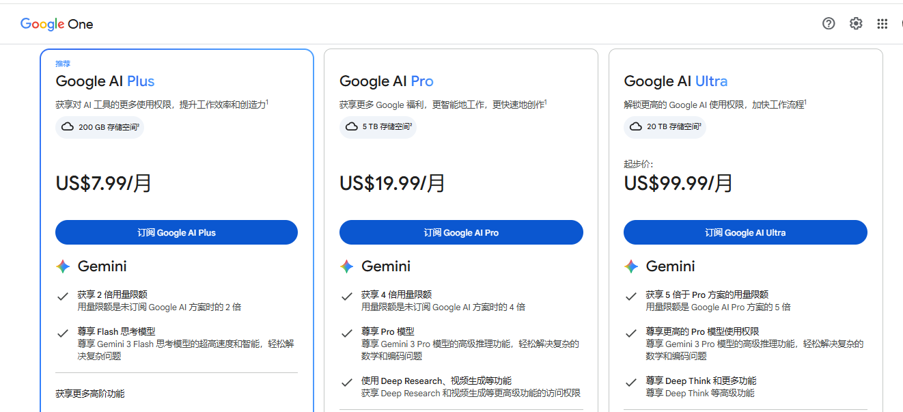
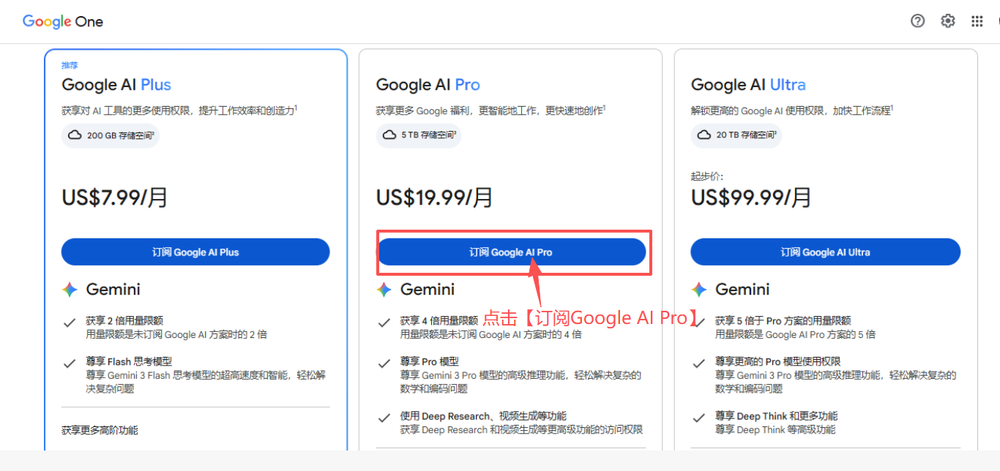
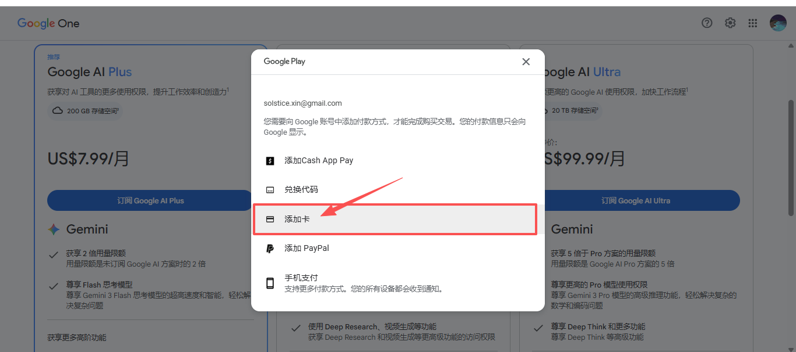
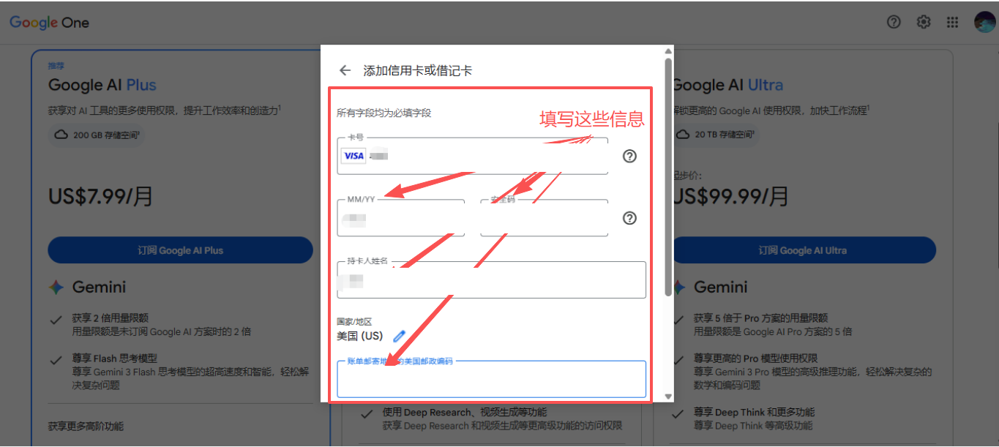
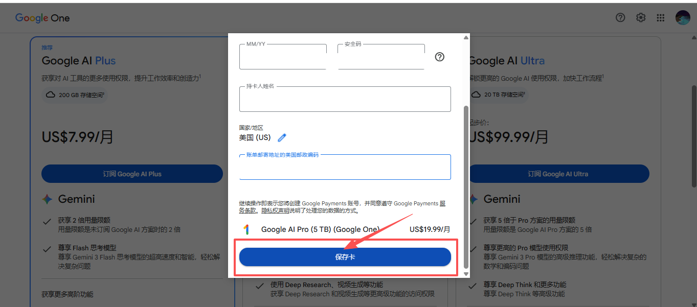
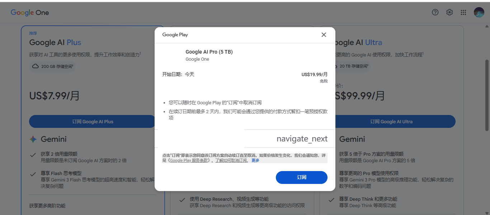
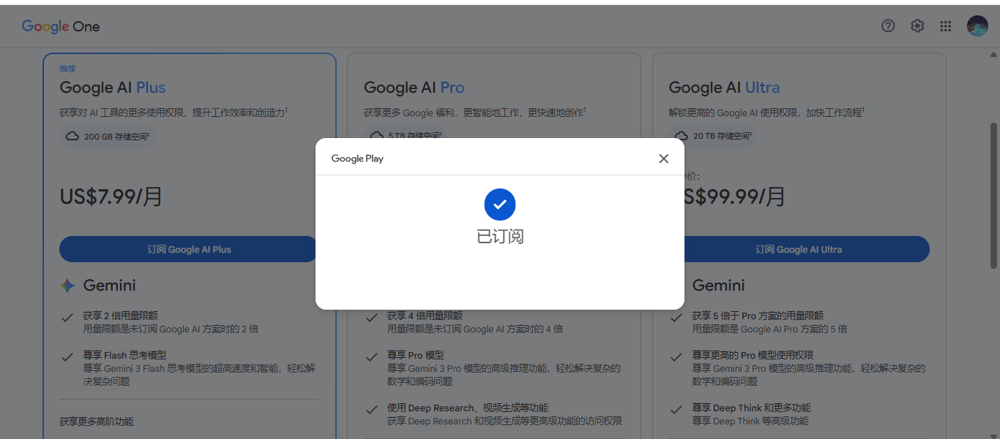
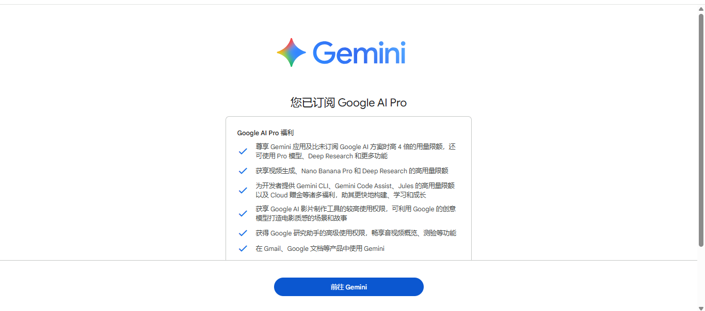

注意！！！注意！！！注意！！！

Google 的黑五已经结束了，大家不用再试了！！！，需要正价正规充值Gemini AI可以联系客服（aicygg888）！


Google 的黑五压轴福利来了：**Google AI Pro 年付直接 5 折，$199.99 → $99.99 一年**（折合每月不到 $8.4，原价 $19.99/月）。老订阅用户的抢先通道已在 **11 月 26 日**截止；**今天 11 月 27 日黑五，新用户通道正式开启**，官方只说"limited time"，先到先得。

官方入口（直达链接，登录即查）：

- **活动主入口**：[https://one.google.com](https://one.google.com)（登录后会员页直接看有没有 5 折角标）
- **官方套餐对比页**：[https://one.google.com/about/google-ai-plans](https://one.google.com/about/google-ai-plans)
- **Gemini 端订阅页**：[https://gemini.google/subscriptions](https://gemini.google/subscriptions)

> **年付 AI Pro 半价 $99.99 用一年（含 Gemini 4 Neon、5TB 存储、家庭共享 5 人），账号归属地/年龄/账号类型三样合规就能上车；支付需要国际卡，没有可以联系客服（aicygg888）代充。**

## 一、活动详情：时间、价格、谁能买

**时间表（分两波）：**

| 用户类型 | 时间 | 说明 |
| --- | --- | --- |
| **老用户**（已有 Google One / AI 订阅） | 11 月 21 日 – **11 月 26 日（已截止）** | 错过抢先价的直接走下面的新用户通道 |
| **新用户**（从未订阅过 AI 套餐） | **11 月 27 日（今天，黑五）开始** | 官方未公布截止时间，limited time，先到先得 |

**价格：**

| 方案 | 原价 | 黑五活动价 |
| --- | --- | --- |
| **Google AI Pro 年付** | $199.99/年 | **$99.99/年（5 折）** |
| Google AI Plus 年付 | $199.99/年起（含 400GB–2TB 档） | 最高 5 折（如 400GB 档 $34.99/年 示例） |
| Google AI Pro 月付 | $19.99/月 | 无年付折扣时的常规选择 |

注意两点：

1. **优惠价一般是首年价**，次年按原价自动续费，不想续费的记得到期前在 [https://one.google.com](https://one.google.com) 会员页取消自动续订；
2. 老用户的 5 折是"换到年付/续费"时生效——会员页下拉到底 **See all plans**，在当前订阅下方选 **Switch to annual（切换年付）** 即可看到 $99.99。

## 二、AI Pro 一年 99.99 刀，里面都有什么（官方口径）

按 [官方套餐页](https://one.google.com/about/google-ai-plans) 的说明，AI Pro 包含：

- **Gemini 4 Neon** 模型高用量权限（Plus 只有 Hydrogen，Pro 才有 Neon）；
- **5 TB** 云存储（Gmail + Drive + Photos 共享）；
- **Deep Research** 深度研究；
- 视频生成（Flow 创意工作室额度）+ Nano Banana 图像高阶权限；
- **YouTube Premium Lite**（个人版）；
- **Google Home Premium Standard** + Google Health Premium；
- 每月 200 个 Colab 算力单位 + 每月 $10 Google Cloud 额度；
- **家庭共享：最多再拉 5 个人**一起用，不加钱；
- **Google Antigravity** 里的 Pro 级模型基础额度（写码党福利）。

## 三、如何检测自己的账号是否满足条件（全部官方直达链接）

按这 5 项自查，全过就能直接买：

| 检查项 | 要求 | 官方直达链接自查方法 |
| --- | --- | --- |
| ① 账号类型 | **个人 @gmail.com 账号**（Workspace/企业/学校账号不参与） | 打开 [https://myaccount.google.com](https://myaccount.google.com) 看账号是不是自己管理的个人号 |
| ② 年龄 | **年满 18 周岁** | [https://myaccount.google.com/personal-info](https://myaccount.google.com/personal-info) 核对生日信息 |
| ③ 国家/地区归属 | 账号归属地必须在活动地区（如美国） | 打开 [https://policies.google.com/terms](https://policies.google.com/terms)，页面显示的条款版本就是你账号当前关联的国家/地区 |
| ④ 订阅资格 | 新用户通道今天（11/27）已开启，登录即可查价 | 登录 [https://one.google.com](https://one.google.com)，会员页出现"50% off"角标即有资格；没有就下拉 See all plans → Switch to annual 再看 |
| ⑤ 支付方式 | 绑定**国际信用卡（Visa/Mastercard 等）** | 打开 [https://pay.google.com](https://pay.google.com) → 付款方法，看有没有可用的国际卡 |

其中 **③ 国家归属是最常见的卡点**——Google 判断的是账号的"国家/地区关联"（Country Association），不是你当前挂的节点。IP 在美国、账号归属不在活动地区，照样看不到优惠。

## 四、不满足条件怎么调整？

**① 国家/地区归属不在活动地区 → 官方表单申诉**

直达链接：[https://policies.google.com/country-association-form](https://policies.google.com/country-association-form)

- 打开后先跳 Google 登录页是正常现象，**用要改的账号登录**就能进表单；
- 按实际使用环境如实填写（长期挂美国节点就按美国环境填），提交后一般**几个工作日**生效；
- 生效后重新打开 [https://one.google.com](https://one.google.com) 查看优惠，部分服务需要重新授权一次。

> 详细操作和截图可以参考之前这篇：[Google Antigravity 登录风控怎么办？（第 4 步就是填这个表单）](https://littlemagic8.github.io/2026/11/15/how-to-solve-antigravity-login/)

**② 年龄不够 18 →** 在 [https://myaccount.google.com/personal-info](https://myaccount.google.com/personal-info) 修正生日（注意：生日改动有次数限制，别乱填）。

**③ 企业/学校账号 →** 换个人 @gmail.com 账号再买，Workspace 账号不走这个活动。

**④ 白号（从未订阅）现在看不到优惠 →** 两个办法：

- 今天就是 **11 月 27 日**，新用户价已开启，直接走官方入口下单（[https://one.google.com/about/google-ai-plans](https://one.google.com/about/google-ai-plans)）；
- 社区技巧（非官方承诺）：先开一个月付最低档 AI Plus，变成"在订用户"后再看会员页有没有年付 5 折优惠活动

## 五、怎么支付

Google One 的订阅走 **Google Play 支付体系**，只认**国际信用卡/借记卡（Visa、Mastercard 等）**，国内银联卡基本被拒，自己反复盲试还容易把支付环境搞脏。

国内用户最稳的路径：

**支付宝/微信人民币 → 充值一张国际卡（拿卡号/有效期/CVV）→ 在 [https://pay.google.com](https://pay.google.com) 绑卡 → 回 Google One 下单年付。**

我们提供国际卡充值代充服务：

> **Gemini/Google AI 充值入口**：[https://littlemagic8.github.io/gptplus/purchase-gemini.html](https://littlemagic8.github.io/gptplus/purchase-gemini.html)
>
> ChatGPT Plus/Pro 等其它代充：[https://littlemagic8.github.io/gptplus/](https://littlemagic8.github.io/gptplus/)
>
> 客服微信：**aicygg888**（备注：Gemini 黑五代充）

支付宝/微信付款、几分钟到账、无需账密，账号全程自己掌控。

## 六、充值订阅全流程

以下截图均为 Google One 官方页面实拍（常规价示意，黑五期间结账页会显示 $99.99 年付价）：

**第 1 步：打开官方套餐页** [https://one.google.com/about/google-ai-plans](https://one.google.com/about/google-ai-plans)（或 [https://one.google.com](https://one.google.com) 会员页），登录 Google 账号，看到 Plus / Pro / Ultra 三档：



**第 2 步：点击【订阅 Google AI Pro】**，黑五期间年付档会显示 $99.99 优惠价：



**第 3 步：在 Google Play 弹窗里点【添加卡】**添加付款方式：



**第 4 步：填写国际卡信息**（卡号/有效期/安全码/持卡人姓名/账单邮编）。**国家和邮编必须与卡的账单地址一致**，对不上这一步最容易失败：



**第 5 步：核对方案后点【保存卡】**：



**第 6 步：确认订阅**——核对方案名称、价格（黑五应为 $99.99/年）和自动续订条款后点【订阅】：



**第 7 步：看到【已订阅】**即开通成功：



**第 8 步：打开 [https://gemini.google](https://gemini.google) 或 [https://one.google.com](https://one.google.com) 查看到账权益**（模型额度、5TB 存储、家庭共享入口）：



## 七、常见问题

**1. 优惠价能用几年？**

活动价一般为**首年价**，到期按原价（$199.99/年）自动续费。不想续就到期前在 [https://one.google.com](https://one.google.com) 会员页取消订阅（支付成功就取消的是续费，当前订阅会显示到期时间，建议当时就取消，以免后续忘记，后续自动续费失败影响账号权重）。

**2. 为什么我挂了美国节点还是看不到 5 折？**

Google 看的是账号的国家/地区归属，不是当前 IP。按第三节③自查归属地，不满足就去第四节①的官方表单申诉。

**3. 白号现在就能买吗？**

能——今天就是 11 月 27 日，新用户通道已开启，官方没公布截止时间。建议尽早下单，避免灰度/售罄变数。

**4. 5 折和学生免费一年能叠加吗？**

不能叠加。有学生资格（SheerID 验证）的直接用学生 offer 更划算； 黑五价适合非学生用户。

**5. 绑卡总失败怎么办？**

90% 是卡账单国家/邮编和表单填的不一致，或者卡不支持 Google Play。按第六节第 4 步核对，或直接找aicygg888卡代充（卡信息由我们提供、配套教程，见第五节入口）。

**6. 不想折腾账号资格和国际卡，还有别的办法吗？**

可以直接购买 Gemini 成品号，开箱即用：[https://littlemagic8.github.io/gptplus/purchase-gemini.html](https://littlemagic8.github.io/gptplus/purchase-gemini.html)，或联系微信 **aicygg888**（备注：Gemini）。

## 总结

这次黑五的核心是 **AI Pro 年付 5 折 $99.99**：老用户通道已在 11 月 26 日截止，**今天 11 月 27 日新用户通道正式开启**，个人号 + 18 岁 + 归属地区合规 + 国际卡就能上车。资格卡在归属地的走 [官方表单](https://policies.google.com/country-association-form) 申诉；卡在支付的直接找我们代充国际卡，黑五价活动时间一周左右，需要的童鞋，上车的抓紧！

## 联系我们

充值过程中遇到任何问题，或有其他业务需求，请联系我们。

请保存网址 [https://littlemagic8.github.io/gptplus/](https://littlemagic8.github.io/gptplus/) ，并加上联系方式，防止失联。

防失联客服微信：

```
aicygg888
```

添加好友请备注：**Gemini黑五**（加的人多，微信防频繁，请扫码）

## 小提示：想用更多 AI 产品，可以联系 V: aicygg888

> **如果不想开通信用卡，可参考：无需开通信用卡完成 ChatGPT 订阅教程。**
>
> ChatGPTplus 独享账号升级充值自助平台：[https://littlemagic8.github.io/gptplus/](https://littlemagic8.github.io/gptplus/)（网站下方有购买卡密和使用教程）
>
> Gemini 成品号/充值直达：[https://littlemagic8.github.io/gptplus/purchase-gemini.html](https://littlemagic8.github.io/gptplus/purchase-gemini.html)（支付宝/微信付款，几分钟到账）
>
> 开通自己的 ChatGPT Plus、Claude Pro 个人独享账号，可参考：[使用支付方式订阅开通 ChatGPT Plus、Claude Pro 教程](https://littlemagic8.github.io/2024/09/04/update-ChatGPT-Plus/)
>
> **国内使用 ChatGPT / Claude 镜像账号，有两种方式：**

**方式一：官网镜像（官网共享账号，国内网络可访问）按教程自行购买**

遇到问题联系微信：aicygg888

登录地址：https://chatshare.biz/ （复制到浏览器打开，用购买成功后的账号密码登录）
购买地址：https://littlemagic8.github.io/buychat/

- [ChatGPT Plus 独享账号教程](https://littlemagic8.github.io/2025/07/17/chatgptplus-auto-system/)
- [Claude Pro 订阅指南](https://littlemagic8.github.io/2026/08/16/how-to-sub-claudepro/)
- [镜像账号使用说明](https://littlemagic8.github.io/2025/07/17/chatgptplus-chatshare/)

**方式二：不想自己注册，添加微信购买**

微信：**aicygg888**（备注：镜像账号）

欢迎加微信：


公众号也可以哦：


